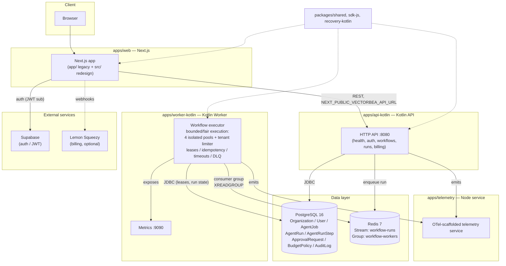
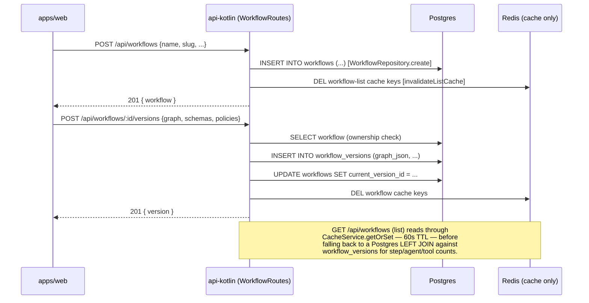
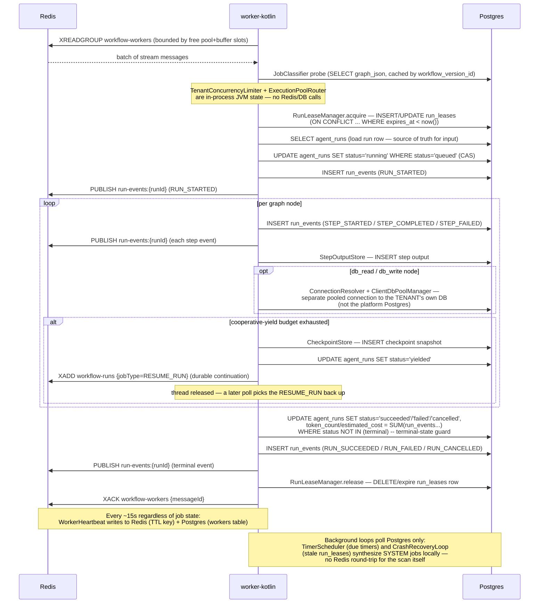

# Vectorbea — Architecture Overview

Monorepo (npm workspaces): `apps/*` + `packages/*`, Prisma schema shared at the root (`/prisma`).

## System diagram



## Components

### Frontend — `apps/web` (Next.js, npm)
- Two coexisting presentation layers:
  - **Legacy**: `apps/web/app/**` + `apps/web/components/**` — ~70 routes, hard-coded light theme, frozen Tailwind config (`tailwind.config.ts`), imports via `@/*` alias.
  - **Redesign**: `apps/web/src/**` — token-driven (`src/styles/tokens/*.css`), dark-first (`:root` is dark, `:root.light` is the light peer), imports via `~/*` alias. Enforced by ESLint (no raw hex, no Tailwind palette names, Phosphor icons only, etc. — see `CLAUDE.md`).
- Talks to the API over REST (`NEXT_PUBLIC_VECTORBEA_API_URL`), and to Supabase directly for auth (JWT `sub`, matched against `id::text` or `supabase_user_id`).
- Deploys to Vercel; `dev` branch → staging, `master` → prod.

### Backend — `apps/api-kotlin`
- Kotlin HTTP API on port 8080 (health-checked at `/health`).
- Owns request-path business logic: auth, workflows, runs, budget/approval policies, audit logging.
- Talks to Postgres over JDBC, and enqueues workflow runs onto the Redis stream `workflow-runs` for the worker to pick up.
- Config via `DATABASE_URL`, `REDIS_URL`, `SECRET_ENCRYPTION_KEY` (+ version), CORS allow-list.

### Workers — `apps/worker-kotlin`
- Consumes the `workflow-runs` Redis stream via consumer group `workflow-workers` (`XREADGROUP`, block 5s).
- Bounded/fair execution model: 4 isolated pools, a job classifier, a per-tenant limiter, cooperative yield/RESUME.
- Durability: leases, idempotency, timeouts, dead-letter queue (DLQ).
- Heartbeats into Redis (15s interval, 60s TTL) for liveness; exposes Prometheus-style metrics on :9090.
- Reads/writes run state in Postgres over JDBC.

### Telemetry — `apps/telemetry`
- Separate Node service; OpenTelemetry scaffolded, revenue features currently disabled. Deploys independently (env-state model tracked separately from web/api/worker).

### Data layer
- **PostgreSQL 16** — single schema (Prisma-managed: `Organization`, `User`, `AgentJob`, `AgentRun`, `AgentRunStep`, `ApprovalRequest`, `BudgetPolicy`, `AuditLog`). Migrations via `prisma migrate`; Neon in staging/prod, Docker Postgres locally.
- **Redis 7** — durable stream/queue between API and worker (`workflow-runs` / `workflow-workers`), plus worker heartbeats.

### External
- **Supabase** — auth provider (JWT), consumed by the web app and validated by the API.
- **Lemon Squeezy** — optional billing integration (API key + webhook secret).

### Shared packages
- `packages/shared` — cross-app TypeScript types/utilities.
- `packages/sdk-js` — client SDK.
- `packages/recovery-kotlin` — shared Kotlin code between API and worker (e.g. recovery/durability primitives).

## Local dev topology
- Infra only (`npm run dev:infra`): Postgres + Redis in Docker; web/api/worker run natively for hot-reload (`npm run dev`, or per-app `dev:web` / `dev:api` / `dev:worker:kotlin`).
- Full-stack (`docker compose up -d`): all four services (postgres, redis, api, worker, web) containerised, no hot-reload — web on :3000, api on :8080, worker metrics on :9090.

## Notes / open questions
- Three generations of run UI still coexist in the web app (`components/runs/**`, `components/agent-runs/**`, `components/agent-runs/v2/**`) — confirm route ownership before further consolidation.
- Telemetry service's exact call graph (which of web/api/worker push to it, and how) wasn't traced in this pass — verify against `apps/telemetry/src` if precision is needed there.

---

## Worker deep-dive: one process serves the whole platform

The pool split in `ExecutionPoolRouter.kt` fixed **head-of-line blocking within a
worker** (a few long agent runs used to occupy the single shared pool and starve
everything else). It did not fix the layer above it: **there is only one worker
process, for every tenant, on the whole platform.**

- `docker-compose.yml` defines a single `worker` service — no `deploy.replicas`.
- `apps/worker-kotlin/railway.json` sets a restart policy but no instance count —
  Railway defaults to 1 instance.
- That one process opens **one** Redis Streams consumer (`Consumer.from(queueGroup, workerId)`
  in [`WorkflowQueueConsumer.kt:65`](apps/worker-kotlin/src/main/kotlin/com/vectorbea/worker/queue/WorkflowQueueConsumer.kt:65))
  against the single `workflow-runs` stream, for every organization.

Inside that one process, capacity is fixed and small
(`WorkerConfig.kt:109-117`, driven by `WORKER_CONCURRENCY`, default **4**):

| Pool | Formula | Default slots |
|---|---|---|
| short | `max(8, concurrency)` | 8 |
| long | `max(1, concurrency / 2)` | 2 |
| agent | `max(1, concurrency / 2)` | 2 |
| system | fixed | 2 |
| **Total** | | **14 concurrent job slots, platform-wide** |

Per-tenant caps (`maxActiveRunsPerTenant=2`, `maxActiveAgentRunsPerTenant=1`,
`maxActiveLongRunsPerTenant=1`, `maxActiveShortRunsPerTenant=4`) only prevent one
tenant from *hogging* those 14 slots — they don't add capacity. With ~7+ tenants
each running one agent workflow, the 2-slot agent pool is saturated and every
other organization's agent runs sit parked in the Redis PEL until a slot frees up.

```mermaid
flowchart TB
    subgraph Tenants["Every organization on the platform"]
        T1["Org A"]
        T2["Org B"]
        T3["Org C"]
        Tn["Org … N"]
    end

    Stream[("Redis Stream\nworkflow-runs\n(single stream, single consumer group)")]

    T1 & T2 & T3 & Tn -- "AgentJob enqueued by api-kotlin" --> Stream

    subgraph Proc["THE one worker process (single container, single JVM)"]
        direction TB
        Consumer["WorkflowQueueConsumer\none poll thread\nconsumer = (workflow-workers, workerId)"]
        Classifier["JobClassifier"]
        TenantLimiter["TenantConcurrencyLimiter\n(fairness WITHIN this one process\nonly — not more capacity)"]

        subgraph Pools["ExecutionPoolRouter — 4 fixed thread pools"]
            direction LR
            Short["short\n8 slots"]
            Long["long\n2 slots"]
            Agent["agent\n2 slots ⚠"]
            System["system\n2 slots"]
        end

        Consumer --> Classifier --> TenantLimiter --> Pools
    end

    Stream --> Consumer

    Short & Long & Agent & System --> RunProcessor["RunProcessor / WorkflowRuntime"]
    RunProcessor --> PG[("Postgres")]

    Blocked["Orgs D…N: agent runs parked in the\nRedis PEL, waiting for 1 of 2 agent slots\nto free up — no matter how many\ntenants are queued"]
    Agent -.->|"saturated"| Blocked

    Crash["Process crash / redeploy / OOM"]
    Crash -.->|"ALL 14 slots gone at once —\nevery tenant's runs stall until\nrestart + XAUTOCLAIM reclaim"| Proc

    style Proc fill:#3a1a1a,stroke:#c0392b,stroke-width:2px
    style Blocked fill:#3a2a10,stroke:#c0392b
    style Crash fill:#3a1a1a,stroke:#c0392b
```



### Why this is the real bottleneck
1. **Fixed, tiny capacity for an entire platform.** 14 total execution slots
   (2 of them for *every* agent/LLM run across *every* tenant) is sized like a
   single dev box, not a multi-tenant production system.
2. **Single point of failure.** One JVM process, one consumer identity. A crash,
   OOM, or redeploy takes the *entire* platform's run execution to zero at once —
   durability (leases, PEL, `XAUTOCLAIM`) means no work is lost, but nothing
   *runs* until that one process comes back.
3. **Per-tenant fairness ≠ more throughput.** `TenantConcurrencyLimiter` stops
   one noisy tenant from starving others *within* the 14 slots — it doesn't grow
   the 14. Add enough concurrent tenants and the platform-wide ceiling is hit
   regardless of fairness.
4. **The fix already exists in the architecture, just isn't turned on**: the
   consumer group model (`workflow-workers`) is designed for multiple consumers.
   Running N replicas of `apps/worker-kotlin` (`docker compose up --scale worker=N`,
   or a Railway/K8s replica count > 1) gives N independent `workerId`s reading
   from the same group and stream — Redis Streams fans work out across them with
   no code changes. Today N = 1 everywhere.

---

## Request flow: Redis + Postgres touchpoints, workflow creation → run

Two separate request paths. Creating a workflow barely touches Redis (cache only).
Triggering a run is where Redis (queue + pub/sub + idempotency) and Postgres
(source of truth for everything) actually interleave.

### A. Workflow creation — `POST /api/workflows`, `POST /api/workflows/:id/versions`

No queue involvement at all — this is a plain CRUD write with a cache-invalidation
side effect.



- **Postgres**: `workflows`, `workflow_versions` tables — this is the only durable
  copy of the graph. `workflows.current_version_id` is what a later run trigger
  resolves against.
- **Redis**: pure read-through cache (`CacheService`, key `workflow-list:{ws}:{env}:...`,
  60s TTL) for the list endpoint. Writes invalidate (`DEL`) rather than update. No
  stream, no pub/sub, no durable state lives here — Redis is disposable for this path.

### B. Triggering a run — `POST /api/workflows/:workflowId/run`

This is where the queue enters. Everything the API does here is designed so that
**Postgres is the source of truth and Redis is the transport** — if Redis loses
the message entirely (not just delays it), the run still exists in Postgres as
`status = enqueue_failed` rather than silently vanishing.

```mermaid
sequenceDiagram
    participant Web as apps/web
    participant API as api-kotlin (RunRoutes.triggerRun)
    participant PG as Postgres
    participant Redis as Redis

    Web->>API: POST /api/workflows/:id/run {input, idempotencyKey, mode}
    API->>PG: SELECT workflow, beta_controls, usage_policy, daily_run_count
    opt idempotencyKey provided
        API->>Redis: GET idempotency:{workspaceId}:{key}
        Redis-->>API: existing runId, or nil
        Note over API: nil → continue; hit → return cached run, skip everything below
    end
    API->>PG: INSERT INTO agent_runs (status='queued', input_json, ...)
    API->>PG: INSERT INTO run_events (RUN_CREATED, RUN_QUEUED)
    API->>Redis: PUBLISH run-events:{runId} (RUN_CREATED, RUN_QUEUED)
    Note over API,Redis: for any SSE client already subscribed
    API->>Redis: XADD workflow-runs {runId, jobType=START_RUN,<br/>inputJson if ≤16KB, else omitted}
    Redis-->>API: message ID
    alt XADD fails
        API->>PG: UPDATE agent_runs SET status='enqueue_failed'
        API-->>Web: 503 queue unavailable
    else XADD succeeds
        API->>PG: UPDATE beta_usage counters (daily run count)
        API->>Redis: SETEX idempotency:{workspaceId}:{key} 86400 {runId}
        API-->>Web: 202 { runId, status: QUEUED }
    end
```

- **Postgres writes before the Redis enqueue**: `agent_runs` row + `RUN_CREATED`/
  `RUN_QUEUED` events are committed *first*. The Redis `XADD` happens after — so a
  run always has a durable row even if the enqueue then fails (caught explicitly,
  flips the row to `enqueue_failed`, `apps\api-kotlin\src\main\kotlin\com\vectorbea\api\routes\RunRoutes.kt:266-273`).
- **Redis payload is deliberately thin**: the stream message carries IDs, job
  type, and `inputJson` only if it's ≤16KB (`MAX_REDIS_MESSAGE_PAYLOAD_BYTES`,
  `RedisStreamsWorkflowQueue.kt:37`). Oversized input is omitted from the message —
  the worker re-reads `agent_runs.input_json` instead. Redis never becomes the only
  copy of a run's input.
- **Idempotency** (`RunRoutes.kt:700-714`) lives entirely in Redis as a 24h
  `SETEX` — a cheap dedup layer in front of Postgres, not authoritative (if the
  key evicts early, worst case is a duplicate run, not data loss).
- **`RUN_CREATED`/`RUN_QUEUED` events double-write**: Postgres `run_events` (durable,
  paged by the UI) and a Redis `PUBLISH` on `run-events:{runId}` (ephemeral, only
  reaches clients already connected to the SSE stream at that instant — the SSE
  handler sends the Postgres-persisted history first, so nothing is missed by a
  late subscriber).

### C. Worker execution — consume, run, checkpoint, complete



- **Lease before status change**: `RunLeaseManager.acquire` (`run_leases` table,
  `ON CONFLICT (run_id) DO UPDATE ... WHERE expires_at < now()`) is the actual
  mutual-exclusion primitive — it runs *before* the `queued → running` CAS, so a
  redelivered or duplicate Redis message for a run another worker already holds
  is dropped without ever touching `agent_runs`.
- **Every status transition is a CAS against Postgres**, not a blind UPDATE
  (`WHERE status IN (...)` / `WHERE status NOT IN ('succeeded','failed','cancelled')`)
  — this is what makes at-least-once Redis delivery safe: a duplicate message
  finds the row already past the expected `fromStatus` and no-ops.
  (`RunProcessor.kt:762-833`)
  <br>See also [[project_worker_hardening]] for the pool/tenant-limiter layer this
  processor runs inside.
- **XACK is the last step**, only after a durable terminal state (or a
  checkpointed yield) is committed to Postgres — so a worker crash mid-execution
  leaves the message un-acked in the Redis PEL, to be reclaimed by
  `XAUTOCLAIM` and replayed once the DB-recorded state makes the replay idempotent.
- **`db_read`/`db_write` graph nodes never touch the platform Postgres** — they go
  through `ConnectionResolver`/`ClientDbPoolManager` to whatever external database
  the tenant connected (credentials via `SecretService`, SSRF-guarded). Only
  step *metadata/output* (not the tenant DB's actual rows) lands in the platform's
  `step_outputs` table.
- **Timers and crash-recovery never call Redis to find work** — `TimerScheduler`
  and `CrashRecoveryLoop` poll Postgres (`due timers`, `run_leases` past
  expiry) and hand synthesized jobs directly to
  `WorkflowQueueConsumer.enqueueRecovery`, which places them on the in-process
  SYSTEM pool/buffer — Redis is only involved if that local placement is full,
  at which point the job simply waits in the local buffer, not on the stream.
