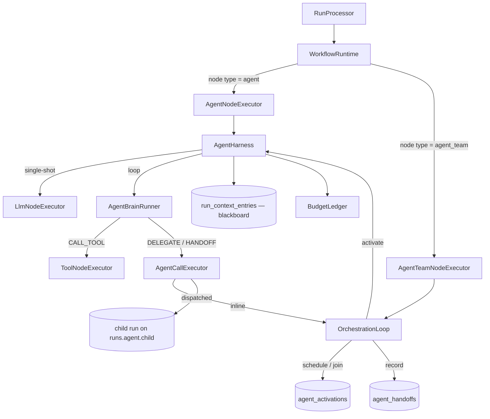

# Agent harness architecture: multi-agent orchestration and handoff

A design for turning the current single-agent node executor into a harness that
can run teams of agents, hand work between them, and stay debuggable and
affordable while doing it.

Scope: the **execution architecture**. The debugger tab, the trace data model and
the failure taxonomy are in
[AGENT-TRACE-AND-DEBUGGER.md](./AGENT-TRACE-AND-DEBUGGER.md).

Baseline: [AGENTIC-WORKFLOW-EXECUTION-FLOW.md](./AGENTIC-WORKFLOW-EXECUTION-FLOW.md)
and [AGENT-BRAIN-EXECUTION.md](./AGENT-BRAIN-EXECUTION.md).

Status: **proposal**, 2026-08-28. Written against the two design documents, not
against a fresh read of the source. §16 lists what to verify in code before
committing to the plan.

---

## 1. Where the current implementation stands

The transport, durability and safety layers are in good shape and mostly carry
over unchanged. The agent layer is the part that does not generalise.

### What carries over as-is

| Asset | Why it survives multi-agent |
|---|---|
| Postgres as system of record, Redis as transport | Multi-agent adds rows, not a new consistency model |
| Run lease + status CAS | Still exactly the right guard against double execution |
| `StepExecutionGuard` idempotency | Extends to activations with a wider key |
| Checkpoint / yield / resume | The mechanism that makes a 40-minute agent team affordable |
| `run_events` + sequence + SSE | Becomes the log half of the trace; the tree half is new |
| Approval gate and `decideOnApproval` | One shared rule already; a delegation gate is one more key |
| Execution-class routing and tenant admission | Needs a new lane, not a new design |
| Crash recovery, dead letters | Unchanged |

### What blocks multi-agent

| # | Constraint today | Consequence |
|---|---|---|
| 1 | An agent is a **DAG node**. Structure is fixed at version time | An agent cannot decide at runtime to involve another agent |
| 2 | Agents have no way to call each other | Every collaboration must be pre-drawn on the canvas |
| 3 | `agent_memory_entries` is keyed `(run_id, agent_id, key)` | No shared state. Agent B cannot read what A learned |
| 4 | **A resumed agent replays from iteration 1** (known limit #2) | With delegation this is not a cost problem, it is a correctness problem: a replayed loop re-delegates |
| 5 | Budgets are flat per agent | A supervisor spawning five workers has no ceiling on the subtree |
| 6 | Observability is a flat ordered event log | You cannot answer "which agent caused this" from a list |
| 7 | ~~No test source set (known limit #5)~~ — **withdrawn, was never true**; the gap is that orchestration paths were untested, not untestable | Addressed 2026-08-29: see §12.6 |

Item 4 must be fixed **before** multi-agent ships, not after. Item 7 is done —
`ScriptedLlmProvider` and the brain loop suite landed 2026-08-29 (§12.6), which
also produced the replay-cost baseline item 4 has to move. Everything else can
land incrementally.

---

## 2. The one idea

> **An agent is a callable, exactly like a tool.**

`ToolNodeExecutor` already gives every tool call: workspace-scoped lookup at
runtime, type dispatch, a grant check, `requires_approval` enforced at the
boundary, and a stable idempotency key. The brain validates `CALL_TOOL` against
the granted-tool list before dispatch, and the model never executes anything
itself.

Model a peer agent the same way and almost all of that machinery transfers for
free:

| Tool concept | Agent equivalent |
|---|---|
| Granted tool list | **Team roster** |
| `TOOL_NOT_ALLOWED` | `AGENT_NOT_IN_ROSTER` |
| `<stepId>:tool:<toolId>` approval key | `<stepId>:agent:<agentId>` |
| `ToolNodeExecutor` | `AgentCallExecutor` |
| Repeated-failure stop | Repeated-handoff stop |
| Tool result → observation | Child output → observation |

This is the same move that made "an agent calling a tool" and "a workflow calling
a tool" identical. Do it once more, one level up, and "a workflow calling an
agent" and "an agent calling an agent" become the same code path.

**There is one engine.** Supervisor/worker, router, critic loop and hierarchical
decomposition are *policies over the same primitives*, not four orchestrators.

---

## 3. Layer map

Two new layers slot between `WorkflowRuntime` and `AgentBrainRunner`. Nothing
above `WorkflowRuntime` changes.



| Layer | New? | Owns |
|---|---|---|
| `AgentTeamNodeExecutor` | new | One `agent_team` graph node → an orchestration session |
| `OrchestrationLoop` | new | Activation scheduling, joins, cycle guards, termination |
| `AgentHarness` | new | One activation's lifecycle: budget carve-out, context assembly, brain invocation, result normalisation |
| `AgentCallExecutor` | new | Validates the roster grant, opens the delegation gate, places the call |
| `BudgetLedger` | new | Hierarchical allocation and consumption reporting |
| `AgentBrainRunner` | extended | Two new actions; durable loop state |
| `AgentNodeExecutor` | thinned | Delegates to `AgentHarness`; keeps single-shot routing |

`AgentNodeExecutor`'s `shouldUseToolLoop` decision stays exactly as it is. The
question "is this agent set up to use tools" is still the right one; it just now
reads "…or peers" as well.

---

## 4. The activation model

An **activation** is one agent's participation in one run. It is to a team what a
step is to a DAG: the durable unit of work, retry, budget and trace.

Activations are created at runtime, so they cannot live in the immutable
`graph_json`. They get their own table.

```sql
CREATE TABLE agent_activations (
  id                    uuid PRIMARY KEY,
  run_id                uuid NOT NULL REFERENCES agent_runs(id),
  workspace_id          uuid NOT NULL,
  environment_id        uuid NOT NULL,
  step_id               text NOT NULL,          -- the agent/agent_team DAG node
  parent_activation_id  uuid REFERENCES agent_activations(id),
  root_activation_id    uuid NOT NULL,          -- subtree root, for cheap subtree queries
  depth                 int  NOT NULL DEFAULT 0,
  sequence              int  NOT NULL,          -- creation order within the run
  agent_id              uuid NOT NULL,
  agent_version         text,                   -- pinned; see §4.2
  role                  text NOT NULL,          -- supervisor|worker|reviewer|router|specialist
  status                text NOT NULL,
  contract_json         jsonb NOT NULL,         -- the TaskContract it was given
  output_json           jsonb,
  stop_reason           text,
  failure_class         text,
  budget_allocated_json jsonb NOT NULL,
  budget_consumed_json  jsonb NOT NULL DEFAULT '{}',
  child_run_id          uuid,                   -- non-null when dispatched, §11
  idempotency_key       text NOT NULL,
  attempt               int NOT NULL DEFAULT 1,
  created_at            timestamptz NOT NULL DEFAULT now(),
  started_at            timestamptz,
  ended_at              timestamptz,
  UNIQUE (run_id, idempotency_key)
);
CREATE INDEX ON agent_activations (run_id, sequence);
CREATE INDEX ON agent_activations (root_activation_id);
CREATE INDEX ON agent_activations (status) WHERE status IN ('running','waiting_for_child','waiting_for_approval');
```

`UNIQUE (run_id, idempotency_key)` is the load-bearing constraint. It is what
makes a resumed orchestration reattach to the activations it already created
instead of starting a second set. The key is derived, never random:

```
idempotency_key = sha256(parent_activation_id ?: step_id
                       | agent_id
                       | canonical_json(contract_json))
```

Same parent, same agent, same contract → same key → the existing row is reused
and its recorded output returned. A genuinely different delegation produces a
different key. This mirrors the existing rule that a durable key must survive
re-execution, and it is the reason iteration numbers must stay out of it.

### 4.1 Status vocabulary

| Status | Meaning | Terminal |
|---|---|---|
| `pending` | Created, not yet dispatched | no |
| `running` | Brain loop executing | no |
| `waiting_for_child` | Delegated; parked until children resolve | no |
| `waiting_for_approval` | A gate is open under this activation | no |
| `handed_off` | Control transferred; this activation is done, the team is not | **yes** |
| `succeeded` | Returned a valid output | yes |
| `failed` | Stop reason other than `FINAL_OUTPUT` | yes |
| `cancelled` | Run cancelled or parent abandoned it | yes |
| `superseded` | A retry replaced it | yes |

`handed_off` deliberately reads as neither success nor failure. A router that
correctly transfers to a specialist did its job; grading it `succeeded` inflates
success metrics and grading it `failed` makes every routed run look broken.

### 4.2 Agent version pinning

A run executes the graph it was created against, because `workflow_versions` is
immutable. Agents are **reference types** read from the database at execution
time, so today an agent edited mid-run changes behaviour between the first tick
and the resumed one.

For a single agent that is tolerable. For a team resuming across an approval that
sat overnight, it is not: half the team runs the old instructions and half the
new. Proposal: snapshot the resolved agent definition (instructions, model,
budgets, roster, granted tools) into the activation row on first creation, and
read from the snapshot on every resume. **As shipped in P6 the granted tools are
deliberately excluded — see §4.3.** `agent_version` records which definition
was pinned. This costs one jsonb column and removes a whole class of
"it worked yesterday" reports.

### 4.3 What P6 actually shipped, and where it deviates

P6 introduced the activation as the durable unit and routed the **existing
single-agent path** through it. Delegation, teams and the new brain actions are
later phases. Nothing about how a single-agent workflow behaves changed — except
in one place, named below.

Behind `AGENT_ACTIVATIONS_ENABLED`, default **off**. Flag off, not one line of the
new path executes and the old branch is byte-for-byte what shipped.

**The contract is deliberately minimal: just the resolved `taskInstruction`.**

The full resolved input is the least stable thing in scope. It is rebuilt every
tick from the step-output view, and one upstream node emitting a timestamp or a
reordered map moves the hash — which creates a duplicate activation on resume,
silently, because a duplicate is not an error. P8's `TaskContract` (§5.2) widens
this safely for exactly the reason P6 cannot: a delegated contract is
*constructed* by the delegating agent — small, explicit, and stable by
construction rather than by luck.

**`step_id` and `agent_id` are inside the hash, not merely alongside it.** With
the contract reduced to an instruction, they are the only thing separating two
agent nodes in one graph that were handed the same words. Drop them and the two
nodes collide onto one activation, and the second agent's work is recorded as the
first's.

**The row is the authority, not the re-derivation.** The instruction is resolved
once, at creation, through the node config → `taskInstruction` → `task` →
`prompt` → `input` fallback, and stored. Every later tick reads it back from the
row and hashes the stored value. The pin is what makes a run finish as the thing
it started as rather than half on one instruction and half on another with a human
having approved the first.

**The reattach lookup for a ROOT activation is by `(run_id, step_id, agent_id)`,
not by the hash.** The unique constraint on the hash is still load-bearing — it is
what stops two workers racing the same insert — but it is the *guard*, not the
lookup. A root activation's contract is not guaranteed byte-identical across
ticks: if the field the fallback chain landed on is absent later, the chain
resolves somewhere else and the hash moves, no row matches, and a second
activation is created. The natural key cannot drift. P7's children reattach by
hash, because a delegated contract is stable by construction.

**`role` is defaulted by the column, not written at the call site**, so P8 can
start passing a real role without editing every P6 caller, and an older worker
inserting without the column during a rolling deploy still produces a valid row.
It is a `CHECK` over the five values rather than a Postgres enum, because
`ALTER TYPE … ADD VALUE` cannot run inside a transaction on older servers — which
makes a Flyway migration that adds a role awkward in exactly the way a migration
must not be.

**Both paths get an activation.** A single-shot agent produces one with zero
iteration spans and its model call as a direct child. That is a legitimate tree,
not a degenerate one, and having one shape for "an agent ran" is worth more than
saving a row.

**`activation` and `iteration` spans are now emitted**, filling the kinds P2
defined and left unwritten. Every span opened beneath an activation inherits its
`activation_id` without any executor knowing activations exist. See the trace
doc's span-kind table for how the parenting works.

#### The one deliberate deviation: the pin covers the definition, not the grant

§4.2 proposes snapshotting "instructions, model, budgets, roster, granted tools".
P6 pins everything on that list **except the granted tools**, and this is a
scoped, deliberate exception rather than an omission.

An operator who revokes a tool mid-run is making a *policy* decision, and policy
is re-read at execution time and fails closed — the same rule the beta gate
follows, for the same reason: a paused run must not resume with access somebody
deliberately removed. Pinning the grant would mean an approval that sat overnight
resumes in the morning still holding a permission that was taken away at 3am.

So: instructions, model, temperature and budgets are pinned; granted tool ids are
absent from `agent_snapshot_json` and re-read live on every execution. First-tick
behaviour is unchanged either way, and flag-off restores today's behaviour
exactly.

**A limit worth stating.** The pin covers the *instruction*, not the resolved
input, which still rides on `AgentBrainConfig.resolvedInput` and is rebuilt every
tick. A drifted upstream value is therefore still visible to the model on a
resume, even though the instruction is not. That boundary is asserted directly in
`AgentActivationIntegrationTest`, so widening or narrowing it has to be a decision
someone writes down rather than a side effect.

---

## 5. Handoff

### 5.1 Five kinds, one vocabulary

| Kind | Parent after | Result flows | Use |
|---|---|---|---|
| `DELEGATE` | `waiting_for_child` | child → parent | Supervisor gives out a subtask and aggregates |
| `TRANSFER` | `handed_off` | child → caller of the team | Router/triage; a tail call, no return |
| `RETURN` | resumed `running` | child → parent | The child's `FINAL`, recorded as an edge |
| `ESCALATE` | `waiting_for_approval` | human decision → parent | Upward to a person or a higher-privilege agent |
| `BROADCAST` | `waiting_for_child` | N children → join | Fan-out with `wait_all` / `wait_any` / `quorum(k)` |

Five kinds is not an accident. It is the smallest set that expresses call,
tail-call, return, and fan-out — the same discipline behind the five brain
actions and the three approval decisions. Resist adding a sixth; every new kind
multiplies the states the debugger and the resume path must handle.

```sql
CREATE TABLE agent_handoffs (
  id                  uuid PRIMARY KEY,
  run_id              uuid NOT NULL,
  from_activation_id  uuid,                  -- null when the team node opens the first activation
  to_activation_id    uuid NOT NULL,
  kind                text NOT NULL,
  reason              text,                  -- the model's stated reason, sanitized
  contract_json       jsonb NOT NULL,
  context_version     bigint NOT NULL,       -- blackboard version visible at handoff, §7
  join_group_id       uuid,                  -- shared by one BROADCAST's children
  created_at          timestamptz NOT NULL DEFAULT now()
);
```

The handoff row is what the debugger's constellation view draws. It is also the
only place the *reason* for a delegation is recorded, which is usually the first
thing a business user wants when a run went sideways.

### 5.2 The task contract

Handoff quality is contract quality. A bare string prompt passed between agents
is the single biggest source of multi-agent failure and the hardest thing to
debug, because nothing records what was actually expected.

```kotlin
data class TaskContract(
    val objective: String,               // one sentence, imperative
    val inputs: JsonNode,                // resolved values, small
    val contextRefs: List<ContextRef>,   // blackboard pointers, NOT payloads
    val outputSchema: JsonNode?,         // what the caller will validate against
    val successCriteria: String?,        // how the caller judges the result
    val constraints: List<String>,       // "do not contact the customer"
    val budget: BudgetAllocation,        // carved from the parent's remainder
    val deadline: Instant?
)
```

Two rules make this work:

1. **`outputSchema` is validated by the caller's harness, not by the callee.**
   The existing `SCHEMA_INVALID` stop reason already does this for a final
   output. A child that returns a shape its parent cannot use fails at the
   boundary with a legible reason, rather than the parent silently reading nulls.
2. **`contextRefs`, not payloads.** Handing over a blob means every hop grows the
   prompt, and prompt growth is how multi-agent systems get expensive
   superlinearly. Pass a pointer; let the callee read what it needs. §7.

### 5.3 Two new brain actions

The action set goes from five to seven:

| Action | Runtime does |
|---|---|
| `THINK` | unchanged |
| `CALL_TOOL` | unchanged |
| `DELEGATE` | Validate roster grant → resolve gate → create activation → park parent |
| `HANDOFF` | Validate roster grant → create activation → terminate parent as `handed_off` |
| `FINAL` | unchanged (validates against `outputSchema` from the contract when present) |
| `ASK_APPROVAL` | unchanged |
| `FAIL` | unchanged |

`DELEGATE` and `HANDOFF` are validated **exactly** the way `CALL_TOOL` is: the
target must appear in the roster, the check is in runtime code and not in the
prompt, and an ungranted target is a hard stop. The prompt states the roster; the
prompt is not the enforcement.

New stop reasons, all non-retryable, all `ORCHESTRATION` class:

| Stop reason | Meaning |
|---|---|
| `AGENT_NOT_IN_ROSTER` | Delegated to an agent it was not granted |
| `MAX_DEPTH_EXCEEDED` | Delegation chain deeper than the team's limit |
| `HANDOFF_LOOP` | Same (from, to, contract-hash) triple seen too many times |
| `CHILD_FAILED` | A child failed and the join policy is `wait_all` |
| `JOIN_DEADLOCK` | Waiting on children that can never resolve |
| `TEAM_BUDGET_EXCEEDED` | The subtree ceiling, not this agent's own |

### 5.4 What shipped, and where the analogy bent

Shipped behind `AGENT_DELEGATION_ENABLED`, default off. Execution is INLINE:
the child runs synchronously, same tick, same thread. Dispatched child runs are
P10.

**A failed delegation is a failed OBSERVATION, not a stop.** §2 governs: an agent
is a callable exactly like a tool, and a failed tool call does not fail the step —
it records an unsuccessful observation and the loop continues. So a supervisor
whose worker fails can try a different worker, reformulate the contract, or
produce a partial `FINAL` stating what it could not get. All three beat a hard
stop, and the last is what the completion margin exists for.

Nothing is unguarded by that choice. `HANDOFF_LOOP` catches the same request going
down the same edge, and the budget tree debits the parent for everything its
children spend — so a supervisor burning its budget on failed delegations hits
`BUDGET_EXCEEDED` on its own account. That second backstop matters because the
cost asymmetry is real: a failed tool call is one HTTP request, a failed child is
a whole brain loop.

Consequently **`CHILD_FAILED` and `JOIN_DEADLOCK` are defined and unconstructed.**
`CHILD_FAILED` is reserved for `wait_all`, where the parent genuinely cannot
proceed; `JOIN_DEADLOCK` needs a fan-out to deadlock on. Both land in P10 with
`onChildFailure`, rather than being given a default now that would have to be
unwound when that config arrives.

**An empty roster fails CLOSED, diverging from the tool grant.**
`validateToolAllowed` reads an empty `allowedToolIds` as "any tool is allowed".
That must not carry over: an empty roster means nobody set one up, and reading it
as "may delegate to any agent in the workspace" is an unbounded control-flow edge
that undoes the grant model. Both sites are commented; see §16.7 for the tool-side
issue this leaves open.

**`waiting_for_child` under inline execution** is a durable MARKER, not a
scheduling state: set before the child runs, cleared after, so a crash
mid-delegation leaves a row saying what the parent was doing and the debugger
draws it as blocked rather than idle. It is a real wait in exactly one case — the
child pauses on approval, and the tick ends there.

**Reattach semantics, for every non-terminal child status.** Terminal: replay the
recorded outcome, run nothing — which is what makes a resumed delegation cost one
row read instead of the child's entire brain loop. Non-terminal: run it.

| Child status on reattach | Behaviour |
|---|---|
| `pending`, `running` | Run it. The previous attempt did not finish, and the run lease already guarantees one worker. |
| `waiting_for_approval` | Run it; its own gate resolves the decision. |
| `waiting_for_child` | Run it; its own delegation re-issues and reattaches. |
| `succeeded`, `failed`, `handed_off`, `cancelled`, `superseded` | Replay the recorded outcome. |

**The resume path works under both reconstruction settings, by different routes.**
Flag off, the parent replays from iteration 1 and re-issues the DELEGATE. Flag on,
it resumes at the delegating iteration — reconstruction takes *completed* and
*failed* rows, the delegating iteration is `running` when the child parks, and
P3's rule rebuilds to N−1 and lets N re-execute. Either way the DELEGATE is
re-issued and reattaches.

**Two things the contract hash excludes beyond the obvious.** Budget and deadline
change on every hop, and so does each `contextRef`'s **watermark** — the blackboard
advances as the team works, so the same pointer resolves to a later version each
time. Include any of the three and A→B→A→B hashes differently every time, and the
loop guard is present, runs on every delegation, and catches nothing. Only the
ref's identity `(key, scope, scopeRef)` is part of the request.

**The loop guard's edge is between AGENTS, not activations.** Every hop creates a
new activation, so counting `(from_activation_id, to_activation_id, hash)` finds
one row each time and never trips. Both sides resolve to every activation the
agent has in the run.

---

## 6. Orchestration policies

The `agent_team` node config selects a policy. All policies drive the same
`OrchestrationLoop`; they differ only in which handoffs they permit and how they
terminate.

| Policy | Roster shape | Permitted handoffs | Terminates when |
|---|---|---|---|
| `supervisor` | one supervisor + N workers | `DELEGATE`, `BROADCAST`, `ESCALATE` | supervisor returns `FINAL` |
| `router` | one router + N specialists | `TRANSFER` only | the transferred-to agent returns `FINAL` |
| `pipeline` | ordered list | implicit `TRANSFER` between stages | last stage returns `FINAL` |
| `review` | worker + reviewer | `DELEGATE` to reviewer, bounded rounds | reviewer approves or rounds exhausted |
| `blackboard` | N peers, no hierarchy | `BROADCAST` + shared context | quorum or a peer returns `FINAL` |

```json
{
  "type": "agent_team",
  "config": {
    "policy": "supervisor",
    "entryAgentId": "…",
    "roster": [
      { "agentId": "…", "role": "supervisor", "canDelegateTo": ["researcher","writer"] },
      { "agentId": "…", "role": "worker", "alias": "researcher" },
      { "agentId": "…", "role": "worker", "alias": "writer" }
    ],
    "limits": { "maxDepth": 3, "maxActivations": 12, "maxHandoffsPerPair": 2, "maxRounds": 4 },
    "budget": { "maxTotalTokens": 120000, "maxCostCents": 400, "maxDurationMs": 900000 },
    "joinPolicy": "wait_all",
    "onChildFailure": "fail_parent"
  }
}
```

`canDelegateTo` is per-member, not global. A researcher that can re-delegate to
the writer creates a cycle the depth limit will eventually catch — but catching
it at the roster is cheaper and much easier to explain in the UI.

Existing `agent` nodes are untouched. A team is a new node type; nothing needs
migrating.

### 6.1 What shipped

Behind `AGENT_TEAMS_ENABLED`, default off. `NodeType.AGENT_TEAM` is a type
addition: `GraphClassifier` gains `agent_team` in `AGENT_NODE_TYPES` and nothing
else changes, so no existing version row can classify differently than it did and
the memo on it stays valid.

**The five policies are a table**, `OrchestrationPolicy`, and `OrchestrationLoop`
is the single thing that reads it. Four of the five run the SAME code — the entry
member starts, its own brain actions drive the delegation, and the policy's only
remaining job is to say how to read the result. Adding a sixth policy must be a
sixth row; if it needs a branch in the loop, the claim that a policy is
configuration has become false.

**`OrchestrationLoop` is not a second scheduler.** No queue, no wait set, no
lease, no timer, nothing to wake. It runs inside ONE node execution, on
`WorkflowRuntime`'s thread, under that runtime's per-tick budget. `PIPELINE` is
the only policy where the runtime picks the next agent — the order IS the
configuration — and that is a `for` over the same `delegate` primitive one
delegation uses.

**BROADCAST is DELEGATE with more than one target**, not an eighth brain action.
§5.1 lists it as a handoff KIND and §5.3 puts the action set at seven; a fan-out
is the same grant check on every target, the same contract, the same boundary.
Children run one after another, inline, so `wait_any` "cancelling the rest" means
the rest are never STARTED — strictly better than starting and killing them. Their
activations are still created and cancelled, because a `wait_any` that shows one
activation hides the most interesting fact about the run.

**A TRANSFER is a tail call and does not grow the depth.** DELEGATE pushes a
frame — the parent waits and reads the result — so the chain genuinely deepens.
TRANSFER replaces the frame: the router is done the moment it transfers. Counting
it as depth would cap a router chain and a pipeline at `maxDepth` stages, a limit
nobody chose. Transfer chains stay bounded by `maxActivations`, `HANDOFF_LOOP` and
the subtree budget.

**`canDelegateTo` is per-member all the way down.** The team's roster reaches
every child through `TeamPolicy.rosterFor`, not just the entry member. Falling
back to the agent row would make the per-member rule look implemented and enforce
nothing below depth 0 — a mutation test found exactly that and it is now asserted
with the child's agent row deliberately granting what the team member does not.

**The fan-out preflight asks a real question.** The obvious per-child figure is an
equal share of what is left, and it makes the check a tautology:
`N × (available / N) ≤ available` always. The question worth asking is whether
each child would get enough to make a single model call —
`AgentBrainRunner.MIN_VIABLE_CHILD` — because a fan-out that funds five agents
that cannot each afford one call has not been afforded, it has been divided into
five failures.

**An unaffordable fan-out is an OBSERVATION, not a stop.** The same choice
`BudgetLedger.allocate` makes when it clamps rather than refuses: an agent told it
cannot afford five workers can narrow to two or answer with what it has, and the
completion margin §8 held back is what it answers with. Stopping outright fails
the run holding a margin it was never given the chance to spend.

**The tick budget reaches the node.** `RuntimeContext.tickDeadlineAtMs` is
advisory and read-only; the team checks it BETWEEN children and never interrupts
one that is running. When it fires, the node returns `NodeResult.Throttled` with
`retryAfterMs = 0` — the runtime's existing "nothing is wrong, give the permit
back, re-execute this node" signal, which `RunProcessor` already parks at status
`yielded` and describes in its own comment as "the same state a cooperative yield
uses". Reused rather than adding a `NodeResult` variant, because a new variant
would change what happens on resume for every node type. Children already finished
are terminal and reattach, so the resumed execution continues instead of
repeating.

#### `handed_off`, and every place that counts an activation outcome

A router that correctly transferred did its job. `handed_off` is terminal and is
graded as **neither** success nor failure, written once in
`OrchestrationLoop.terminaliseEntry`.

The audit §6 asks for, in full — as of this phase, `agent_activations` has exactly
four readers:

| Reader | Reads status? | Effect of `handed_off` |
|---|---|---|
| `ActivationStore` | yes, for the reattach rule | Terminal, so a resume replays the recorded outcome. Correct. |
| `BudgetLedger.hydrate` | yes, via `terminal` | Terminal, so the activation's unspent reservation is released. Correct. |
| `HandoffStore` | no — ids only | None |
| `TraceRoutes` / the Debug tab | no — SPAN kinds and span statuses | None |

**No metric, dashboard or aggregate reads it at all.** Every success rate counts
`agent_runs.status`, and `handed_off` never reaches that table: a routed run's
STEP completes — the specialist's answer is the team's answer — so the run is
whatever it would have been. `AgentTeamTest` asserts that boundary rather than the
arithmetic, so it is the test that fails if something later starts aggregating
activation outcomes and counts a handed-off router as a failure.

---

## 7. Shared context

Agent memory today is `(run_id, agent_id, key)` — the agent's private notes, and
correctly so. Multi-agent needs a second thing beside it: a place the team writes
findings that peers can read.

```sql
CREATE TABLE run_context_entries (
  id             bigserial PRIMARY KEY,
  run_id         uuid NOT NULL,
  scope          text NOT NULL,        -- run | team | activation
  scope_ref      text,                 -- team node id or activation id
  key            text NOT NULL,
  value_json     jsonb NOT NULL,       -- sanitized, capped
  version        bigint NOT NULL,      -- monotonic per (run_id, scope, scope_ref, key)
  written_by     uuid REFERENCES agent_activations(id),
  visibility     text NOT NULL DEFAULT 'team',   -- public | team | private
  payload_ref    text,                 -- large values offloaded, §12.1
  created_at     timestamptz NOT NULL DEFAULT now()
);
CREATE INDEX ON run_context_entries (run_id, scope, key, version DESC);
```

**Append-only, versioned.** Never update in place. Three reasons: concurrent
peers writing the same key do not need a lock, the debugger can answer "what did
this agent see when it decided that" by reading at `context_version` from the
handoff row, and a bad write is inspectable rather than lost.

Reads are `SELECT DISTINCT ON (key) … ORDER BY key, version DESC` filtered by
visibility and the reader's scope.

### Memory scopes

| Scope | Table | Status |
|---|---|---|
| Run-scoped agent memory | `agent_memory_entries` | exists |
| Workflow-scoped memory | `agent_memory_entries` | **in schema, not implemented** (known limit #4) |
| Team blackboard | `run_context_entries` | new |

Implementing workflow-scoped memory is a small, separable win and worth doing
during this work: it is the difference between an agent that learns across runs
and one that starts cold every time. It needs a retention policy and a size cap
before it ships, or it becomes an unbounded prompt-growth vector.

### Context assembly

`AgentHarness` builds each activation's context deterministically, in priority
order, under a hard character budget:

```
1. Contract objective + constraints + success criteria   (never truncated)
2. Contract inputs                                       (never truncated)
3. Own memory recall — last N                            (existing behaviour)
4. Blackboard entries named in contextRefs               (resolved on demand)
5. Recent handoff history for this subtree               (summarised)
6. Previous observations                                 (existing, last 10)
```

When the budget is hit, drop from the bottom and record what was dropped in the
trace. A context that was silently truncated is the hardest agent failure to
diagnose; making the truncation an observable event removes the whole category.

### 7.1 What shipped, and two corrections the code forced

Shipped in V043 and the `agents/context` package. `run_context_entries` is
append-only and versioned exactly as above. Two things in the sketch turned out
to be wrong when written down against a real reader, and both are corrected here
rather than in the implementation only.

**Correction 1 — `version` cannot serve as a snapshot point.** The table's
`version` is monotonic *per key*, which is what makes "which version of
`findings.pricing` did you read" answerable. It is NOT a run-wide clock: key `a`
at version 2 and key `c` at version 1 say nothing about which was written first,
so an as-of read filtered on `version <= 2` returns a `c` that did not exist when
the decision was made. An as-of read that shows an agent something it could not
have seen is worse than having no as-of read at all.

So there are two numbers. `version` is the per-key version. The **watermark** is
the row's `BIGSERIAL` id, which is already a run-wide write order and therefore
free. `RunContextStore.currentWatermark(runId)` is what a handoff records as
`context_version`, and `asOf(reader, watermark)` reads at it.

**Correction 2 — `visibility` narrows, `scope` addresses.** The sketch listed
`public | team | private` without saying how they compose with the scope. Read
naively — `team` meaning "readers who are in a team" — the DEFAULT write becomes
unreadable by the DEFAULT reader: a single agent, or a supervisor that has not
delegated yet, has no team ref and cannot read back a value it just wrote. The
rule that works:

| | Effect |
|---|---|
| `public` | Widens past the scope — any activation in the run |
| `team` | Neutral. The scope is the boundary; this adds nothing |
| `private` | Narrows — the writer and its descendants only, whatever the scope |

`private` is enforced as `written_by = ANY(reader's lineage)`, and the lineage
runs UPWARD — so a child reads its parent's private notes and a supervisor cannot
read its workers'. A private write with no `written_by` is **refused at the
write**, because it would otherwise be unreadable by everyone including its
author: a write-only black hole that costs storage and says nothing.

The visibility predicate is one SQL string shared by both reads. Two
hand-maintained copies of an access-control clause drift, and the way they drift
is that the less-exercised one — the historical read — becomes the permissive
one.

**Workflow-scoped memory** ships behind `AGENT_WORKFLOW_MEMORY_ENABLED`, default
off, with all three limits from day one: a per-entry byte cap, a per-(workflow,
agent) entry-count cap enforced at write time, and a TTL swept by
`agent_memory_prune_expired`. One row per `(workflow, agent, key)`, enforced by a
partial unique index — run memory is a transcript and appends, a workflow fact is
a fact and must not. `run_id` became nullable with `ON DELETE SET NULL`: the FK
was `CASCADE`, so pruning a 30-day-old run would have taken the learning with it
and the feature would have appeared to work and then quietly forgotten.

**Context assembly** ships behind `AGENT_CONTEXT_ASSEMBLY_ENABLED`, default off.
`ContextAssembler` is pure — no I/O, no clock — and emits the six sections in the
order above, dropping whole sections from the bottom. Whole sections, not
fractions: half a blackboard entry or a truncated observation reads to a model as
a complete but wrong fact, which is worse than its absence. When the two
protected sections alone exceed the budget it goes over and records
`context_over_budget` rather than cutting them — an oversized prompt fails at the
provider with a message naming the real problem, while an agent given half its
task answers confidently and wrongly.

Every drop lands on the iteration span as `context_truncated` and
`context_dropped_sections`.

---

## 8. Budget tree

Flat per-agent budgets do not bound a subtree. A supervisor with `maxCostCents =
50` that spawns eight workers each with `maxCostCents = 50` costs 450 cents, and
nothing in the system said no.

```kotlin
class BudgetLedger(private val runCeilings: RunCeilings) {
    fun allocate(parent: ActivationId?, request: BudgetRequest): BudgetAllocation
    fun consume(activation: ActivationId, usage: BudgetUsage)   // propagates to ancestors
    fun remaining(activation: ActivationId): BudgetSnapshot
}
```

Three invariants, enforced in code:

1. **A child's allocation never exceeds its parent's remaining.** Checked at
   allocation time. An over-request is clamped, not refused, and the clamp is
   recorded — a worker told it has less budget usually adapts; one refused
   outright fails the run.
2. **Consumption propagates upward synchronously.** A child spending tokens
   debits every ancestor before the next activation is allocated. Deferred
   accounting is how fan-out overspends.
3. **The run ceilings still win.** `CeilingExceeded` remains a distinct terminal
   state, not `Failed`, for the same reason it is today: nothing went wrong, a
   limit was reached, and the user needs to know which one.

Reserve a **completion margin**: hold back a slice (default 10%) of the team
budget so that when workers exhaust the rest, the supervisor still has enough to
produce a partial `FINAL` rather than dying at `BUDGET_EXCEEDED` with nothing to
show. A partial answer plus a stated shortfall is worth more than a failed run.

Fan-out needs **preflight estimation**: before a `BROADCAST` of N children,
estimate `N × per-child allocation` against the remaining team budget and refuse
the fan-out if it cannot afford all of it. Discovering the ceiling after three of
eight children have run wastes the spend on all three.

### 8.1 What shipped, and the invariant the sketch was missing

`BudgetLedger` and `BudgetVector` in `agents/budget`. The three invariants are
enforced as written. Three things the sketch did not say, each of which the code
or a test forced:

**Reservation, not just accounting.** Invariant 2 — propagate consumption
upward — does not bound a fan-out, because at the moment eight children are
allocated *nothing has been consumed yet*. All eight see the parent's full
remaining and the tree hands out 8× the budget, with every individual step
looking correct. So `allocate` DEBITS the parent immediately, and `settle`
returns whatever a finished child did not spend. Without that, invariant 1 is a
statement about one child at a time and says nothing about the set of them.

**A settled activation cannot delegate, and a late spend re-debits.** Found by
the randomised-tree property test on its second trial. Settling hands the
unspent reservation back, so the grandparent's books then say the child holds
only what it actually spent; allocating a NEW child from it after that spends
against its original allocation a second time, invisibly. It cannot happen
through the intended call sequence — settling follows a terminal activation, and
a terminal activation does not delegate — which is exactly why it is enforced
rather than assumed.

**Cost is an integer of micro-cents.** Floating-point addition is not
associative, so "total consumption never exceeds the root allocation" would hold
on a shallow tree and fail by 1e-13 on a deep one. A limit that behaves
differently by depth is the worst kind of limit. Micro-cents rather than cents
because a single model call can cost a fraction of a cent, and a per-call cost
that rounds to zero is a budget that never depletes.

**Wall clock is deliberately not a budget dimension.** It does not divide: eight
children running in parallel each take the same ten seconds, so a parent handing
out 10s × 8 has either over- or under-allocated by 8× depending on how they run,
and it cannot know which at allocation time. Time stays a per-activation timeout
and a run ceiling.

The completion margin defaults to 10% (`AGENT_COMPLETION_MARGIN`), rounds UP —
rounding down reserves zero on every small budget, which is every budget that
needs the reserve — and bounds only what may be given to children. The parent may
spend into it; that is the entire point.

Preflight is all-or-nothing and reports `affordableChildren`, so a caller can
narrow the fan-out instead of failing. `BudgetVector.times` saturates rather than
overflowing, because the fan-out width comes from a model and an overflow that
wraps negative makes the check pass — the one way a preflight is worse than none.

There is deliberately **no ledger table**. `agent_activations` already carries
`budget_allocated_json` and `budget_consumed_json`; `hydrate` rebuilds the tree
from them on a resumed tick, deriving subtree totals rather than restoring them,
because a stored total that disagrees with the sum of its parts is a budget that
is wrong in a way nothing detects.

---

## 9. Safety and termination

Multi-agent's characteristic failure is not a wrong answer; it is a system that
never stops. Every guard below is runtime code, checked before an activation is
created.

| Guard | Bound | Stop reason |
|---|---|---|
| Depth | `limits.maxDepth`, default 3 | `MAX_DEPTH_EXCEEDED` |
| Total activations | `limits.maxActivations`, default 12 | `TEAM_BUDGET_EXCEEDED` |
| Repeated handoff | `(from, to, sha256(contract))` seen > `maxHandoffsPerPair` | `HANDOFF_LOOP` |
| Roster grant | target in caller's `canDelegateTo` | `AGENT_NOT_IN_ROSTER` |
| Subtree budget | §8 | `TEAM_BUDGET_EXCEEDED` |
| Join progress | no runnable activation and children outstanding that cannot resolve | `JOIN_DEADLOCK` |
| Wall clock | team `maxDurationMs`, excluding approval parking | `BUDGET_EXCEEDED` |

The repeated-handoff guard is the direct analogue of the existing
repeated-tool-failure stop: if the same request has already been made twice and
come back the same, spending the remaining budget reproving it helps nobody. Hash
the contract, not the prose, so a reworded but identical request is still caught.

**Approvals.** Delegation reuses the existing gate wholesale. Keys stay disjoint:

| Gate | Key |
|---|---|
| Agent's own `ASK_APPROVAL` | `<stepId>` |
| Tool with `requires_approval` | `<stepId>:tool:<toolId>` |
| Delegation to a gated agent | `<stepId>:agent:<agentId>` |
| Activation-scoped tool gate | `<activationId>:tool:<toolId>` |

The fourth is new and necessary: two workers in one team calling the same gated
tool must open two gates, or the second silently inherits the first's decision.
The existing `(runId, nodeId)` find-then-create and the one shared
`decideOnApproval` rule apply unchanged, including the rule that anything
unrecognised means `WAIT` and never "open a new gate".

**As shipped, the scope is chosen by DEPTH, and both tool keys take it together:**

```
depth == 0  →  guard <stepId>:tool:<toolId>:<argsHash>        approve <stepId>:tool:<toolId>
depth  > 0  →  guard <activationId>:tool:<toolId>:<argsHash>  approve <activationId>:tool:<toolId>
```

A root keeps exactly the keys that shipped, so nothing in flight can change
meaning — no run can be at depth > 0, because delegation did not exist. It is a
strict widening at a boundary that has never been reachable, not a key move.

**Both keys move together, or the fix is worse than the bug.** Scoping only the
approval key gives two gates and one execution: the second worker's call finds the
first's guard row under the shared `<stepId>:tool:<toolId>:<argsHash>`, is served
from that cache and emits `STEP_SKIPPED`. Somebody approved something that then did
not happen. The cross-agent dedup this gives up is real but speculative, and
belongs in a deliberate caching feature rather than as an emergent property of key
derivation.

**What it rests on.** The activation-scoped key is stable only because
`ActivationStore` reattaches deterministically. A delegation that produced a second
activation row for the same work would move the key with it, and the resumed run
would open a gate nobody could ever close. `DelegationTest` asserts both halves in
ONE test — delegate, park on approval, resume, then one activation row and one
approval row under the same key — because two tests would let one keep passing
after the other's premise had quietly broken.

**Convergence path**, so this does not calcify into folklore: once no run predates
activations, a maintenance-window migration can rewrite pending `<stepId>:tool:*`
rows to their activation scope, and `AgentBrainRunner.keyScope` collapses to
`activationId ?: stepId`. Not now — but written down.

Known limit #1 — one approval per (step, tool) — becomes one per (activation,
tool), which is the right granularity and resolves most of the practical pain
without changing the rule.

---

## 10. Durable loop state

> This is the prerequisite. Multi-agent on top of replay-from-iteration-1 is not
> a degraded experience, it is a correctness bug that spends money.

Today loop state is in memory, the step re-executes from iteration 1 on resume,
and only sanitized memory is recalled — observations are not restored. A resumed
agent therefore repeats every LLM and tool call it already made, protected only
by the step guard's cached outputs.

With delegation, a replayed loop replays the `DELEGATE` too. The activation
idempotency key (§4) makes that *safe* — the second attempt reattaches to the
existing row — but the loop still burns iterations and tokens re-deriving a
decision it already made, and the trace shows a delegation happening twice.

### The change

Make the loop reconstructible instead of replayable:

1. Persist the full sanitized transcript per iteration — the parsed action and its
   arguments, the observation payload (by `run_payloads` ref), the tool result ref,
   and the **budget delta**. Deltas, not the cumulative totals `agent_iterations`
   already carries: a rebuild resuming at iteration 5 needs what the budget stood at
   after 4, and a running total may have been written by an attempt since abandoned.
2. On step start, if a transcript exists for this `(run, step)` and the job is a
   continuation, rebuild `LoopState` from it and **resume at `lastIteration + 1`**.
3. Recalled iterations are marked `recalled = true` and never re-persisted.
4. Reconstruction and memory recall must never both run. They restore overlapping
   state at different fidelities, and running both puts every observation in front
   of the model twice — which reads to the model as the tool having been called
   twice. Reconstruct if possible, recall if not.

Resume becomes a continuation. The cost of an approval that sat overnight drops to
zero LLM calls, and the trace stops showing phantom repeats.

**Consumption carries over; liveness resets.** Tokens, cost, tool calls and
iterations bound *spend* and are cumulative — iterations especially, or a run that
resumes ten times never reaches `MAX_ITERATIONS`. Wall clock bounds *hang
detection* and is per-execution: restoring `startedAt` would make an overnight
approval blow `timeoutMs` the instant it resumed. This is the line the codebase
already draws — `WORKER_MAX_RUN_DURATION_MS` defaults to unlimited because waiting
at a gate is the product, and the run ceiling measures active duration.

### Two tables, two different traps

An earlier draft of this section said `agent_iterations` has no unique key and that
re-persisting a recalled iteration would double the rows. That is true of
`agent_memory_entries` and was transplanted onto the wrong table. They fail in
opposite ways, and a fix aimed at the wrong one would do nothing:

| Table | Key | What re-persisting does |
|---|---|---|
| `agent_memory_entries` | none — its `ON CONFLICT DO NOTHING` can never fire | **Doubles** the rows, and doubles again on every resume |
| `agent_iterations` | `UNIQUE (run_id, step_id, iteration_number)` (V010) | **Blanks** them — `persistIterationStart` upserts with `DO UPDATE SET action_type = NULL, observation_summary_sanitized = NULL, …` |

The blanking is the more dangerous of the two now that these rows carry the action
and the payload refs. A fallback to replay walks iteration 1..N overwriting as it
goes, so one transient reconstruction failure would destroy the evidence of what
happened *and* guarantee every later resume also falls back. The transcript is
therefore snapshotted into `run_payloads` before a fallback, with the ref on the
`AGENT_LOOP_RECONSTRUCTION_SKIPPED` event.

### Degraded, never failed

Any of — flag off, not a continuation, no transcript, a schema version this build
does not know, a hole in the numbering, an unreadable action — falls back to
today's replay. A reconstruction that is subtly wrong is worse than one that does
not happen: it would hand the model a false account of its own history.

The event is named `..._SKIPPED`, not `..._FAILED`. The timeline grades event
names, and a fallback usually precedes a run that succeeds; painting it red sends
someone hunting a break that is not there. Same reasoning as `RUN_RESUMED` over
`RETRY_STARTED`.

This also removes the need for the `MAX_TOOL_PAYLOAD_CHARS` observation cap to
double as durability: the full result goes to the payload store with a ref, the
capped version goes in the prompt.

> **`UNIQUE (activation_id, attempt, iteration_index)` is deferred to P6.** Adding
> `attempt` means dropping the existing unique constraint, and a deployed worker's
> `ON CONFLICT (run_id, step_id, iteration_number)` does not degrade when its
> constraint disappears — it errors, and every iteration write fails. The API and
> worker deploy independently, so that window is real; it needs two migrations with
> a full rollout between them. That belongs with P6, which introduces `activation_id`
> and its own notion of attempt, rather than creating a second competing one now.
> V040 adds the `activation_id` column, nullable and unwritten, so P6 alters an
> existing column instead of adding one to a large table.

---

## 11. Where an activation executes

Two placements. Same durable row, same lifecycle, different transport. The
`OrchestrationLoop` chooses per activation.

| | **Inline** | **Dispatched (child run)** |
|---|---|---|
| Runs | In the parent's worker tick | As its own `agent_runs` row on `runs.agent.child` |
| Latency per hop | ~0 | one queue round-trip |
| Worker permit | shares the parent's | takes its own |
| Isolation | shares the tick budget | independent lease, CAS, timeout, dead-letter |
| Crash blast radius | the whole subtree | one activation |
| Parallelism | coroutines under one permit | true horizontal spread |

Selection rule:

```kotlin
fun placement(a: PendingActivation): Placement = when {
    a.contract.deadline != null && a.isShortLived  -> INLINE
    a.joinGroupSize > INLINE_FANOUT_THRESHOLD      -> DISPATCHED   // default 3
    a.estimatedDurationMs > REMAINING_TICK_BUDGET  -> DISPATCHED
    a.depth == 0                                   -> INLINE
    else                                           -> INLINE
}
```

Start with **inline-only** (Phase 3). It is strictly simpler, needs no new queue
plumbing, and the existing yield/checkpoint machinery already handles a tick
running out mid-subtree. Add dispatch in Phase 4 when wide fan-out demands it.

Dispatched children get their own run row with `parent_run_id` and
`parent_activation_id`. The parent parks as `waiting_for_child`; a child's
terminal state enqueues a `RESUME_RUN` for the parent. That is a new resume
trigger and it must be reconciled the same way approvals are — see §16, because
the approval resume path already has a known reliability gap here.

**Fair scheduling.** Child runs inherit the parent's `fair_vtime` plus a depth
penalty, so a deep tree cannot jump ahead of a tenant's other work by
manufacturing children. Also cap concurrent activations per run, per workspace,
so one team cannot occupy the whole `runs.agent` lane.

### 11.1 What shipped

`agent_runs` gains `parent_run_id` and `parent_activation_id`, with **no foreign
keys** — a child's lifecycle must not depend on its parent's row surviving
retention, and both CASCADE and RESTRICT are worse than a dangling id the
reconciler already treats as "parent gone".

The **activation is not duplicated**. `parent_activation_id` points at the row
`AgentCallExecutor` already created, so the trace, the budget ledger and the
reattach rule see one activation whichever transport it took.

**Placement** is `ActivationPlacement`: pure, no I/O, in the doc's clause order —
because the order IS the specification. A short-lived activation with a deadline
goes inline even inside a ten-wide fan-out, since the queue round-trip is what
would miss the deadline; swapping the first two clauses silently changes which
property wins. Thresholds default to §11's values and come from the environment.
One addition: a floor on the remaining tick, because an activation that "fits" in
the 40 ms left goes inline, overruns, and yields anyway — paying the dispatch
latency *and* the yield.

**The depth penalty is multiplied by depth, not added once.** A parent is at the
head of its tenant's queue — that is why it is running — so a child inheriting its
vtime unmodified enters at the head too, and a 20-wide fan-out places 20 runs
ahead of that tenant's own queued work. Adding the penalty once would close the
fan-out arbitrage and leave the nesting one open.

**A cap is not a failure.** `ChildRunDispatcher` returns `Capped`, and the caller
runs that activation inline instead — the trade the caps exist to make. Both caps
default from `workspace_usage_policies`, and a cap that cannot be READ is
enforced, because the fallback is inline: slower and completely safe.

**Waking the parent** happens behind the terminal status CAS in `RunProcessor`,
so a redelivered message cannot wake it twice, and only when no sibling is still
live, so five children wake their parent once. That enqueue is best-effort — which
is the fourth instance of the pattern §16 describes, and why the reconciler
exists.

**Behind the CAS, but not inside its connection.** Three things follow a won
transition — root-cause attribution, the parent wake, the OTel trace export — and
each acquires connections of its own. They used to run inside
`updateRunCompleted`'s `dataSource.connection.use { … }`, so a thread held one
pooled connection while waiting for another. That is hold-and-wait: at P
concurrently terminalising runs against a pool of P, every thread owns one and
needs a second, none can release, and Hikari's `connectionTimeout` then fires on
all of them together. The symptom is a fleet-wide stall at exactly the moment a
burst of runs finishes, with no error naming the cause — and a fan-out finishing
together is the normal case, not a pathological one.

They now run in `RunProcessor.onTerminalTransition`, called after the connection
is released, on the boolean the CAS produced. **The CAS, its guard and the rule
that every step is gated on winning it are unchanged**; the UPDATE has already
committed under autoCommit, so nothing here was ever inside its transaction and
releasing first reorders nothing observable.

Three tests hold it: `TerminalCompletionPoolTest` asserts that no thread ever
holds two connections at once on this path and reproduces the exhaustion at 16
threads over a pool of 4, and `RunProcessorStructureTest` fails the build if the
call moves back inside a `use` block. The last one earns its place because the
edit that reintroduces this is two lines, reads *better* than the correct version,
and passes every behavioural test in the suite — they all terminalise one run at a
time against a pool with room to spare.

---

## 12. Scaling

### 12.1 Trace and event volume

This is the first thing that breaks. A deterministic 6-node workflow emits tens
of events. One agent step emits an event per iteration, tool call and LLM call. A
five-agent team multiplies that again. Expect **50–200× the event volume per run**
versus today's non-agent workflows.

| Measure | Detail |
|---|---|
| Partition | Declarative monthly partitions on `run_events` and `run_spans` by `created_at`; drop partitions rather than `DELETE` |
| Offload payloads | Prompts, tool results and outputs > 8 KiB go to object storage; the row keeps a content-addressed `payload_ref` |
| Deduplicate | Content addressing means a system prompt repeated across 40 iterations is stored once |
| Tier | Hot 7 days in Postgres; warm 90 days as Parquet in object storage; cold beyond that is export-only |
| Sample | Keep **100% of failed runs** and 100% of runs under 60s old; sample successful long runs at a workspace-configurable rate. Never sample a run that had a failed step, an approval or a budget clamp |
| Batch writes | Buffer spans in the worker and flush every 250 ms or 50 spans, whichever first, with a bounded queue that drops to a counter under pressure rather than blocking execution |

Trace writes must never block or fail a run. A dropped span is a degraded
debugging experience; a blocked span write is an outage.

#### 12.1.1 Tiering — built (P13)

Rotation already existed (`PartitionMaintenance`, V028, V041) and already dropped
rather than DELETEd. What was missing was the **order**: the drop decided purely
on age and had no idea whether the data had been exported anywhere.

| Piece | Where |
|---|---|
| Export | `TraceArchiver` — one closed monthly partition at a time, streamed with a server-side cursor, never materialised |
| Bytes | `ArchiveStore` → `FilesystemArchiveStore` (`TRACE_ARCHIVE_DIR`). An S3 implementation is a class, not a migration |
| Format | `ArchiveEncoder` → `NdJsonGzEncoder` |
| Ledger | `run_trace_archives` (V047) — row count, byte count, SHA-256, tier, `dropped_at` |
| Gate | `PartitionMaintenance.reportOrDropExpired` refuses to drop **any** partition of a table that still has an un-exported one past the hot window |

The gate is on the archiver's own queue (`TraceArchiver.due`), not on "every
partition has a ledger row" — the current month never has one and never should,
so the latter would refuse every drop forever, read as a bug, and get switched
off. It fails **closed**: if the export state cannot be determined, nothing is
dropped.

**The gate says no in two ways, and they are not the same event.** Fail-closed is
right for both; reporting them identically was not, because one is a status and
the other is an incident.

| State | Log | Metric | What it means |
|---|---|---|---|
| `Outstanding` | `warn` — "gate: N un-exported partition(s)" | `worker_partition_drops_gated{cause="work_outstanding"}` | The exporter is behind. Self-correcting. The gate is doing its job. |
| `Unavailable` | `error` — "GATE UNAVAILABLE" | `worker_partition_drops_gated{cause="gate_unavailable"}` | The gate cannot be evaluated. **Not** self-correcting: nothing drops for any table until somebody acts, so retention has stopped and disk use is unbounded. |

**Ops: alert on `gate_unavailable`.** The commonest cause is a worker deployed
with `TRACE_ARCHIVE_DIR` set against a database where V047 has not been applied —
`run_trace_unarchived_partitions` does not exist, `due()` throws, and every drop
is refused. The fix is to apply the migration or unset the variable; the log line
names both. Nothing errors, nothing retries and no run fails, which is exactly
why this needs a metric rather than a log line alone: the symptom is a job
quietly declining to act, and that is invisible until someone notices the disk.

**⚠ `TRACE_ARCHIVE_DIR` holds every tenant's data.** The unit of archiving is a
partition — a month of one table across the whole installation — so the object
key contains no workspace id and there is no per-tenant mode. Pointing this at a
location one customer can read is a breach with no failure signal: the export
succeeds, the ledger records it, the partitions are dropped.
`archiveStoreFromEnv` therefore **refuses** a root containing a UUID segment, an
unsubstituted `{placeholder}`, or a `customers`/`tenants`/`clients`/`workspaces`
segment. `TRACE_ARCHIVE_ALLOW_SCOPED_PATH=true` overrides it and logs which
segment was waived. Per-tenant destinations would require changing the unit of
archiving; they are not a configuration change.

Windows: `TRACE_HOT_DAYS` (7), `TRACE_WARM_DAYS` (90). A partition is eligible
for export once its whole month is past the hot window — the unit of eviction is
a partition, so a snapshot taken while the month is still being appended to would
silently miss its tail.

**Parquet is not what ships, and this is the honest reason.** `parquet-avro`
drags in the Hadoop client tree, and a new dependency is a question rather than a
decision. The encoder seam is real and the `format` column records which encoder
wrote each object, so a bucket holding both stays readable; `ParquetEncoder` is a
class next to `NdJsonGzEncoder` the day the dependency is approved. NDJSON+gzip
is read directly by `COPY`, DuckDB, Athena, BigQuery and Spark in the meantime.

#### 12.1.2 Sampling — built (P13), and NOT at write time

`TraceSampler`, applied at the **archive boundary**, deciding which runs' spans
reach the warm tier.

Write-time sampling was implemented and rejected, because it cannot satisfy the
rule that matters. "Never sample a run that had a failed step, an approval or a
budget clamp" is unsatisfiable at `SpanWriter.emit`: the span that proves a run
was interesting arrives *after* the spans that would already have been dropped. A
run can look ordinary for twenty-nine minutes and fail in the thirtieth, and no
latch, grace window or buffer recovers what was discarded at minute three.

Deciding once the run has finished makes the rule absolute, and keeps the other
§12.1 rule intact — nothing is ever DELETEd from Postgres. The cost, stated
plainly: **this does not reduce span write volume.** Batching, payload offload
and content addressing are what do that.

**What was sampled out is recorded (V055).** `run_trace_archives.row_count`
describes the OBJECT, not the partition, and once sampling is on those differ by
whatever the sampler declined to keep. The ledger is the only surviving record
that a dropped partition existed, so recording what it kept while staying silent
about what it dropped made the difference unobservable by construction —
`TraceArchiver.Archived.sampledOutRuns` was computed on every export and thrown
away. It is now written in the same INSERT as the checksum, and
`run_trace_archives_reduced` lists the months it is non-zero for. Runs, not rows:
the sampler's unit is a whole trace tree and it never keeps part of a run, so a
row count would mean a second full scan of the month to produce a number nobody
would query.

The worker probes for the column before using it — new worker against a pre-V055
database must still export, because an INSERT that fails on an unknown column
stops archiving and therefore stops retention.

The rules, in order, every KEEP unconditional: younger than
`TRACE_SAMPLE_GRACE_SECONDS` (60) → keep; status is anything but `succeeded` →
keep (so a status added later is kept, not silently discarded); a failed step, an
approval or a budget clamp → keep; shorter than
`TRACE_SAMPLE_LONG_RUN_SECONDS` (60), or of unknown duration → keep; otherwise
hash the run id against `workspace_usage_policies.trace_sample_rate` (V048,
default 1.000). The hash, not a coin — an export that crashes is retried, and a
random draw would produce a different file than the row count recorded beside it
claims.

### 12.2 The event sequence lock

`RunEventStore` assigns `sequence` under a `FOR UPDATE` lock on the run's
`agent_runs` row, held for the insert transaction. Correct today, and it is the
right call against a second process appending to the same run.

With a five-agent team it is a per-run serialization point taken hundreds of
times, contending with run status updates on the same row.

Two changes, in order:

1. **Batch.** Acquire the lock once per flush of N events and assign a contiguous
   block of sequence numbers. Cuts acquisitions by N× with no semantic change.
2. **Move the counter off the run row.** A dedicated `run_event_seq (run_id,
   next_seq)` row, or a Postgres advisory lock on `hash(run_id)`. Either stops
   event writes from contending with `agent_runs` updates.

Spans do not need a global sequence at all — they have `parent_span_id` and
timestamps, which is enough to build the tree. Keep sequencing for the event log
only.

#### 12.2.1 Both, built (P13)

**Batching.** `RunEventStore.appendEvents(List<RunEvent>)` takes the lock once
for N events and assigns a contiguous block. `appendEvent` is now that method
with a list of one, so there is a single path. Behind `AGENT_EVENT_BATCH_ENABLED`
a per-run buffer flushes at 50 events or 250 ms.

The buffer applies **back-pressure, not dropping** — the opposite of `SpanWriter`,
deliberately. A missing span is a degraded trace; a missing event is a hole in the
timeline that `?afterSequence=` paging exposes and cannot explain, and a lost
RUN_FAILED is an outage reported as a success. A synchronous write drains the
run's queue first, so sequence order stays emission order.

**What is never buffered** is not "terminal states" — that described the set more
narrowly than it already was, and read as exhaustive when it was not. The rule is
**an event whose emitting thread is about to stop touching this run**: terminal
states, and every point where the run leaves this worker for a queue, a timer or a
successor. Anything else waits in the per-run deque for the next append or the
250 ms timer, both of which need a thread that is still working on the run — and
at a handoff there is not one, so the timeline loses the line that explains why
the run appears to jump.

So the set is the four terminal states, plus `RUN_YIELDED`, `RUN_REENQUEUED`,
`RUN_RESUMED` and the two approval gates, plus all four continue-as-new
transitions. `HISTORY_LIMIT_WARNING` and `CONTINUE_AS_NEW_RECOMMENDED` stay out
deliberately: they observe a threshold, the run and the thread carry on, and
forcing a synchronous round trip for advice nothing waits on would put it on the
hot path.

`appendEvent` returns `SEQ_BUFFERED` (-1) for a buffered event. No caller in the
worker reads the return value; one that needs the number calls `appendEvents`.

**The counter row.** `run_event_seq` (V046) with
`run_events_allocate_seq(run_id, count)` — one statement that locks, advances and
returns the block's first number. The `FOR UPDATE` on `agent_runs` is **not
removed**; the same serialization moves to a row that carries nothing else, and
allocation stops scanning the monthly partitions for `MAX(sequence)`.

Chosen over `pg_advisory_xact_lock(hash(run_id))` for two reasons: an advisory
lock still needs `MAX(sequence)` to find the number, and `hash(uuid)` into bigint
collides, so two unrelated runs would serialize against each other invisibly.

**`AGENT_EVENT_SEQ_COUNTER` is read identically by the worker
(`RunEventStore.SequenceSource`) and the API (`RunEventRepository`), and defaults
off.** A fleet with one side on the counter and the other on `MAX(sequence)`
excludes nothing — two different rows, two writers, one duplicate sequence. Never
set it on one service alone, not even briefly during a rollout. The seeding branch
of the allocate function is what makes flipping it safe mid-run.

**Measured** (`EventWriteLoadTest`, 100 runs × 150 events, pool of 32, eight
competing `agent_runs` writers, local Postgres 18):

| | wall | p50 | p99 | max | `agent_runs` n_tup_upd |
|---|---|---|---|---|---|
| run-row lock, no batch | 9192 ms | 6.39 ms | 515 ms | 2518 ms | 14 297 |
| run-row lock + batch | 2124 ms | 0.00 ms | 381 ms | 1628 ms | 249 |
| counter row, no batch | 6981 ms | 6.40 ms | 326 ms | 2579 ms | 14 056 |
| counter row + batch | 1537 ms | 0.00 ms | 244 ms | 874 ms | 239 |

Six times the throughput and 60× less row churn on the row that also carries
status, the lease and the fair-queueing vtime.

**The table is now guarded, not just recorded.** `EventWriteLoadTest` asserted
nothing and was excluded from every tier, so the figures above could be reverted,
mis-flagged or refactored away with the whole suite still green — every other test
is about correctness at a concurrency of one. It is now two tests: the four-pass
measurement keeps the `benchmark` tag and produces this table, and a two-pass
regression runs **on merge** at a tenth of the volume with no competing writers.

The primary assertion is row churn, because it is structural rather than timed —
run-row sequencing takes `FOR UPDATE` on the run row per flush and leaves a dead
tuple; the counter row does not touch `agent_runs` at all. Measured at the
regression's volume: 1 747 versus 11, and the bound is a tenth of the run-row
pass's own churn. Wall clock is asserted too, at 1.5× against a measured 8.7×.
The gap between the measurement and the bound is deliberate: the difference
between a test that fails when the change is undone and one that fails when CI is
busy. Two caveats worth keeping: **p50
of 0.00 ms in the batched rows is enqueue latency, not write latency** — the
comparable numbers are wall clock and p99. And sampled lock wait (`pg_locks` not
granted, plus backends in a `Lock` wait event, every 2 ms) was **0.00 in all four
passes**: with one event-writer per run, the cross-process lock is rarely
contended in this harness, so the contention shows up as latency and row churn
rather than as observable waits. End-to-end run latency is not measured — that
needs Redis, a lease, a scheduler and a provider, and a number produced without
them would be a number about the test.

### 12.3 Queue lanes

`runs.agent` currently carries everything agentic. Split it:

| Stream | Carries |
|---|---|
| `runs.agent` | Top-level agent and team runs |
| `runs.agent.child` | Dispatched child activations |
| `runs.agent.interactive` | Runs with a caller waiting (SSE attached, deadline set) |

Two reasons the child lane matters: a supervisor parked on children must not sit
behind a cold backlog of new top-level runs, and child work has a different
duration profile, so mixing them makes the `COUNT freeSlots` heuristic wrong for
both. Interactive separation is what keeps a demo responsive while a batch of 500
runs drains.

`GraphClassifier` needs one line: a graph containing an `agent_team` node
classifies as `agent`, same precedence rule as `llm`/`agent` nodes today.

**Shipped.** `ExecutionClass` and `WorkerJobType` each gain `AGENT_CHILD` and
`AGENT_INTERACTIVE`, and everything else follows from the two enums: `Main` maps
over `WorkerJobType.entries`, so each lane gets its own consumer, its own consumer
group and its own **dedicated Redis connection** — which is not incidental.
`XREADGROUP BLOCK` holds a connection for the whole block window, so lanes sharing
one would serialise behind whichever happened to be waiting, and a child lane that
cannot be read while the agent lane blocks is worse than no child lane at all.

Each lane also gets its own pool (`ExecutionSlots`), defaulting from the agent
pool so a worker deployed before an operator sets the new variables can still run
children — a child lane with no permits is a supervisor parked forever.

Per-tenant caps treat the three agent lanes as ONE budget, deliberately: separate
allowances would mean a tenant at its agent cap could still start unlimited work
by fanning out, which is the cap not existing. Fan-out width is bounded by the
per-run and per-workspace activation caps instead.

### 12.4 Provider capacity

Agent loops multiply provider calls, and 200 workers independently respecting a
per-request timeout will still collectively blow a per-minute token limit. The
existing per-provider circuit breaker handles the failure; it does not prevent
it.

Add a Redis-backed distributed token bucket keyed `(provider, model,
workspace_id)` with lease-and-return semantics: a worker reserves its estimated
token spend before the call and returns the difference after. Interactive lanes
draw first; batch waits. A `Throttled` result already maps cleanly onto the
existing timer/yield path, so exhausting the bucket costs a yield rather than an
error.

#### 12.4.1 Built (P13) — `ProviderCapacityBucket`

Behind `PROVIDER_CAPACITY_ENABLED`, wired into `LlmNodeExecutor` (and therefore
into the agent loop, which is where one run becomes twenty provider calls).
Reserve on an estimate immediately before the call, settle against
`result.tokenCount` after; release whole on a circuit-open or a provider 429,
since neither consumed anything on our behalf.

**Depth and rate are not the same number.** The naive bucket — depth equal to the
per-minute limit, refilling at the per-minute limit — admits *twice* the limit in
the first minute: the full bucket is spent at once and a whole minute of refill is
spent on top of it. The load test found this at 19 rejections against a limit that
should have produced none. So the configured limit is split by
`PROVIDER_CAPACITY_BURST` (0.2): `depth = limit × burst`,
`refill = limit × (1 − burst)` per minute. The most any 60-second window can
admit is then `depth + refill` — exactly the limit, whatever the arrival pattern.
Sustained throughput is `(1 − burst)` of the limit, which is the headroom every
rate-limiting guide recommends, arrived at by construction rather than by picking
80% and hoping.

**Interactive first** is a floor, not a queue: batch may only draw down to
`PROVIDER_CAPACITY_INTERACTIVE_FLOOR` (0.2) of depth; `AGENT_INTERACTIVE` may
draw to zero and below. A run's lane reaches the executor as
`RuntimeContext.executionLane`, and a null lane is treated as batch — mislabelling
batch work as interactive is what would let a fan-out eat the reserve.

**Two backends, and the second is not a test double.** `RedisCapacityBackend`
(one Lua script per operation) for the fleet; `InProcessCapacityBackend` when
there is no Redis, because "no Redis" is not a reason to be unmetered. The
arithmetic lives in `BucketMath` and is transcribed into Lua; a parity test pins
them together and **skips without a Redis**, which is a real gap — on a machine
with no Redis the Lua is never executed by anything.

Every failure mode fails **open**. A bucket that cannot be reached must not stop
the fleet calling providers: the 429 handling that predates it is still there and
still correct.

### 12.5 Context growth

Left alone, a five-hop handoff chain carries five accumulated contexts. Mitigated
by three rules already stated: pass `contextRefs` not payloads (§5.2), assemble
context under a hard budget with recorded truncation (§7), and summarise handoff
history rather than concatenating it. Add a per-team `maxContextChars` and treat
breaching it as a budget event, visible in the trace.

#### 12.5.1 Built (P13)

`TeamLimits.maxContextChars`, from node config or `AGENT_TEAM_MAX_CONTEXT_CHARS`,
defaulting to the single-agent `AGENT_CONTEXT_CHAR_BUDGET` so a team with no
override behaves exactly as one agent does today.

It belongs to the team because context growth is a property of the **chain**, not
of any member of it. Every agent in a five-hop handoff is behaving reasonably —
each added only its own summary — and the team is the only thing that knows there
is a chain. `AgentBrainRunner` passes it on every iteration, which covers the
entry member, every delegated child and every inline hop without a per-call-site
decision about which budget applies.

A breach emits `AGENT_CONTEXT_BUDGET_EXCEEDED` and puts the same numbers on the
iteration span. Named separately from `AGENT_BUDGET_EXCEEDED` because that one is
terminal and this one is not: the sections were dropped, the iteration ran, and a
timeline that graded them the same would paint a stopped run over a working one.
Both halves are reported — `truncated` (sections dropped to fit) and `overBudget`
(the protected sections alone exceeded the budget, so it was not enforced at
all, and the operator should hear that from us rather than from a provider
error). Still gated on `AGENT_CONTEXT_ASSEMBLY_ENABLED`; with assembly off the
prompt is byte-for-byte what it was and no event fires.

### 12.6 Testing — the largest risk

> **Corrected 2026-08-29.** This section said neither Kotlin module had a test
> source set. That was never true of the code as committed: `apps/worker-kotlin`
> and `apps/api-kotlin` both have `src/test/kotlin` on JUnit 5, and
> `packages/observability-kotlin` and `packages/recovery-kotlin` do too. Item 1
> below is now **built**; the rest stands. Known limit #5 is withdrawn.

Orchestration is precisely the code that reading does not verify: the interesting
cases are a child failing mid-join, a resume landing on a half-built subtree, and
a handoff cycle. None of those are visible by inspection.

1. **`ScriptedLlmProvider` — built.** `apps/worker-kotlin/src/test/kotlin/com/vectorbea/worker/testsupport/ScriptedLlmProvider.kt`.
   It substitutes at the `HttpClient` seam `LlmNodeExecutor` already exposes, so
   prompt assembly, provider dialect, response parsing and cost accounting all run
   for real against a queued script. It records every request and exposes a call
   count. `AgentBrainLoopTest` covers every documented stop reason in 0.09s or
   less per test with no network and no database, via `AgentBrainFixture`.

   One production seam was needed: `AgentBrainRunner` built its own
   `LlmNodeExecutor` with no way to pass a client through, so it takes an optional
   `llmHttpClient`, null in production.

2. **Record/replay suite — blocked, and not for the stated reason.** `REPLAY_RUN`
   and `model_calls` exist, but **neither reaches the agent path**:
   `AgentNodeExecutor` accepts no `ModelCallRecorder` or `ReplayContext`, and
   `AgentBrainRunner` constructs its executors without them. So agent steps record
   nothing, and a replay of a workflow containing an agent node executes it live.
   Wiring those two parameters through is a prerequisite for this item, not a
   detail of it. See
   [AGENT-HARNESS-FINDINGS.md](./AGENT-HARNESS-FINDINGS.md) §1(c).

**Baseline worth keeping.** `AgentBrainLoopTest` pins the current cost of a
resumed agent step: 3 replayed provider calls before 1 new decision, because loop
state is in memory and the step restarts at iteration 1. §10 should drive the
replayed portion to zero, and that test is where it will show.

Also worth adding: a **chaos mode** that injects lease loss, provider 429s and
mid-join child failures at configurable rates, run nightly against the golden
set. The reliability claim in the product positioning is only as good as the
evidence behind it.

---

## 13. Invariants

Any implementation of the above must preserve these. They are the reason the
current system is trustworthy, and each one is easy to break by accident.

1. **The model chooses; the runtime executes.** No action is dispatched without
   runtime validation against a grant list. A roster in a prompt is documentation,
   not enforcement.
2. **Every durable key survives re-execution.** No iteration numbers, no
   timestamps, no random ids in approval keys or activation idempotency keys.
3. **Terminal state is durable before acknowledgment.** Unchanged from today.
4. **Sanitization happens once, at the write boundary.** `RunEventStore` and the
   span writer take already-sanitized payloads. Raw errors, stack traces and
   provider responses never reach them.
5. **A child can never be allocated more than its parent's remaining budget.**
6. **A ceiling breach is not a failure.** `CeilingExceeded` stays distinct, and
   the breached limit is always named.
7. **Trace writes never block execution — but SPANS may drop and EVENTS may
   not.** Bounded buffer both times; what happens when it fills differs, because
   the two are not the same kind of loss.

   A dropped **span** is a degraded trace: the waterfall is thinner, the run is
   unaffected, and nothing downstream depends on span N existing. `SpanWriter`
   therefore drops to a counter under pressure, which is correct.

   A dropped **event** is a hole in the run timeline, which pages on
   `?afterSequence=`. The reader sees a gap it cannot explain, one event is never
   delivered to an open stream, and a lost `RUN_FAILED` is an outage reported as
   a success. So `RunEventStore` applies BACK-PRESSURE instead: a full buffer is
   flushed on the emitting thread.

   That block is **bounded** (`AGENT_EVENT_BACKPRESSURE_TIMEOUT_MS`, 5s). Past
   the deadline it drops and counts, loudly. Blocking indefinitely would convert
   a degraded timeline into a stalled fleet — every thread emitting an event
   parked on a database that is not answering — which is the outage this
   invariant exists to prevent, reached from the other direction. "Never blocks"
   means never blocks *indefinitely*; it never meant "never waits".

   Every drop is counted and exposed: `worker_trace_spans_dropped{cause}`,
   `worker_run_events_dropped{cause}`, `worker_trace_exports_dropped{cause}`.
   Span drops are additionally persisted per run on `agent_runs.dropped_spans`,
   because "was this trace complete" is asked hours later by the Debug tab and
   an in-memory counter dies with the process.
8. **Cross-workspace access is impossible.** Roster resolution is
   workspace-scoped at the same boundary agent and tool lookup already are.
9. **One engine.** A new orchestration pattern is a policy, never a second
   runtime.

---

## 14. Delivery

Sequenced so that each phase ships something usable and nothing depends on a
later phase.

| Phase | Weeks | Ships | Depends on |
|---|---|---|---|
| **0 — Trace spine** | 2 | `run_spans`, `span_id` on events, payload store, span emission from existing executors. No behaviour change | — |
| **0.5 — Test harness** | 1 | `ScriptedLlmProvider`, test source sets in both modules, record/replay in CI | — |
| **1 — Durable loop state** | 3 | Reconstructible loop, resume-as-continuation, iteration uniqueness (§10) | 0.5 |
| **2 — Debug tab v1** | 3 | Run map, timeline, iteration inspector, failure panel, root-cause attribution | 0 |
| **3 — Agent-to-agent, inline** | 4 | `agent_activations`, `agent_handoffs`, `AgentCallExecutor`, `DELEGATE`/`HANDOFF`, budget tree, cycle guards, activation gates | 1 |
| **4 — Teams and fan-out** | 3 | `agent_team` node, policies, `BROADCAST` + joins, dispatched child runs, `runs.agent.child` | 3 |
| **5 — Debug tab v2** | 2 | Handoff constellation, budget burn-down, run comparison, replay-from-iteration | 2, 4 |
| **6 — Scale** | ongoing | Partitioning, tiering, sampling, sequence batching, provider rate limiter, lane split | 0 |

Phase 2 before Phase 3 is deliberate. Shipping the debugger against today's
single-agent runs proves the trace model on traffic that already exists, and it
means the first multi-agent bug is diagnosed with a working tool rather than by
reading logs.

Roughly 15 weeks to the full picture, with usable increments at weeks 2, 6 and 9.

---

## 15. Open decisions

Things this design deliberately leaves open, with a recommendation.

| # | Question | Recommendation |
|---|---|---|
| 1 | Do child activations get their own run rows from day one? | No. Inline-only in Phase 3; dispatch in Phase 4 once fan-out demand is real |
| 2 | Is the blackboard readable across steps, or only within a team node? | Team-scoped by default, run-scoped opt-in. Run-scoped-by-default makes every agent's context grow with the whole run |
| 3 | Should `TRANSFER` be allowed to leave the team roster? | **Closed.** No — enforced by `validateAgentAllowed`, which every kind goes through, and by the policy's permitted kinds at the `AgentCallExecutor` boundary |
| 4 | Workflow-scoped memory in this work, or separately? | **Closed.** Shipped in V043 behind `AGENT_WORKFLOW_MEMORY_ENABLED`, with a per-entry cap, a per-(workflow, agent) count cap and a TTL. See §7.1 |
| 5 | Where do span payloads live? | Object storage with content-addressed refs. Postgres for anything > 8 KiB will not survive Phase 4 volumes |
| 6 | Do we expose team composition to the AI Architect? | Yes, but only after Phase 4. Generating teams before the runtime is proven produces workflows nobody can debug |

---

## 16. Verify in code before building

This plan was written against the two design documents. Confirm the following
against the source before committing to it; each one would change a decision above.

1. **Tool guard key collision — CONFIRMED and CLOSED.**
   The two keys were one, and it was a bug in each direction. Split, as proposed:

   | Question | Key | Filed in |
   |---|---|---|
   | **May this run?** | `<scope>:tool:<toolId>` | `run_approvals` |
   | **Has this already run?** | `<scope>:tool:<toolId>:<sha256(canonical args)>` | `step_executions` + `step_outputs` |

   `AgentBrainRunner.toolApprovalNodeId` / `toolGuardNodeId`; `<scope>` is
   `keyScope(config)` — the step id at depth 0, the activation id below it.

   The approval key must NOT carry the arguments: a step replays from iteration 1
   on resume and re-derives them from the model, so they need not come back byte
   for byte. That is the same hazard the original `<stepId>:tool-<iteration>` had,
   in slower motion — file under one name, look up under another, open a second
   gate forever.

   The guard key MUST carry them, canonicalised rather than serialised
   (`canonicalJson`: sorted keys, `1`/`1.0`/`1.00` identical, nulls dropped, list
   order significant). A naive hash moves between attempts, and a guard key that
   moves stops deduplicating while still looking present.

   Covered by `AgentToolGuardKeyTest` (20 tests, the derivation) and
   `AgentToolGuardIntegrationTest` (8, the behaviour against real
   `step_executions` and `run_approvals` — including a resume that re-derives its
   arguments and must still find the one decision already made).

   Depth on both key shapes:
   [AGENT-BRAIN-EXECUTION.md §7](./architecture/AGENT-BRAIN-EXECUTION.md#tool-calls).
2. **Approval resume reliability — CLOSED by `ResumeReconciler`.**
   One sweep covers all four parked statuses P0 enumerated, because all four are
   the same bug: *a durable state change followed by a best-effort enqueue.*

   | Parked in | The gap |
   |---|---|
   | `waiting_for_approval` | decision stored, enqueue swallowed by `runCatching` |
   | `waiting_for_child` | last child terminal, parent's resume enqueue swallowed |
   | `recovering` | `CrashRecoveryLoop` marks the status *before* it enqueues, and does not scan `recovering` — so it can strand the run it is rescuing |
   | `waiting_for_timer` | `TimerScheduler` marks the timer `fired` *before* it enqueues, and `findDueTimers` requires `scheduled` |

   It needs **no state-machine change**: `RunProcessor` already accepts all five
   statuses as resumable, so this is a sweep and an enqueue.

   Idempotent by construction — re-enqueueing a run that is already running is
   refused by the processor's status CAS, which is what makes it safe to run on
   every worker and to race the real enqueue it backs up. Duplicate resumes are
   the expected steady state.

   The retry count is a TABLE, not a counter: the reconciler runs on every worker,
   so an in-heap bound would give a failing run N attempts per worker and scale
   with the fleet. On exhaustion the row is dead-lettered and KEPT — deleting it
   would return the run to the next sweep — and the run stays parked rather than
   being failed, because a run that could not be resumed has not necessarily
   failed and telling a user their work was lost would be untrue.

   Watch `resume_reconciled{reason}`: every increment is a run that was parked
   with nothing coming for it, and the label says which of the four paths did it.

   Original finding follows.

   **Approval resume reliability.** Observation #3 in
   AGENTIC-WORKFLOW-EXECUTION-FLOW notes that a stored approval decision whose
   `RESUME_RUN` enqueue fails leaves a run stuck, because crash recovery does not
   scan `waiting_for_approval`. Dispatched child activations (§11) add a second
   resume trigger with the same shape. Build the reconciler once, for both:
   a periodic sweep of runs parked with a resolved gate or resolved children.
3. **`agent_iterations` uniqueness.** Confirm there is no unique key today
   (implied by the memory-recall note). §10 depends on adding one.
4. **`GraphClassifier` precedence.** Confirm adding `agent_team` to the agent
   class needs only a type addition, not a rule change.
5. **`RunEventStore` sanitization contract.** Confirm callers sanitize before
   calling, so the span writer can adopt the same contract rather than
   re-sanitizing.
6. **The tool grant fails OPEN on an empty list — fix before P10.**
   `AgentSafetyGuard.validateToolAllowed` reads
   `allowedToolIds.isNotEmpty() && toolId !in allowedToolIds`, so an agent with
   ZERO granted tools passes the check for every tool in the workspace. This is
   reachable, not theoretical: `shouldUseToolLoop` routes an `iterative_agent` to
   the loop on its type alone, and `brainEnabled` forces it in either direction.
   It contradicts invariant 1 directly.

   Deliberately NOT fixed inside P9 — it changes behaviour for agents that run
   today. It needs a standalone change, and one that **starts with an audit, not
   a patch**: count agents with an empty `allowed_tool_ids` that route to the
   loop, and how many have run. If that is zero it is a one-line fix. If it is
   not, some workspace is relying on the convenience, and the fix is an explicit
   `allow_all_tools BOOLEAN` — intent belongs in a flag, not in an absence.

   `validateAgentAllowed` deliberately does not copy the behaviour; see §5.4.

7. **Architect `setCurrentVersion` gap.** Observation #2 says Architect-created
   workflows can have a version while `current_version_id` stays null. Worth
   fixing before teams become generatable.

---

## 17. Schema summary

| Table | New? | Purpose |
|---|---|---|
| `agent_activations` | new — shipped V042 | One agent's participation in a run |
| `agent_handoffs` | new — shipped V044 | The delegation edges, plus `contract_hash` for the loop guard |
| `run_context_entries` | new — shipped V043 | Versioned team blackboard |
| `run_spans` | new | Causal trace tree ([debugger doc](./AGENT-TRACE-AND-DEBUGGER.md)) |
| `run_payloads` | new | Content-addressed payload refs |
| `run_event_seq` | new | Sequence counter, off the run row |
| `agent_iterations` | extended | `activation_id`, observation payload, parsed action, unique key |
| `agent_memory_entries` | extended — shipped V043 | `workflow_id`, `expires_at`, nullable `run_id`, partial unique key. Implements `workflow_scoped` |
| `run_events` | extended | `span_id`, `activation_id` |
| `agent_runs` | extended | `parent_run_id`, `parent_activation_id` |
| `run_approvals` | unchanged | New key shapes only |

## 18. Code map

New and changed paths under
`apps/worker-kotlin/src/main/kotlin/com/vectorbea/worker/`:

| Concern | Path | Status |
|---|---|---|
| Team node executor | `runtime/executor/AgentTeamNodeExecutor.kt` | **shipped P10** |
| Orchestration loop, joins, termination | `agents/orchestration/OrchestrationLoop.kt`, `OrchestrationPolicy.kt`, `JoinEvaluator.kt`, `TeamConfig.kt` | **shipped P10** |
| Activation lifecycle | `agents/orchestration/AgentHarness.kt` | **shipped P6** |
| Roster grant + delegation gate | `runtime/executor/AgentCallExecutor.kt` | **shipped P9** |
| Activation persistence | `agents/orchestration/ActivationStore.kt` | **shipped P6** |
| Handoff records | `agents/orchestration/HandoffStore.kt` | **shipped P9** |
| Hierarchical budgets | `agents/budget/BudgetLedger.kt`, `agents/budget/BudgetVector.kt` | **shipped P7-pre** |
| Blackboard | `agents/context/RunContextStore.kt` | **shipped P7-pre** |
| Context assembly under budget | `agents/context/ContextAssembler.kt` | **shipped P7-pre**, behind `AGENT_CONTEXT_ASSEMBLY_ENABLED` |
| Span emission | `events/SpanWriter.kt` | **shipped P2** |
| Payload offload | `events/PayloadStore.kt` | **shipped P2** |
| Two new actions, durable loop state | `agents/brain/runtime/AgentBrainRunner.kt` | **changed P9** (behind `AGENT_DELEGATION_ENABLED`) |
| Roster in the system prompt | `agents/brain/prompts/AgentPromptBuilder.kt` | **changed P9** |
| Delegate to harness | `runtime/executor/AgentNodeExecutor.kt` | **changed P6** (behind `AGENT_ACTIVATIONS_ENABLED`) |
| Sequence batching | `events/RunEventStore.kt` | changed |
| Scripted provider | `test/.../testsupport/ScriptedLlmProvider.kt` | **shipped P1** |
| Span tree bookkeeping | `events/RunTracer.kt` | **shipped P2**, node-id rebinding added P6 |
| Canonical key derivation | `packages/observability-kotlin/.../keys/CanonicalJson.kt` | **shipped P6**, shared with the tool guard |
| Activation + iteration spans | `agents/orchestration/AgentHarness.kt`, `agents/brain/runtime/AgentBrainRunner.kt` | **changed P6** |

API side, under `apps/api-kotlin/.../api/`:

| Concern | Path | Status |
|---|---|---|
| Trace read API | `routes/TraceRoutes.kt` | **shipped P4** |
| `agent_team` classification | `queue/GraphClassifier.kt` | **changed P10** — a type addition, no rule change |
| Child-lane enqueue | `queue/TypedStreamsWorkflowQueue.kt` | changed |
| Resume reconciler | `schedule/ResumeReconciler.kt` | new |
