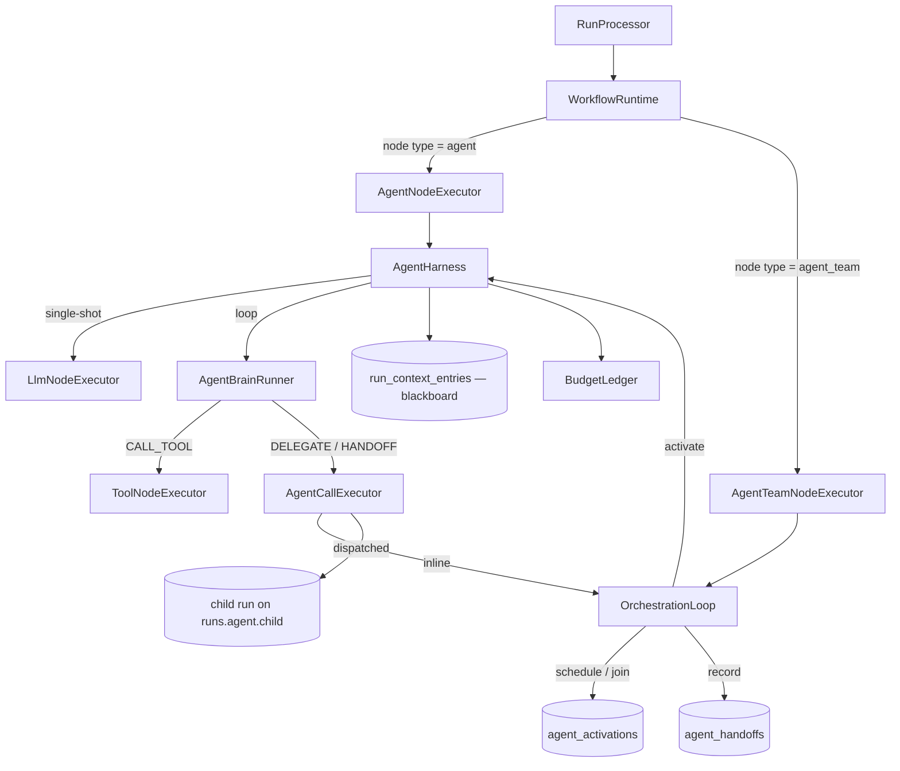

# Agent harness architecture: multi-agent orchestration and handoff

A design for turning the current single-agent node executor into a harness that
can run teams of agents, hand work between them, and stay debuggable and
affordable while doing it.

Scope: the **execution architecture**. The debugger tab, the trace data model and
the failure taxonomy are in
[AGENT-TRACE-AND-DEBUGGER.md](./AGENT-TRACE-AND-DEBUGGER.md).

Baseline: [AGENTIC-WORKFLOW-EXECUTION-FLOW.md](./AGENTIC-WORKFLOW-EXECUTION-FLOW.md)
and [AGENT-BRAIN-EXECUTION.md](./AGENT-BRAIN-EXECUTION.md).

Status: **proposal**, 2026-08-28. Written against the two design documents, not
against a fresh read of the source. §16 lists what to verify in code before
committing to the plan.

---

## 1. Where the current implementation stands

The transport, durability and safety layers are in good shape and mostly carry
over unchanged. The agent layer is the part that does not generalise.

### What carries over as-is

| Asset | Why it survives multi-agent |
|---|---|
| Postgres as system of record, Redis as transport | Multi-agent adds rows, not a new consistency model |
| Run lease + status CAS | Still exactly the right guard against double execution |
| `StepExecutionGuard` idempotency | Extends to activations with a wider key |
| Checkpoint / yield / resume | The mechanism that makes a 40-minute agent team affordable |
| `run_events` + sequence + SSE | Becomes the log half of the trace; the tree half is new |
| Approval gate and `decideOnApproval` | One shared rule already; a delegation gate is one more key |
| Execution-class routing and tenant admission | Needs a new lane, not a new design |
| Crash recovery, dead letters | Unchanged |

### What blocks multi-agent

| # | Constraint today | Consequence |
|---|---|---|
| 1 | An agent is a **DAG node**. Structure is fixed at version time | An agent cannot decide at runtime to involve another agent |
| 2 | Agents have no way to call each other | Every collaboration must be pre-drawn on the canvas |
| 3 | `agent_memory_entries` is keyed `(run_id, agent_id, key)` | No shared state. Agent B cannot read what A learned |
| 4 | **A resumed agent replays from iteration 1** (known limit #2) | With delegation this is not a cost problem, it is a correctness problem: a replayed loop re-delegates |
| 5 | Budgets are flat per agent | A supervisor spawning five workers has no ceiling on the subtree |
| 6 | Observability is a flat ordered event log | You cannot answer "which agent caused this" from a list |
| 7 | ~~No test source set (known limit #5)~~ — **withdrawn, was never true**; the gap is that orchestration paths were untested, not untestable | Addressed 2026-08-29: see §12.6 |

Item 4 must be fixed **before** multi-agent ships, not after. Item 7 is done —
`ScriptedLlmProvider` and the brain loop suite landed 2026-08-29 (§12.6), which
also produced the replay-cost baseline item 4 has to move. Everything else can
land incrementally.

---

## 2. The one idea

> **An agent is a callable, exactly like a tool.**

`ToolNodeExecutor` already gives every tool call: workspace-scoped lookup at
runtime, type dispatch, a grant check, `requires_approval` enforced at the
boundary, and a stable idempotency key. The brain validates `CALL_TOOL` against
the granted-tool list before dispatch, and the model never executes anything
itself.

Model a peer agent the same way and almost all of that machinery transfers for
free:

| Tool concept | Agent equivalent |
|---|---|
| Granted tool list | **Team roster** |
| `TOOL_NOT_ALLOWED` | `AGENT_NOT_IN_ROSTER` |
| `<stepId>:tool:<toolId>` approval key | `<stepId>:agent:<agentId>` |
| `ToolNodeExecutor` | `AgentCallExecutor` |
| Repeated-failure stop | Repeated-handoff stop |
| Tool result → observation | Child output → observation |

This is the same move that made "an agent calling a tool" and "a workflow calling
a tool" identical. Do it once more, one level up, and "a workflow calling an
agent" and "an agent calling an agent" become the same code path.

**There is one engine.** Supervisor/worker, router, critic loop and hierarchical
decomposition are *policies over the same primitives*, not four orchestrators.

---

## 3. Layer map

Two new layers slot between `WorkflowRuntime` and `AgentBrainRunner`. Nothing
above `WorkflowRuntime` changes.



| Layer | New? | Owns |
|---|---|---|
| `AgentTeamNodeExecutor` | new | One `agent_team` graph node → an orchestration session |
| `OrchestrationLoop` | new | Activation scheduling, joins, cycle guards, termination |
| `AgentHarness` | new | One activation's lifecycle: budget carve-out, context assembly, brain invocation, result normalisation |
| `AgentCallExecutor` | new | Validates the roster grant, opens the delegation gate, places the call |
| `BudgetLedger` | new | Hierarchical allocation and consumption reporting |
| `AgentBrainRunner` | extended | Two new actions; durable loop state |
| `AgentNodeExecutor` | thinned | Delegates to `AgentHarness`; keeps single-shot routing |

`AgentNodeExecutor`'s `shouldUseToolLoop` decision stays exactly as it is. The
question "is this agent set up to use tools" is still the right one; it just now
reads "…or peers" as well.

---

## 4. The activation model

An **activation** is one agent's participation in one run. It is to a team what a
step is to a DAG: the durable unit of work, retry, budget and trace.

Activations are created at runtime, so they cannot live in the immutable
`graph_json`. They get their own table.

```sql
CREATE TABLE agent_activations (
  id                    uuid PRIMARY KEY,
  run_id                uuid NOT NULL REFERENCES agent_runs(id),
  workspace_id          uuid NOT NULL,
  environment_id        uuid NOT NULL,
  step_id               text NOT NULL,          -- the agent/agent_team DAG node
  parent_activation_id  uuid REFERENCES agent_activations(id),
  root_activation_id    uuid NOT NULL,          -- subtree root, for cheap subtree queries
  depth                 int  NOT NULL DEFAULT 0,
  sequence              int  NOT NULL,          -- creation order within the run
  agent_id              uuid NOT NULL,
  agent_version         text,                   -- pinned; see §4.2
  role                  text NOT NULL,          -- supervisor|worker|reviewer|router|specialist
  status                text NOT NULL,
  contract_json         jsonb NOT NULL,         -- the TaskContract it was given
  output_json           jsonb,
  stop_reason           text,
  failure_class         text,
  budget_allocated_json jsonb NOT NULL,
  budget_consumed_json  jsonb NOT NULL DEFAULT '{}',
  child_run_id          uuid,                   -- non-null when dispatched, §11
  idempotency_key       text NOT NULL,
  attempt               int NOT NULL DEFAULT 1,
  created_at            timestamptz NOT NULL DEFAULT now(),
  started_at            timestamptz,
  ended_at              timestamptz,
  UNIQUE (run_id, idempotency_key)
);
CREATE INDEX ON agent_activations (run_id, sequence);
CREATE INDEX ON agent_activations (root_activation_id);
CREATE INDEX ON agent_activations (status) WHERE status IN ('running','waiting_for_child','waiting_for_approval');
```

`UNIQUE (run_id, idempotency_key)` is the load-bearing constraint. It is what
makes a resumed orchestration reattach to the activations it already created
instead of starting a second set. The key is derived, never random:

```
idempotency_key = sha256(parent_activation_id ?: step_id
                       | agent_id
                       | canonical_json(contract_json))
```

Same parent, same agent, same contract → same key → the existing row is reused
and its recorded output returned. A genuinely different delegation produces a
different key. This mirrors the existing rule that a durable key must survive
re-execution, and it is the reason iteration numbers must stay out of it.

### 4.1 Status vocabulary

| Status | Meaning | Terminal |
|---|---|---|
| `pending` | Created, not yet dispatched | no |
| `running` | Brain loop executing | no |
| `waiting_for_child` | Delegated; parked until children resolve | no |
| `waiting_for_approval` | A gate is open under this activation | no |
| `handed_off` | Control transferred; this activation is done, the team is not | **yes** |
| `succeeded` | Returned a valid output | yes |
| `failed` | Stop reason other than `FINAL_OUTPUT` | yes |
| `cancelled` | Run cancelled or parent abandoned it | yes |
| `superseded` | A retry replaced it | yes |

`handed_off` deliberately reads as neither success nor failure. A router that
correctly transfers to a specialist did its job; grading it `succeeded` inflates
success metrics and grading it `failed` makes every routed run look broken.

### 4.2 Agent version pinning

A run executes the graph it was created against, because `workflow_versions` is
immutable. Agents are **reference types** read from the database at execution
time, so today an agent edited mid-run changes behaviour between the first tick
and the resumed one.

For a single agent that is tolerable. For a team resuming across an approval that
sat overnight, it is not: half the team runs the old instructions and half the
new. Proposal: snapshot the resolved agent definition (instructions, model,
budgets, roster, granted tools) into the activation row on first creation, and
read from the snapshot on every resume. **As shipped in P6 the granted tools are
deliberately excluded — see §4.3.** `agent_version` records which definition
was pinned. This costs one jsonb column and removes a whole class of
"it worked yesterday" reports.

### 4.3 What P6 actually shipped, and where it deviates

P6 introduced the activation as the durable unit and routed the **existing
single-agent path** through it. Delegation, teams and the new brain actions are
later phases. Nothing about how a single-agent workflow behaves changed — except
in one place, named below.

Behind `AGENT_ACTIVATIONS_ENABLED`, default **off**. Flag off, not one line of the
new path executes and the old branch is byte-for-byte what shipped.

**The contract is deliberately minimal: just the resolved `taskInstruction`.**

The full resolved input is the least stable thing in scope. It is rebuilt every
tick from the step-output view, and one upstream node emitting a timestamp or a
reordered map moves the hash — which creates a duplicate activation on resume,
silently, because a duplicate is not an error. P8's `TaskContract` (§5.2) widens
this safely for exactly the reason P6 cannot: a delegated contract is
*constructed* by the delegating agent — small, explicit, and stable by
construction rather than by luck.

**`step_id` and `agent_id` are inside the hash, not merely alongside it.** With
the contract reduced to an instruction, they are the only thing separating two
agent nodes in one graph that were handed the same words. Drop them and the two
nodes collide onto one activation, and the second agent's work is recorded as the
first's.

**The row is the authority, not the re-derivation.** The instruction is resolved
once, at creation, through the node config → `taskInstruction` → `task` →
`prompt` → `input` fallback, and stored. Every later tick reads it back from the
row and hashes the stored value. The pin is what makes a run finish as the thing
it started as rather than half on one instruction and half on another with a human
having approved the first.

**The reattach lookup for a ROOT activation is by `(run_id, step_id, agent_id)`,
not by the hash.** The unique constraint on the hash is still load-bearing — it is
what stops two workers racing the same insert — but it is the *guard*, not the
lookup. A root activation's contract is not guaranteed byte-identical across
ticks: if the field the fallback chain landed on is absent later, the chain
resolves somewhere else and the hash moves, no row matches, and a second
activation is created. The natural key cannot drift. P7's children reattach by
hash, because a delegated contract is stable by construction.

**`role` is defaulted by the column, not written at the call site**, so P8 can
start passing a real role without editing every P6 caller, and an older worker
inserting without the column during a rolling deploy still produces a valid row.
It is a `CHECK` over the five values rather than a Postgres enum, because
`ALTER TYPE … ADD VALUE` cannot run inside a transaction on older servers — which
makes a Flyway migration that adds a role awkward in exactly the way a migration
must not be.

**Both paths get an activation.** A single-shot agent produces one with zero
iteration spans and its model call as a direct child. That is a legitimate tree,
not a degenerate one, and having one shape for "an agent ran" is worth more than
saving a row.

**`activation` and `iteration` spans are now emitted**, filling the kinds P2
defined and left unwritten. Every span opened beneath an activation inherits its
`activation_id` without any executor knowing activations exist. See the trace
doc's span-kind table for how the parenting works.

#### The one deliberate deviation: the pin covers the definition, not the grant

§4.2 proposes snapshotting "instructions, model, budgets, roster, granted tools".
P6 pins everything on that list **except the granted tools**, and this is a
scoped, deliberate exception rather than an omission.

An operator who revokes a tool mid-run is making a *policy* decision, and policy
is re-read at execution time and fails closed — the same rule the beta gate
follows, for the same reason: a paused run must not resume with access somebody
deliberately removed. Pinning the grant would mean an approval that sat overnight
resumes in the morning still holding a permission that was taken away at 3am.

So: instructions, model, temperature and budgets are pinned; granted tool ids are
absent from `agent_snapshot_json` and re-read live on every execution. First-tick
behaviour is unchanged either way, and flag-off restores today's behaviour
exactly.

**A limit worth stating.** The pin covers the *instruction*, not the resolved
input, which still rides on `AgentBrainConfig.resolvedInput` and is rebuilt every
tick. A drifted upstream value is therefore still visible to the model on a
resume, even though the instruction is not. That boundary is asserted directly in
`AgentActivationIntegrationTest`, so widening or narrowing it has to be a decision
someone writes down rather than a side effect.

---

## 5. Handoff

### 5.1 Five kinds, one vocabulary

| Kind | Parent after | Result flows | Use |
|---|---|---|---|
| `DELEGATE` | `waiting_for_child` | child → parent | Supervisor gives out a subtask and aggregates |
| `TRANSFER` | `handed_off` | child → caller of the team | Router/triage; a tail call, no return |
| `RETURN` | resumed `running` | child → parent | The child's `FINAL`, recorded as an edge |
| `ESCALATE` | `waiting_for_approval` | human decision → parent | Upward to a person or a higher-privilege agent |
| `BROADCAST` | `waiting_for_child` | N children → join | Fan-out with `wait_all` / `wait_any` / `quorum(k)` |

Five kinds is not an accident. It is the smallest set that expresses call,
tail-call, return, and fan-out — the same discipline behind the five brain
actions and the three approval decisions. Resist adding a sixth; every new kind
multiplies the states the debugger and the resume path must handle.

```sql
CREATE TABLE agent_handoffs (
  id                  uuid PRIMARY KEY,
  run_id              uuid NOT NULL,
  from_activation_id  uuid,                  -- null when the team node opens the first activation
  to_activation_id    uuid NOT NULL,
  kind                text NOT NULL,
  reason              text,                  -- the model's stated reason, sanitized
  contract_json       jsonb NOT NULL,
  context_version     bigint NOT NULL,       -- blackboard version visible at handoff, §7
  join_group_id       uuid,                  -- shared by one BROADCAST's children
  created_at          timestamptz NOT NULL DEFAULT now()
);
```

The handoff row is what the debugger's constellation view draws. It is also the
only place the *reason* for a delegation is recorded, which is usually the first
thing a business user wants when a run went sideways.

### 5.2 The task contract

Handoff quality is contract quality. A bare string prompt passed between agents
is the single biggest source of multi-agent failure and the hardest thing to
debug, because nothing records what was actually expected.

```kotlin
data class TaskContract(
    val objective: String,               // one sentence, imperative
    val inputs: JsonNode,                // resolved values, small
    val contextRefs: List<ContextRef>,   // blackboard pointers, NOT payloads
    val outputSchema: JsonNode?,         // what the caller will validate against
    val successCriteria: String?,        // how the caller judges the result
    val constraints: List<String>,       // "do not contact the customer"
    val budget: BudgetAllocation,        // carved from the parent's remainder
    val deadline: Instant?
)
```

Two rules make this work:

1. **`outputSchema` is validated by the caller's harness, not by the callee.**
   The existing `SCHEMA_INVALID` stop reason already does this for a final
   output. A child that returns a shape its parent cannot use fails at the
   boundary with a legible reason, rather than the parent silently reading nulls.
2. **`contextRefs`, not payloads.** Handing over a blob means every hop grows the
   prompt, and prompt growth is how multi-agent systems get expensive
   superlinearly. Pass a pointer; let the callee read what it needs. §7.

### 5.3 Two new brain actions

The action set goes from five to seven:

| Action | Runtime does |
|---|---|
| `THINK` | unchanged |
| `CALL_TOOL` | unchanged |
| `DELEGATE` | Validate roster grant → resolve gate → create activation → park parent |
| `HANDOFF` | Validate roster grant → create activation → terminate parent as `handed_off` |
| `FINAL` | unchanged (validates against `outputSchema` from the contract when present) |
| `ASK_APPROVAL` | unchanged |
| `FAIL` | unchanged |

`DELEGATE` and `HANDOFF` are validated **exactly** the way `CALL_TOOL` is: the
target must appear in the roster, the check is in runtime code and not in the
prompt, and an ungranted target is a hard stop. The prompt states the roster; the
prompt is not the enforcement.

New stop reasons, all non-retryable, all `ORCHESTRATION` class:

| Stop reason | Meaning |
|---|---|
| `AGENT_NOT_IN_ROSTER` | Delegated to an agent it was not granted |
| `MAX_DEPTH_EXCEEDED` | Delegation chain deeper than the team's limit |
| `HANDOFF_LOOP` | Same (from, to, contract-hash) triple seen too many times |
| `CHILD_FAILED` | A child failed and the join policy is `wait_all` |
| `JOIN_DEADLOCK` | Waiting on children that can never resolve |
| `TEAM_BUDGET_EXCEEDED` | The subtree ceiling, not this agent's own |

---

## 6. Orchestration policies

The `agent_team` node config selects a policy. All policies drive the same
`OrchestrationLoop`; they differ only in which handoffs they permit and how they
terminate.

| Policy | Roster shape | Permitted handoffs | Terminates when |
|---|---|---|---|
| `supervisor` | one supervisor + N workers | `DELEGATE`, `BROADCAST`, `ESCALATE` | supervisor returns `FINAL` |
| `router` | one router + N specialists | `TRANSFER` only | the transferred-to agent returns `FINAL` |
| `pipeline` | ordered list | implicit `TRANSFER` between stages | last stage returns `FINAL` |
| `review` | worker + reviewer | `DELEGATE` to reviewer, bounded rounds | reviewer approves or rounds exhausted |
| `blackboard` | N peers, no hierarchy | `BROADCAST` + shared context | quorum or a peer returns `FINAL` |

```json
{
  "type": "agent_team",
  "config": {
    "policy": "supervisor",
    "entryAgentId": "…",
    "roster": [
      { "agentId": "…", "role": "supervisor", "canDelegateTo": ["researcher","writer"] },
      { "agentId": "…", "role": "worker", "alias": "researcher" },
      { "agentId": "…", "role": "worker", "alias": "writer" }
    ],
    "limits": { "maxDepth": 3, "maxActivations": 12, "maxHandoffsPerPair": 2, "maxRounds": 4 },
    "budget": { "maxTotalTokens": 120000, "maxCostCents": 400, "maxDurationMs": 900000 },
    "joinPolicy": "wait_all",
    "onChildFailure": "fail_parent"
  }
}
```

`canDelegateTo` is per-member, not global. A researcher that can re-delegate to
the writer creates a cycle the depth limit will eventually catch — but catching
it at the roster is cheaper and much easier to explain in the UI.

Existing `agent` nodes are untouched. A team is a new node type; nothing needs
migrating.

---

## 7. Shared context

Agent memory today is `(run_id, agent_id, key)` — the agent's private notes, and
correctly so. Multi-agent needs a second thing beside it: a place the team writes
findings that peers can read.

```sql
CREATE TABLE run_context_entries (
  id             bigserial PRIMARY KEY,
  run_id         uuid NOT NULL,
  scope          text NOT NULL,        -- run | team | activation
  scope_ref      text,                 -- team node id or activation id
  key            text NOT NULL,
  value_json     jsonb NOT NULL,       -- sanitized, capped
  version        bigint NOT NULL,      -- monotonic per (run_id, scope, scope_ref, key)
  written_by     uuid REFERENCES agent_activations(id),
  visibility     text NOT NULL DEFAULT 'team',   -- public | team | private
  payload_ref    text,                 -- large values offloaded, §12.1
  created_at     timestamptz NOT NULL DEFAULT now()
);
CREATE INDEX ON run_context_entries (run_id, scope, key, version DESC);
```

**Append-only, versioned.** Never update in place. Three reasons: concurrent
peers writing the same key do not need a lock, the debugger can answer "what did
this agent see when it decided that" by reading at `context_version` from the
handoff row, and a bad write is inspectable rather than lost.

Reads are `SELECT DISTINCT ON (key) … ORDER BY key, version DESC` filtered by
visibility and the reader's scope.

### Memory scopes

| Scope | Table | Status |
|---|---|---|
| Run-scoped agent memory | `agent_memory_entries` | exists |
| Workflow-scoped memory | `agent_memory_entries` | **in schema, not implemented** (known limit #4) |
| Team blackboard | `run_context_entries` | new |

Implementing workflow-scoped memory is a small, separable win and worth doing
during this work: it is the difference between an agent that learns across runs
and one that starts cold every time. It needs a retention policy and a size cap
before it ships, or it becomes an unbounded prompt-growth vector.

### Context assembly

`AgentHarness` builds each activation's context deterministically, in priority
order, under a hard character budget:

```
1. Contract objective + constraints + success criteria   (never truncated)
2. Contract inputs                                       (never truncated)
3. Own memory recall — last N                            (existing behaviour)
4. Blackboard entries named in contextRefs               (resolved on demand)
5. Recent handoff history for this subtree               (summarised)
6. Previous observations                                 (existing, last 10)
```

When the budget is hit, drop from the bottom and record what was dropped in the
trace. A context that was silently truncated is the hardest agent failure to
diagnose; making the truncation an observable event removes the whole category.

---

## 8. Budget tree

Flat per-agent budgets do not bound a subtree. A supervisor with `maxCostCents =
50` that spawns eight workers each with `maxCostCents = 50` costs 450 cents, and
nothing in the system said no.

```kotlin
class BudgetLedger(private val runCeilings: RunCeilings) {
    fun allocate(parent: ActivationId?, request: BudgetRequest): BudgetAllocation
    fun consume(activation: ActivationId, usage: BudgetUsage)   // propagates to ancestors
    fun remaining(activation: ActivationId): BudgetSnapshot
}
```

Three invariants, enforced in code:

1. **A child's allocation never exceeds its parent's remaining.** Checked at
   allocation time. An over-request is clamped, not refused, and the clamp is
   recorded — a worker told it has less budget usually adapts; one refused
   outright fails the run.
2. **Consumption propagates upward synchronously.** A child spending tokens
   debits every ancestor before the next activation is allocated. Deferred
   accounting is how fan-out overspends.
3. **The run ceilings still win.** `CeilingExceeded` remains a distinct terminal
   state, not `Failed`, for the same reason it is today: nothing went wrong, a
   limit was reached, and the user needs to know which one.

Reserve a **completion margin**: hold back a slice (default 10%) of the team
budget so that when workers exhaust the rest, the supervisor still has enough to
produce a partial `FINAL` rather than dying at `BUDGET_EXCEEDED` with nothing to
show. A partial answer plus a stated shortfall is worth more than a failed run.

Fan-out needs **preflight estimation**: before a `BROADCAST` of N children,
estimate `N × per-child allocation` against the remaining team budget and refuse
the fan-out if it cannot afford all of it. Discovering the ceiling after three of
eight children have run wastes the spend on all three.

---

## 9. Safety and termination

Multi-agent's characteristic failure is not a wrong answer; it is a system that
never stops. Every guard below is runtime code, checked before an activation is
created.

| Guard | Bound | Stop reason |
|---|---|---|
| Depth | `limits.maxDepth`, default 3 | `MAX_DEPTH_EXCEEDED` |
| Total activations | `limits.maxActivations`, default 12 | `TEAM_BUDGET_EXCEEDED` |
| Repeated handoff | `(from, to, sha256(contract))` seen > `maxHandoffsPerPair` | `HANDOFF_LOOP` |
| Roster grant | target in caller's `canDelegateTo` | `AGENT_NOT_IN_ROSTER` |
| Subtree budget | §8 | `TEAM_BUDGET_EXCEEDED` |
| Join progress | no runnable activation and children outstanding that cannot resolve | `JOIN_DEADLOCK` |
| Wall clock | team `maxDurationMs`, excluding approval parking | `BUDGET_EXCEEDED` |

The repeated-handoff guard is the direct analogue of the existing
repeated-tool-failure stop: if the same request has already been made twice and
come back the same, spending the remaining budget reproving it helps nobody. Hash
the contract, not the prose, so a reworded but identical request is still caught.

**Approvals.** Delegation reuses the existing gate wholesale. Keys stay disjoint:

| Gate | Key |
|---|---|
| Agent's own `ASK_APPROVAL` | `<stepId>` |
| Tool with `requires_approval` | `<stepId>:tool:<toolId>` |
| Delegation to a gated agent | `<stepId>:agent:<agentId>` |
| Activation-scoped tool gate | `<activationId>:tool:<toolId>` |

The fourth is new and necessary: two workers in one team calling the same gated
tool must open two gates, or the second silently inherits the first's decision.
The existing `(runId, nodeId)` find-then-create and the one shared
`decideOnApproval` rule apply unchanged, including the rule that anything
unrecognised means `WAIT` and never "open a new gate".

Known limit #1 — one approval per (step, tool) — becomes one per (activation,
tool), which is the right granularity and resolves most of the practical pain
without changing the rule.

---

## 10. Durable loop state

> This is the prerequisite. Multi-agent on top of replay-from-iteration-1 is not
> a degraded experience, it is a correctness bug that spends money.

Today loop state is in memory, the step re-executes from iteration 1 on resume,
and only sanitized memory is recalled — observations are not restored. A resumed
agent therefore repeats every LLM and tool call it already made, protected only
by the step guard's cached outputs.

With delegation, a replayed loop replays the `DELEGATE` too. The activation
idempotency key (§4) makes that *safe* — the second attempt reattaches to the
existing row — but the loop still burns iterations and tokens re-deriving a
decision it already made, and the trace shows a delegation happening twice.

### The change

Make the loop reconstructible instead of replayable:

1. Persist the full sanitized transcript per iteration — the parsed action and its
   arguments, the observation payload (by `run_payloads` ref), the tool result ref,
   and the **budget delta**. Deltas, not the cumulative totals `agent_iterations`
   already carries: a rebuild resuming at iteration 5 needs what the budget stood at
   after 4, and a running total may have been written by an attempt since abandoned.
2. On step start, if a transcript exists for this `(run, step)` and the job is a
   continuation, rebuild `LoopState` from it and **resume at `lastIteration + 1`**.
3. Recalled iterations are marked `recalled = true` and never re-persisted.
4. Reconstruction and memory recall must never both run. They restore overlapping
   state at different fidelities, and running both puts every observation in front
   of the model twice — which reads to the model as the tool having been called
   twice. Reconstruct if possible, recall if not.

Resume becomes a continuation. The cost of an approval that sat overnight drops to
zero LLM calls, and the trace stops showing phantom repeats.

**Consumption carries over; liveness resets.** Tokens, cost, tool calls and
iterations bound *spend* and are cumulative — iterations especially, or a run that
resumes ten times never reaches `MAX_ITERATIONS`. Wall clock bounds *hang
detection* and is per-execution: restoring `startedAt` would make an overnight
approval blow `timeoutMs` the instant it resumed. This is the line the codebase
already draws — `WORKER_MAX_RUN_DURATION_MS` defaults to unlimited because waiting
at a gate is the product, and the run ceiling measures active duration.

### Two tables, two different traps

An earlier draft of this section said `agent_iterations` has no unique key and that
re-persisting a recalled iteration would double the rows. That is true of
`agent_memory_entries` and was transplanted onto the wrong table. They fail in
opposite ways, and a fix aimed at the wrong one would do nothing:

| Table | Key | What re-persisting does |
|---|---|---|
| `agent_memory_entries` | none — its `ON CONFLICT DO NOTHING` can never fire | **Doubles** the rows, and doubles again on every resume |
| `agent_iterations` | `UNIQUE (run_id, step_id, iteration_number)` (V010) | **Blanks** them — `persistIterationStart` upserts with `DO UPDATE SET action_type = NULL, observation_summary_sanitized = NULL, …` |

The blanking is the more dangerous of the two now that these rows carry the action
and the payload refs. A fallback to replay walks iteration 1..N overwriting as it
goes, so one transient reconstruction failure would destroy the evidence of what
happened *and* guarantee every later resume also falls back. The transcript is
therefore snapshotted into `run_payloads` before a fallback, with the ref on the
`AGENT_LOOP_RECONSTRUCTION_SKIPPED` event.

### Degraded, never failed

Any of — flag off, not a continuation, no transcript, a schema version this build
does not know, a hole in the numbering, an unreadable action — falls back to
today's replay. A reconstruction that is subtly wrong is worse than one that does
not happen: it would hand the model a false account of its own history.

The event is named `..._SKIPPED`, not `..._FAILED`. The timeline grades event
names, and a fallback usually precedes a run that succeeds; painting it red sends
someone hunting a break that is not there. Same reasoning as `RUN_RESUMED` over
`RETRY_STARTED`.

This also removes the need for the `MAX_TOOL_PAYLOAD_CHARS` observation cap to
double as durability: the full result goes to the payload store with a ref, the
capped version goes in the prompt.

> **`UNIQUE (activation_id, attempt, iteration_index)` is deferred to P6.** Adding
> `attempt` means dropping the existing unique constraint, and a deployed worker's
> `ON CONFLICT (run_id, step_id, iteration_number)` does not degrade when its
> constraint disappears — it errors, and every iteration write fails. The API and
> worker deploy independently, so that window is real; it needs two migrations with
> a full rollout between them. That belongs with P6, which introduces `activation_id`
> and its own notion of attempt, rather than creating a second competing one now.
> V040 adds the `activation_id` column, nullable and unwritten, so P6 alters an
> existing column instead of adding one to a large table.

---

## 11. Where an activation executes

Two placements. Same durable row, same lifecycle, different transport. The
`OrchestrationLoop` chooses per activation.

| | **Inline** | **Dispatched (child run)** |
|---|---|---|
| Runs | In the parent's worker tick | As its own `agent_runs` row on `runs.agent.child` |
| Latency per hop | ~0 | one queue round-trip |
| Worker permit | shares the parent's | takes its own |
| Isolation | shares the tick budget | independent lease, CAS, timeout, dead-letter |
| Crash blast radius | the whole subtree | one activation |
| Parallelism | coroutines under one permit | true horizontal spread |

Selection rule:

```kotlin
fun placement(a: PendingActivation): Placement = when {
    a.contract.deadline != null && a.isShortLived  -> INLINE
    a.joinGroupSize > INLINE_FANOUT_THRESHOLD      -> DISPATCHED   // default 3
    a.estimatedDurationMs > REMAINING_TICK_BUDGET  -> DISPATCHED
    a.depth == 0                                   -> INLINE
    else                                           -> INLINE
}
```

Start with **inline-only** (Phase 3). It is strictly simpler, needs no new queue
plumbing, and the existing yield/checkpoint machinery already handles a tick
running out mid-subtree. Add dispatch in Phase 4 when wide fan-out demands it.

Dispatched children get their own run row with `parent_run_id` and
`parent_activation_id`. The parent parks as `waiting_for_child`; a child's
terminal state enqueues a `RESUME_RUN` for the parent. That is a new resume
trigger and it must be reconciled the same way approvals are — see §16, because
the approval resume path already has a known reliability gap here.

**Fair scheduling.** Child runs inherit the parent's `fair_vtime` plus a depth
penalty, so a deep tree cannot jump ahead of a tenant's other work by
manufacturing children. Also cap concurrent activations per run, per workspace,
so one team cannot occupy the whole `runs.agent` lane.

---

## 12. Scaling

### 12.1 Trace and event volume

This is the first thing that breaks. A deterministic 6-node workflow emits tens
of events. One agent step emits an event per iteration, tool call and LLM call. A
five-agent team multiplies that again. Expect **50–200× the event volume per run**
versus today's non-agent workflows.

| Measure | Detail |
|---|---|
| Partition | Declarative monthly partitions on `run_events` and `run_spans` by `created_at`; drop partitions rather than `DELETE` |
| Offload payloads | Prompts, tool results and outputs > 8 KiB go to object storage; the row keeps a content-addressed `payload_ref` |
| Deduplicate | Content addressing means a system prompt repeated across 40 iterations is stored once |
| Tier | Hot 7 days in Postgres; warm 90 days as Parquet in object storage; cold beyond that is export-only |
| Sample | Keep **100% of failed runs** and 100% of runs under 60s old; sample successful long runs at a workspace-configurable rate. Never sample a run that had a failed step, an approval or a budget clamp |
| Batch writes | Buffer spans in the worker and flush every 250 ms or 50 spans, whichever first, with a bounded queue that drops to a counter under pressure rather than blocking execution |

Trace writes must never block or fail a run. A dropped span is a degraded
debugging experience; a blocked span write is an outage.

### 12.2 The event sequence lock

`RunEventStore` assigns `sequence` under a `FOR UPDATE` lock on the run's
`agent_runs` row, held for the insert transaction. Correct today, and it is the
right call against a second process appending to the same run.

With a five-agent team it is a per-run serialization point taken hundreds of
times, contending with run status updates on the same row.

Two changes, in order:

1. **Batch.** Acquire the lock once per flush of N events and assign a contiguous
   block of sequence numbers. Cuts acquisitions by N× with no semantic change.
2. **Move the counter off the run row.** A dedicated `run_event_seq (run_id,
   next_seq)` row, or a Postgres advisory lock on `hash(run_id)`. Either stops
   event writes from contending with `agent_runs` updates.

Spans do not need a global sequence at all — they have `parent_span_id` and
timestamps, which is enough to build the tree. Keep sequencing for the event log
only.

### 12.3 Queue lanes

`runs.agent` currently carries everything agentic. Split it:

| Stream | Carries |
|---|---|
| `runs.agent` | Top-level agent and team runs |
| `runs.agent.child` | Dispatched child activations |
| `runs.agent.interactive` | Runs with a caller waiting (SSE attached, deadline set) |

Two reasons the child lane matters: a supervisor parked on children must not sit
behind a cold backlog of new top-level runs, and child work has a different
duration profile, so mixing them makes the `COUNT freeSlots` heuristic wrong for
both. Interactive separation is what keeps a demo responsive while a batch of 500
runs drains.

`GraphClassifier` needs one line: a graph containing an `agent_team` node
classifies as `agent`, same precedence rule as `llm`/`agent` nodes today.

### 12.4 Provider capacity

Agent loops multiply provider calls, and 200 workers independently respecting a
per-request timeout will still collectively blow a per-minute token limit. The
existing per-provider circuit breaker handles the failure; it does not prevent
it.

Add a Redis-backed distributed token bucket keyed `(provider, model,
workspace_id)` with lease-and-return semantics: a worker reserves its estimated
token spend before the call and returns the difference after. Interactive lanes
draw first; batch waits. A `Throttled` result already maps cleanly onto the
existing timer/yield path, so exhausting the bucket costs a yield rather than an
error.

### 12.5 Context growth

Left alone, a five-hop handoff chain carries five accumulated contexts. Mitigated
by three rules already stated: pass `contextRefs` not payloads (§5.2), assemble
context under a hard budget with recorded truncation (§7), and summarise handoff
history rather than concatenating it. Add a per-team `maxContextChars` and treat
breaching it as a budget event, visible in the trace.

### 12.6 Testing — the largest risk

> **Corrected 2026-08-29.** This section said neither Kotlin module had a test
> source set. That was never true of the code as committed: `apps/worker-kotlin`
> and `apps/api-kotlin` both have `src/test/kotlin` on JUnit 5, and
> `packages/observability-kotlin` and `packages/recovery-kotlin` do too. Item 1
> below is now **built**; the rest stands. Known limit #5 is withdrawn.

Orchestration is precisely the code that reading does not verify: the interesting
cases are a child failing mid-join, a resume landing on a half-built subtree, and
a handoff cycle. None of those are visible by inspection.

1. **`ScriptedLlmProvider` — built.** `apps/worker-kotlin/src/test/kotlin/com/vectorbea/worker/testsupport/ScriptedLlmProvider.kt`.
   It substitutes at the `HttpClient` seam `LlmNodeExecutor` already exposes, so
   prompt assembly, provider dialect, response parsing and cost accounting all run
   for real against a queued script. It records every request and exposes a call
   count. `AgentBrainLoopTest` covers every documented stop reason in 0.09s or
   less per test with no network and no database, via `AgentBrainFixture`.

   One production seam was needed: `AgentBrainRunner` built its own
   `LlmNodeExecutor` with no way to pass a client through, so it takes an optional
   `llmHttpClient`, null in production.

2. **Record/replay suite — blocked, and not for the stated reason.** `REPLAY_RUN`
   and `model_calls` exist, but **neither reaches the agent path**:
   `AgentNodeExecutor` accepts no `ModelCallRecorder` or `ReplayContext`, and
   `AgentBrainRunner` constructs its executors without them. So agent steps record
   nothing, and a replay of a workflow containing an agent node executes it live.
   Wiring those two parameters through is a prerequisite for this item, not a
   detail of it. See
   [AGENT-HARNESS-FINDINGS.md](./AGENT-HARNESS-FINDINGS.md) §1(c).

**Baseline worth keeping.** `AgentBrainLoopTest` pins the current cost of a
resumed agent step: 3 replayed provider calls before 1 new decision, because loop
state is in memory and the step restarts at iteration 1. §10 should drive the
replayed portion to zero, and that test is where it will show.

Also worth adding: a **chaos mode** that injects lease loss, provider 429s and
mid-join child failures at configurable rates, run nightly against the golden
set. The reliability claim in the product positioning is only as good as the
evidence behind it.

---

## 13. Invariants

Any implementation of the above must preserve these. They are the reason the
current system is trustworthy, and each one is easy to break by accident.

1. **The model chooses; the runtime executes.** No action is dispatched without
   runtime validation against a grant list. A roster in a prompt is documentation,
   not enforcement.
2. **Every durable key survives re-execution.** No iteration numbers, no
   timestamps, no random ids in approval keys or activation idempotency keys.
3. **Terminal state is durable before acknowledgment.** Unchanged from today.
4. **Sanitization happens once, at the write boundary.** `RunEventStore` and the
   span writer take already-sanitized payloads. Raw errors, stack traces and
   provider responses never reach them.
5. **A child can never be allocated more than its parent's remaining budget.**
6. **A ceiling breach is not a failure.** `CeilingExceeded` stays distinct, and
   the breached limit is always named.
7. **Trace writes never block execution.** Bounded buffer, drop to a counter.
8. **Cross-workspace access is impossible.** Roster resolution is
   workspace-scoped at the same boundary agent and tool lookup already are.
9. **One engine.** A new orchestration pattern is a policy, never a second
   runtime.

---

## 14. Delivery

Sequenced so that each phase ships something usable and nothing depends on a
later phase.

| Phase | Weeks | Ships | Depends on |
|---|---|---|---|
| **0 — Trace spine** | 2 | `run_spans`, `span_id` on events, payload store, span emission from existing executors. No behaviour change | — |
| **0.5 — Test harness** | 1 | `ScriptedLlmProvider`, test source sets in both modules, record/replay in CI | — |
| **1 — Durable loop state** | 3 | Reconstructible loop, resume-as-continuation, iteration uniqueness (§10) | 0.5 |
| **2 — Debug tab v1** | 3 | Run map, timeline, iteration inspector, failure panel, root-cause attribution | 0 |
| **3 — Agent-to-agent, inline** | 4 | `agent_activations`, `agent_handoffs`, `AgentCallExecutor`, `DELEGATE`/`HANDOFF`, budget tree, cycle guards, activation gates | 1 |
| **4 — Teams and fan-out** | 3 | `agent_team` node, policies, `BROADCAST` + joins, dispatched child runs, `runs.agent.child` | 3 |
| **5 — Debug tab v2** | 2 | Handoff constellation, budget burn-down, run comparison, replay-from-iteration | 2, 4 |
| **6 — Scale** | ongoing | Partitioning, tiering, sampling, sequence batching, provider rate limiter, lane split | 0 |

Phase 2 before Phase 3 is deliberate. Shipping the debugger against today's
single-agent runs proves the trace model on traffic that already exists, and it
means the first multi-agent bug is diagnosed with a working tool rather than by
reading logs.

Roughly 15 weeks to the full picture, with usable increments at weeks 2, 6 and 9.

---

## 15. Open decisions

Things this design deliberately leaves open, with a recommendation.

| # | Question | Recommendation |
|---|---|---|
| 1 | Do child activations get their own run rows from day one? | No. Inline-only in Phase 3; dispatch in Phase 4 once fan-out demand is real |
| 2 | Is the blackboard readable across steps, or only within a team node? | Team-scoped by default, run-scoped opt-in. Run-scoped-by-default makes every agent's context grow with the whole run |
| 3 | Should `TRANSFER` be allowed to leave the team roster? | No. A transfer outside the roster is an unbounded control-flow edge and undoes the grant model |
| 4 | Workflow-scoped memory in this work, or separately? | In this work, but behind a flag and with a size cap and retention policy from the start |
| 5 | Where do span payloads live? | Object storage with content-addressed refs. Postgres for anything > 8 KiB will not survive Phase 4 volumes |
| 6 | Do we expose team composition to the AI Architect? | Yes, but only after Phase 4. Generating teams before the runtime is proven produces workflows nobody can debug |

---

## 16. Verify in code before building

This plan was written against the two design documents. Confirm the following
against the source before committing to it; each one would change a decision above.

1. **Tool guard key collision.** The synthetic tool node id is
   `<stepId>:tool:<toolId>` and must be stable for approval keying. If
   `StepExecutionGuard` uses that same id, then an agent calling the same tool
   twice with *different arguments* in one step appears to have already completed
   and receives the first call's cached output. If confirmed, the fix is to split
   the keys: guard on `<stepId>:tool:<toolId>:<argsHash>`, approve on
   `<stepId>:tool:<toolId>`. This is independent of multi-agent and should be
   fixed regardless.
2. **Approval resume reliability.** Observation #3 in
   AGENTIC-WORKFLOW-EXECUTION-FLOW notes that a stored approval decision whose
   `RESUME_RUN` enqueue fails leaves a run stuck, because crash recovery does not
   scan `waiting_for_approval`. Dispatched child activations (§11) add a second
   resume trigger with the same shape. Build the reconciler once, for both:
   a periodic sweep of runs parked with a resolved gate or resolved children.
3. **`agent_iterations` uniqueness.** Confirm there is no unique key today
   (implied by the memory-recall note). §10 depends on adding one.
4. **`GraphClassifier` precedence.** Confirm adding `agent_team` to the agent
   class needs only a type addition, not a rule change.
5. **`RunEventStore` sanitization contract.** Confirm callers sanitize before
   calling, so the span writer can adopt the same contract rather than
   re-sanitizing.
6. **Architect `setCurrentVersion` gap.** Observation #2 says Architect-created
   workflows can have a version while `current_version_id` stays null. Worth
   fixing before teams become generatable.

---

## 17. Schema summary

| Table | New? | Purpose |
|---|---|---|
| `agent_activations` | new — shipped V042 | One agent's participation in a run |
| `agent_handoffs` | new | The delegation edges |
| `run_context_entries` | new | Versioned team blackboard |
| `run_spans` | new | Causal trace tree ([debugger doc](./AGENT-TRACE-AND-DEBUGGER.md)) |
| `run_payloads` | new | Content-addressed payload refs |
| `run_event_seq` | new | Sequence counter, off the run row |
| `agent_iterations` | extended | `activation_id`, observation payload, parsed action, unique key |
| `agent_memory_entries` | extended | Implement `workflow_scoped` |
| `run_events` | extended | `span_id`, `activation_id` |
| `agent_runs` | extended | `parent_run_id`, `parent_activation_id` |
| `run_approvals` | unchanged | New key shapes only |

## 18. Code map

New and changed paths under
`apps/worker-kotlin/src/main/kotlin/com/vectorbea/worker/`:

| Concern | Path | Status |
|---|---|---|
| Team node executor | `runtime/executor/AgentTeamNodeExecutor.kt` | new |
| Orchestration loop, joins, termination | `agents/orchestration/OrchestrationLoop.kt` | new |
| Activation lifecycle | `agents/orchestration/AgentHarness.kt` | **shipped P6** |
| Roster grant + delegation gate | `runtime/executor/AgentCallExecutor.kt` | new |
| Activation persistence | `agents/orchestration/ActivationStore.kt` | **shipped P6** |
| Handoff records | `agents/orchestration/HandoffStore.kt` | new |
| Hierarchical budgets | `agents/budget/BudgetLedger.kt` | new |
| Blackboard | `agents/context/RunContextStore.kt` | new |
| Context assembly under budget | `agents/context/ContextAssembler.kt` | new |
| Span emission | `events/SpanWriter.kt` | **shipped P2** |
| Payload offload | `events/PayloadStore.kt` | **shipped P2** |
| Two new actions, durable loop state | `agents/brain/runtime/AgentBrainRunner.kt` | changed |
| Roster in the system prompt | `agents/brain/prompts/AgentPromptBuilder.kt` | changed |
| Delegate to harness | `runtime/executor/AgentNodeExecutor.kt` | **changed P6** (behind `AGENT_ACTIVATIONS_ENABLED`) |
| Sequence batching | `events/RunEventStore.kt` | changed |
| Scripted provider | `test/.../testsupport/ScriptedLlmProvider.kt` | **shipped P1** |
| Span tree bookkeeping | `events/RunTracer.kt` | **shipped P2**, node-id rebinding added P6 |
| Canonical key derivation | `packages/observability-kotlin/.../keys/CanonicalJson.kt` | **shipped P6**, shared with the tool guard |
| Activation + iteration spans | `agents/orchestration/AgentHarness.kt`, `agents/brain/runtime/AgentBrainRunner.kt` | **changed P6** |

API side, under `apps/api-kotlin/.../api/`:

| Concern | Path | Status |
|---|---|---|
| Trace read API | `routes/TraceRoutes.kt` | **shipped P4** |
| `agent_team` classification | `queue/GraphClassifier.kt` | changed |
| Child-lane enqueue | `queue/TypedStreamsWorkflowQueue.kt` | changed |
| Resume reconciler | `schedule/ResumeReconciler.kt` | new |
