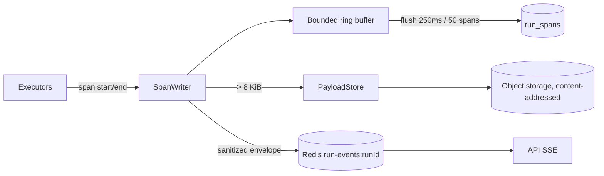
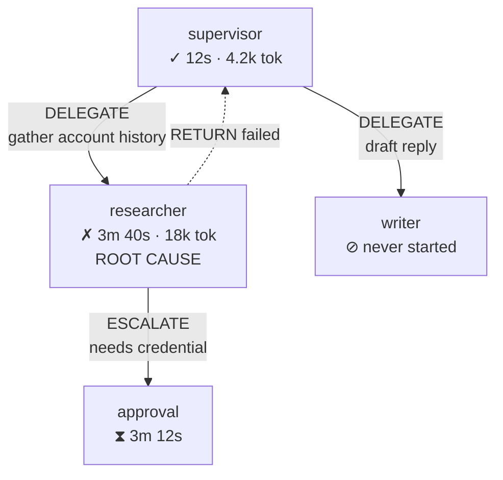

# Agent trace model and the Debug tab

The data model and UI for answering one question: **where did this agent fail,
and why.**

Companion to [AGENT-HARNESS-ARCHITECTURE.md](./AGENT-HARNESS-ARCHITECTURE.md).
Baseline: [AGENT-BRAIN-EXECUTION.md](./AGENT-BRAIN-EXECUTION.md) §8 (events) and
[AGENTIC-WORKFLOW-EXECUTION-FLOW.md](./AGENTIC-WORKFLOW-EXECUTION-FLOW.md) §11.

Status: **proposal**, 2026-08-28.

---

## 1. What the tab must answer

The user is an operations lead, not the engineer who built the workflow. A run
failed at 03:00 and somebody wants to know whether to re-run it, fix a
credential, or call support. Six questions, in the order they get asked:

| # | Question | View that answers it |
|---|---|---|
| 1 | Did it fail, and where? | Run map, one glance |
| 2 | Which agent, and what was it trying to do? | Handoff constellation |
| 3 | What did it call, with what, and what came back? | Iteration inspector |
| 4 | Was this our fault or theirs? | Failure panel + taxonomy |
| 5 | Why did it take four minutes / cost $3? | Timeline + budget burn-down |
| 6 | Will re-running fix it? | Retryability verdict + replay |

Question 4 is the commercial one. "Your CRM credential expired" and "the model
never converged" are different conversations, and a runtime that cannot tell them
apart generates support tickets for both.

### Why the existing event log is not enough

`run_events` is flat, ordered by `sequence`, and correct. But a flat log cannot
express **containment**: that an LLM call happened inside iteration 4, inside the
`researcher` activation, inside the `triage` step. With one agent you can infer
it from ordering. With five agents running concurrently under a supervisor,
interleaved events are unreadable, and inference is guesswork.

The event log stays. A **span tree** is added beside it.

- Spans answer *what contained what*.
- Events answer *what happened when*.
- They share `span_id`, so any event can be located in the tree.

---

## 2. Trace data model

> **The primary key must include `created_at`.** An earlier draft of this schema
> said `span_id uuid PRIMARY KEY` alongside `PARTITION BY RANGE (created_at)`.
> Postgres rejects that outright — *"unique constraint on partitioned table must
> include all partitioning columns"* — so the table could never have been created
> as written. V028 hit the same rule partitioning `run_events` and used
> `PRIMARY KEY (id, created_at)`; its comment at line 238 says so. `span_id` stays
> the leading column, so lookups by span id alone still use the index.
>
> Two consequences, both applied in V041:
>
> - **`run_events.span_id` is a plain `uuid`, not a foreign key.** A foreign key
>   into a partitioned table must include the partition key for the same reason,
>   and V028 already had to drop one over it. Events and spans are joined in the
>   reader.
> - **There is a `DEFAULT` partition**, so a month the maintenance job failed to
>   create costs query speed rather than every span in the flush batch. It must be
>   monitored: `run_spans_default_partition_rows()` should read zero, and a
>   non-zero value is how you learn the job died three weeks ago rather than
>   discovering it in an incident.

```sql
CREATE TABLE run_spans (
  span_id         uuid NOT NULL,
  trace_id        uuid NOT NULL,            -- = run_id of the root run
  run_id          uuid NOT NULL,
  parent_span_id  uuid,
  workspace_id    uuid NOT NULL,

  kind            text NOT NULL,
  name            text NOT NULL,            -- human label: "researcher", "crm.search"
  status          text NOT NULL,            -- ok|error|paused|skipped|cancelled|running

  step_id         text,
  activation_id   uuid,
  iteration_index int,
  attempt         int NOT NULL DEFAULT 1,

  started_at      timestamptz NOT NULL,
  ended_at        timestamptz,
  duration_ms     int,
  self_ms         int,                      -- duration minus time in children

  attributes_json jsonb NOT NULL DEFAULT '{}',   -- sanitized, small, indexed
  input_ref       text,                          -- payload store
  output_ref      text,
  error_json      jsonb,                         -- sanitized
  failure_class   text,
  is_root_cause   boolean NOT NULL DEFAULT false,

  tokens_in       int,
  tokens_out      int,
  cost_cents      numeric(10,4),

  created_at      timestamptz NOT NULL DEFAULT now(),

  PRIMARY KEY (span_id, created_at)          -- partition key must be in the key
) PARTITION BY RANGE (created_at);

CREATE TABLE run_spans_default PARTITION OF run_spans DEFAULT;

CREATE INDEX ON run_spans (trace_id, started_at);
CREATE INDEX ON run_spans (run_id, parent_span_id);
CREATE INDEX ON run_spans (workspace_id, failure_class, created_at DESC)
  WHERE status = 'error';
```

### Span kinds

| Kind | Parent | Emitted by |
|---|---|---|
| `run` | none (or parent `activation` for child runs) | `RunProcessor` |
| `tick` | `run` | `WorkflowRuntime`, one per worker tick |
| `step` | `tick` | `WorkflowRuntime.executeSingleNode` |
| `input_mapping` | `step` | input resolution |
| `activation` | `step`, or the `handoff` that created it | `AgentHarness` / `AgentCallExecutor` |
| `iteration` | `activation` | `AgentBrainRunner` |
| `llm_call` | `iteration` or `step` | `LlmNodeExecutor` |
| `tool_call` | `iteration` or `step` | `ToolNodeExecutor` |
| `handoff` | `activation` | `AgentBrainRunner` (wraps the whole delegation) |
| `approval` | `step`, `activation` or `tool_call` | approval gate |
| `retry` | `step` or `activation` | `executeGuardedWithRetry` |
| `checkpoint` | `tick` | checkpoint writer |
| `wait` | `run` | queue wait, approval parking, timer |

**Which of these are emitted today.** `run`, `tick`, `step`, `wait`, `llm_call`
and `tool_call` since P2; `activation` and `iteration` since P6; `handoff`
since P9. The rest —
`input_mapping`, `handoff`, `approval`, `retry`, `checkpoint` — are the vocabulary
this table reserves, and nothing writes them yet. A reader must not infer from a
trace's absence of `retry` spans that a step was not retried.

**Attributes that explain a thin answer.** Two families are worth knowing about,
because both describe an agent that behaved reasonably given inputs nobody
recorded:

* `context_truncated` / `context_dropped_sections` / `context_over_budget` on an
  `iteration` span — what the context assembler had to drop to fit the prompt. An
  agent that "ignored" an instruction it was never shown is the hardest agent
  failure to diagnose, because the prompt is well formed, the tool worked, and
  the model behaved sensibly given what it got.
* `budget_clamped` / `budget_clamped_dimensions` on an `activation` span — the
  agent was handed less than it asked for because its parent could not afford it.
  In every other artefact this looks exactly like an agent that is bad at its job.

**A delegation's shape.** The `handoff` span covers the WHOLE delegation — the
guards, the gate and the child's execution — so "this delegation took 40 seconds,
38 of them waiting on a gate" is answerable. The child's `activation` span nests
INSIDE it, which gives the constellation view a direct edge-to-node mapping rather
than one inferred by pairing timestamps.

**How an agent's spans find their parent.** Executors resolve their parent from
the node id they already hold, via `RunTracer`'s `nodeId -> spanId` registry — see
`RunTracer.bindNode`. For an agent step that one node id is claimed in turn by the
`step` span, then the `activation`, then each `iteration`, so a model call made in
iteration three parents to iteration three. Before P6 nothing claimed it back from
the step, and every model and tool call an agent made hung flat off the step: a
waterfall could say the step took four seconds but not which iteration spent them.
A `tool_call`'s synthetic node id (`<stepId>:tool:<toolId>`) is bound to the live
iteration for the duration of the call and unbound immediately after, because that
id is reused by every later iteration calling the same tool.

`tick` as a span kind is worth the extra level: it is what makes
"why did my run take 20 minutes of wall clock and 40 seconds of work" answerable
in one look. A run with nine ticks and eight `wait` spans is not slow, it is
yielding, and the UI should say so rather than showing a mysterious gap.

### `wait` spans

Every gap between ticks gets an explicit span with a reason: `queue`,
`approval`, `throttle`, `timer`, `child`, `tenant_admission`. Unexplained gaps in
a waterfall generate more support tickets than errors do, because they look like
the product hanging.

### Attributes

Small, flat, and sanitized. Payloads go to the payload store; attributes carry
what you filter and group by.

```json
{
  "model": "…", "provider": "…", "temperature": 0.2,
  "tool_id": "…", "tool_type": "http", "http_status": 403,
  "agent_id": "…", "agent_role": "worker", "depth": 2,
  "action": "CALL_TOOL", "stop_reason": "ERROR",
  "budget_remaining_pct": 34,
  "context_truncated": true, "context_dropped_sections": ["observations"],
  "recalled": false, "replayed": false
}
```

`context_truncated` earns its place: a silently shortened prompt is one of the
hardest agent failures to diagnose, and surfacing it as a filterable attribute
turns a two-hour investigation into a glance.

---

## 3. Write path

One boundary, same as events today.



Rules, carried over from `RunEventStore` because they are the reason it is
trustworthy:

1. **Sanitization is the caller's job.** `SpanWriter` stores what it is given.
   Raw provider responses, stack traces and secrets never reach it.
2. **Postgres before Pub/Sub.** A missed live update loses nothing; the span is
   already durable.
3. **Never block execution.** The buffer is bounded. Under pressure it drops
   spans and increments a counter that surfaces in the UI as
   "trace incomplete (N spans dropped)". A degraded trace is acceptable; a
   blocked run is not.
4. **No global sequence.** Spans have `parent_span_id` and timestamps, which is
   enough to build the tree. Only the event log needs the sequence lock, and §12.2
   of the architecture doc reduces how often it is taken.

### Payload store

> **`run_payloads` already exists — do not create it.** It shipped in **V040** with
> the agent loop reconstruction work, which needed somewhere to put an observation
> payload before this phase was built. A payload store two features share is the
> whole point of content addressing, so it was pulled forward rather than
> duplicated.
>
> What V040 created, matching the schema below plus a `truncated boolean`:
>
> | Aspect | V040 state | What this phase adds |
> |---|---|---|
> | Content addressing | sha256 of the **redacted** content | — |
> | Redaction + `redactions` | working, from day one | — |
> | `storage` / `object_key` | columns present, only `'inline'` ever written | the object tier |
> | Size ceiling | 64 KiB, truncate above and set `truncated` | 8 KiB inline / object above |
> | `expires_at` | written from workspace `log_retention_days` | — |
> | Reaper | none | deferred to P12 |
>
> **Done in V041:** the inline boundary is now 8 KiB and the object tier exists
> behind `PayloadBlobStore` (`put(key, bytes): String` / `get(key): bytes?` — no
> connection, no transaction handle, so an S3 implementation can satisfy it).
>
> **The object tier is still Postgres.** Bytes above 8 KiB go to
> `run_payload_blobs`, a table separate from `run_payloads` precisely so the two are
> independently swappable — P12 replaces one class and the metadata table does not
> change. Until then, a row reading `storage = 'object'` is **not** off the primary
> database. Do not read that column and assume a bucket.
>
> Still to do here: point span `input_ref` / `output_ref` at the same store.

```sql
CREATE TABLE run_payloads (
  ref          text PRIMARY KEY,        -- sha256 of content
  workspace_id uuid NOT NULL,
  size_bytes   int NOT NULL,
  content_type text NOT NULL,
  storage      text NOT NULL,           -- inline | object
  inline_value jsonb,                   -- when small
  object_key   text,
  redactions   jsonb,                   -- what was masked and why
  expires_at   timestamptz NOT NULL,
  created_at   timestamptz NOT NULL DEFAULT now()
);
```

Content addressing pays for itself immediately: a system prompt identical across
40 iterations is stored once. Redaction happens **before** storage and what was
redacted is recorded, so a user reading a trace sees `[redacted: connection
secret]` rather than a gap they will assume is a bug.

---

## 4. Failure taxonomy

A stop reason is a category, and a category tells nobody what happened to their
run. Every failure gets a class, a plain-language cause, and an owner.

| Class | Typical cause | Owner | Retry helps? |
|---|---|---|---|
| `CONFIG` | No tools granted, bad model id, empty roster | Workflow builder | No |
| `INPUT` | `INPUT_MAPPING_FAILED`, missing upstream field | Workflow builder | No |
| `AUTH` | Expired credential, revoked token, 401 | Workspace admin | No, until fixed |
| `TOOL_FAILURE` | Integration 4xx/5xx, malformed response | Integration owner | Sometimes |
| `MODEL_BEHAVIOR` | `MAX_ITERATIONS`, `SCHEMA_INVALID`, refusal | Agent designer | Rarely |
| `BUDGET` | `BUDGET_EXCEEDED`, `TEAM_BUDGET_EXCEEDED`, ceilings | Operator | Only with a raised limit |
| `POLICY` | Approval rejected, `TOOL_NOT_ALLOWED`, `AGENT_NOT_IN_ROSTER` | Approver / builder | No |
| `ORCHESTRATION` | `HANDOFF_LOOP`, `MAX_DEPTH_EXCEEDED`, `JOIN_DEADLOCK` | Workflow builder | No |
| `TIMEOUT` | Node, tick or provider timeout | Platform + design | Sometimes |
| `INFRA` | Lease loss, worker crash, provider 5xx, DB error | Platform | **Yes** |

The classes map onto the existing stop-reason table, which already draws the
right line: only "the loop broke" is retryable, and everything the loop reached
*by deciding* is not. The taxonomy makes that visible to a non-engineer.

`CeilingExceeded` renders as `BUDGET`, never as an error state, and always names
the breached limit — a run that did what it was asked, more expensively than
allowed, should not look like a crash.

### Root-cause attribution

A failed run has many `error` spans; almost all are propagation. The one that
matters is the deepest span whose error is not caused by a child.

```
1. Start at the failed root span.
2. Walk down through error children.
3. Stop at the deepest error span with no error child.
4. That span is the root cause. Set is_root_cause = true.
5. If it has error siblings (a parallel branch or a wait_all join),
   mark all of them and label the group "N concurrent failures".
```

Computed once, at run terminalisation, and stored — not recomputed per page view.
The UI reads a flag.

The failure panel then reads as one sentence a business user can act on:

> Run failed because the **researcher** agent could not reach **Salesforce**.
> Step `triage` → activation `researcher` (depth 2) → iteration 4 → tool
> `crm.search` returned **HTTP 403: token expired**.
> Class **AUTH** — a workspace admin needs to reconnect Salesforce.
> Retrying now will fail the same way.

---

## 5. The Debug tab

New tab beside the existing run views. Six views over the same trace.

### 5.1 Layout

```
┌──────────────────────────────────────────────────────────────────────────┐
│  Run  #4f21a  ·  Ticket triage v7  ·  FAILED  ·  4m 12s  ·  $0.31        │
│  [Overview] [Agents] [Timeline] [Iterations] [Cost] [Compare]   ⟳ Replay │
├──────────────────────────────────────────────────────────────────────────┤
│ ▼ Root cause                                                             │
│   AUTH · researcher → crm.search · HTTP 403 token expired                │
│   Reconnect Salesforce, then retry.        [Reconnect]  [Retry from here]│
├──────────────────────────────────────────────────────────────────────────┤
│                                                                          │
│                      ( active view renders here )                        │
│                                                                          │
└──────────────────────────────────────────────────────────────────────────┘
```

The root-cause banner is pinned across every view. It is the answer; the views
are the evidence.

### 5.2 Overview — the run map

The workflow DAG, exactly as drawn in the builder, with live status colouring.
Familiarity is the point: the debugger should look like the thing they built.

```
  ┌────────┐   ┌──────────────┐   ┌─────────┐   ┌──────────┐
  │ trigger│──▶│ triage (team)│──▶│ branch  │──▶│ notify   │
  │   ✓    │   │      ✗       │   │  ⊘      │   │    ⊘     │
  │  0.1s  │   │  3m 58s  ▼   │   │ skipped │   │ skipped  │
  └────────┘   └──────┬───────┘   └─────────┘   └──────────┘
                      │ expand
         ┌────────────┴──────────────┐
         │ supervisor ✓ → researcher ✗ → writer ⊘ │
         └───────────────────────────────────────┘
```

Built as the **Flow view**, where structure and time are one picture.

- **One card per GRAPH NODE, never per span.** A span is one EXECUTION, and a
  node that yields, retries or resumes after an approval has several. The first
  implementation iterated spans and rendered every step twice.
- **`GET /api/runs/{id}/trace/graph` resolves the graph server-side.** The client
  never parses `graph_json`: it has two historical shapes, `WorkflowGraph.parse`
  is the only reader of both, and a second implementation in TypeScript would
  diverge silently on the one screen people open when something is already wrong.
- **The RUN BAR sits above the graph** — wall clock split into queued, working,
  parked and failed, proportional and labelled with real durations. "This took 4
  minutes" is heard as four minutes of work; usually it is 68 seconds of work and
  2m38s parked on an approval, and those are opposite problems.
- **Node WIDTH is duration**, square-rooted against the slowest node in the run
  so one 10-minute model call cannot crush the rest, with a floor that keeps a
  1ms node clickable. A node that dominates the run by more than its width can
  show is marked, because there the number is the truth and the geometry is not.
- **Status by fill, border, icon and word** — four redundant encodings, because
  the whole page rests on a red/green distinction that roughly one in twelve men
  cannot make. The failing node gets a 2px border and the words "Root cause".
- **Unreached nodes render dashed and dimmed, never hidden,** and so do their
  edges. A run that failed at step two and a run that was never going to reach
  step four look identical if only what executed is drawn. The unselected branch
  is how a reader sees what did NOT run.
- **Edge traversal is derived and TRI-STATE.** Exact when a reached node has one
  reached inbound source (the branch case); `null` when several could have
  delivered control, because spans cannot say which did. Null claims nothing.
- **Agent and team nodes carry a summary line** — activation count and the
  failing member — and expand inline to per-member status and duration.
- **Warnings render as markers on the node**: retries, truncated context, clamped
  budgets, approvals. All of them leave a run green, and without them "it worked"
  and "it worked this time" render identically.
- **Wide graphs scroll, with a minimap. Never shrink-to-fit** — 200 nodes scaled
  to the viewport is 200 unreadable specks. Legible beats complete. Above ~50
  nodes only the visible window is rendered.
- **Selection lives in the URL** (`?node=&span=&view=`), so picking a node here
  selects it in every other view and the link is the finding.

### 5.3 Agents — the handoff constellation

The view that does not exist today and that multi-agent needs most. Nodes are
activations; edges are handoffs, labelled with kind and reason.



What it makes visible in one glance:

- **Depth and fan-out** — a team that went three levels deep when it should have
  gone one.
- **Cycles** — A→B→A rendered as a loop with a hit counter, alongside the
  `HANDOFF_LOOP` guard that stopped it.
- **Blocked branches** — `writer` never started because its sibling failed under
  `wait_all`. This is the most common "why is nothing happening" question and the
  hardest to answer from a log.
- **Cost per agent** — node size scales with tokens, so the expensive member is
  obvious without opening the cost view.

Hovering an edge shows the task contract sent and the output returned — the
delegation's request and response, side by side. When a child returns a shape the
parent could not use, this is where that is legible. Both come down with the
graph, so a hover is instant rather than a request per edge.

Served by `GET /api/runs/{id}/constellation` (`ConstellationRoutes`) — nodes from
`agent_activations`, edges from `agent_handoffs`.

- **Depth runs LEFT TO RIGHT**, siblings share a column, layout is deterministic
  and O(n). Not force-directed: a force layout settles over time, produces a
  different picture every load — so "the writer node, top right" means nothing to
  a colleague — and throws away the one structural fact being read.
- **Node area scales with tokens** (square root of the ratio, since the eye reads
  AREA as magnitude), so the expensive member is obvious without opening the cost
  view.
- **`handed_off` is its own visual state**, on the brand ramp — the one place
  brand is allowed near status, because the point is that there is no status. A
  router that correctly transferred is neither a success nor a failure: given the
  success hue it would inflate a success rate, given the failure hue it would
  send somebody debugging a working router. It is also NOT dimmed — it carries a
  `blockedReason` sentence, but it is a state, not an absence.
- **A cycle is ONE arc with a hit count**, and its edges are withheld from the
  ordinary edge list. Every repeat has the same endpoints, so drawn normally they
  stack into an unreadable blob exactly where the reader is looking.
- **The loop guard's real state is shown.** `HANDOFF_LOOP` is a defined stop
  reason with no construction site in the runtime — joins, fan-out and the loop
  guard land in a later phase — so the panel says the guard *would* catch this
  and is not enforced yet, rather than claiming it stopped something.
- **Blocked branches lead**, above the diagram, with the reason. The evidence is
  an ABSENCE — no spans, no events, no output — and only the child's status and
  the PARENT's stop reason together explain it. `CHILD_FAILED` is the runtime's
  own word for "a child failed and the join could not proceed without it".
- **The root cause is ringed and its chain emphasised.** `run_spans.is_root_cause`
  marks the SPAN that broke, usually a tool call several levels below the agent
  worth looking at; the server walks up through `activation_id` to the owning
  activation and then to its ancestors, because the client has neither the span
  tree nor the parent links together.
- **A single-agent run is one node.** P6 routed the existing single-agent path
  through the activation, so every run since has at least one. Not an error, not
  an empty state — the model is uniform.

### 5.4 Timeline — waterfall

Every span on a shared time axis, indented by containment.

```
 0s        30s       60s       90s      120s     180s     240s
 ├─────────┼─────────┼─────────┼─────────┼─────────┼─────────┤
 run                 ████████████████████████████████████████
 ├ wait:queue        ██
 ├ tick 1              ██████████
 │ └ step triage       ██████████
 │   └ activation:supervisor ████
 │     ├ iteration 1   ██
 │     │ └ llm_call    █▌
 │     └ iteration 2     ██
 │       └ handoff        ▌
 │   └ activation:researcher ████████
 │     └ iteration 4        ███
 │       └ tool_call crm.search  ██  ✗ 403
 ├ wait:approval             ░░░░░░░░░░░░░░░░░░░░░░░░
 └ tick 2                                            ████
```

- **Rows are collapsible by subtree**, indented by containment, and virtualised:
  a 2000-span trace keeps ~23 rows in the DOM and the container is sized by
  arithmetic so the scrollbar stays honest.
- The **critical path** is highlighted, and `Critical path only` filters to it.
  At 2000 spans that is the only view that fits, and the only one that answers
  what actually determined the duration — everything off the path could be made
  instant with no effect on the total.
- `wait` spans render hatched and labelled with their reason, so parked time
  reads as parked rather than as a hang.
- **Unaccounted time is drawn, never left as whitespace.** Any stretch of the run
  covered by no span becomes an `Unaccounted` row, hatched differently from
  parked, placed where the hole is; the header reports the total even when it is
  too small to draw. Whitespace reads as "nothing was happening", which is
  exactly what a lost span looks like — so the bug hides behind the shape of the
  answer. A known contributor: `RunTracer.emitWait` drops gaps under one second
  as scheduling noise, so short queue waits surface here rather than as `wait`
  bars.
- **Coverage is asserted, not assumed.** Top-level spans plus waits must account
  for the run's wall clock within 1%, measured as a UNION rather than a sum —
  summing would let two overlapping top-level spans exceed the run duration and
  pass. `SpanTreeTest` asserts it against the real emitter.
- Concurrent activations render as genuinely parallel bars, positioned by
  absolute time, which is how a supervisor's fan-out becomes self-explanatory.
- **Tick boundaries are marked and numbered**, so a run that yielded and resumed
  reads as yielding rather than as one long bar with holes in it.
- Brush to zoom (two full-width range inputs, so each handle sits under the
  moment it selects and the control is keyboard-operable); click any bar to
  select it in every view; hover for name, kind, status, duration and self time.
  Payloads are never in the tooltip — they load on demand in the inspector.
- Status and critical-path membership both carry a text equivalent alongside the
  colour and the ring, because a coloured dot is invisible to a screen reader.

#### The run span is written twice, and the second write completes the first

`openRunSpan` emits the run span `running` the moment the run starts — the worker
that opens a run is frequently not the one that closes it, so a span held only in
memory would vanish with the process. `closeRunSpan` emits the same span id again
with the outcome. Both pin `created_at` to the run's start so the partition key is
stable.

The insert is therefore an upsert, guarded:

```sql
ON CONFLICT (span_id, created_at) DO UPDATE SET status = ..., ended_at = ..., ...
WHERE run_spans.ended_at IS NULL AND EXCLUDED.ended_at IS NOT NULL
```

It was `DO NOTHING`, which silently discarded every close: run spans said
`running` with no `ended_at` forever, so the waterfall had no axis, `traceComplete`
was false on every healthy run, and the run bar guessed from the longest child.
The `WHERE` clause is the whole fix — without it a redelivered job's
`openRunSpan` would flip a finished run back to `running`. With it, open→close
completes, close→close is a no-op, and nothing can reopen a closed span.

### 5.5 Iterations — the inspector

The deep view. One activation, its iterations down the left, detail on the right.

```
┌─ researcher ─────────────┬──────────────────────────────────────────────┐
│ ● 1  THINK        1.2s   │  Iteration 4          CALL_TOOL   ✗  2.4s    │
│ ● 2  CALL_TOOL    0.8s ✓ │  ┌────────────────────────────────────────┐  │
│ ● 3  THINK        1.1s   │  │ PROMPT             12,400 chars  [show] │  │
│ ● 4  CALL_TOOL    2.4s ✗ │  │  ⚠ truncated: 3 observations dropped   │  │
│ ○ 5  —      not reached  │  ├────────────────────────────────────────┤  │
│                          │  │ MODEL RESPONSE                  [show] │  │
│ Budget                   │  │ PARSED ACTION                          │  │
│ iterations  4/5  ████░   │  │  { "action": "CALL_TOOL",              │  │
│ tokens     18k/24k ███░  │  │    "toolId": "crm.search",             │  │
│ cost      21¢/40¢  ██░░  │  │    "args": { "accountId": "A-8891" } } │  │
│ time     3m40s/5m  ███░  │  ├────────────────────────────────────────┤  │
│                          │  │ TOOL RESULT                        ✗   │  │
│ [◀ prev]  [next ▶]       │  │  HTTP 403  · 240ms                     │  │
│ [diff 3 ↔ 4]             │  │  { "error": "token expired" }          │  │
│                          │  ├────────────────────────────────────────┤  │
│                          │  │ OBSERVATION RECORDED                   │  │
│                          │  │ MEMORY WRITTEN         (none)          │  │
│                          │  └────────────────────────────────────────┘  │
└──────────────────────────┴──────────────────────────────────────────────┘
```

Served by `GET /api/runs/{id}/trace/iterations`, which joins the four places
this view's facts live: `agent_iterations` (the parsed action, the observation,
the budget deltas), `run_spans` (the model and tool calls beneath each
iteration), `agent_activations` (the granted budget) and `run_events` (whether
resume recalled the transcript or replayed it). Joining those in the client would
mean paging the event feed and time-matching spans to iterations, which gets the
wrong answer on a fast loop that calls the same tool twice.

Design decisions that matter here:

- **Prompt and response collapsed by default AND NOT FETCHED.** Expanded they
  drown the page; hidden entirely the tab is useless to the person who can
  actually fix it. The panels render from metadata — size, truncation,
  redactions — which arrives with the iteration list, and the bytes are a second
  request made on the click that reveals them. `GET .../trace/spans/{id}?content=false`
  exists for exactly this: a 40-iteration activation costs one request and no
  prompt content.
- **The truncation warning sits on the prompt**, where the missing information
  is, and NAMES the dropped sections. "Context was truncated" says something is
  missing but not what; the diagnostic value is entirely in which sections went.
- **Parsed action shown next to raw response, and a REPAIR says so.** An
  unparseable response is turned into a `THINK` so the loop can continue.
  Unmarked, the stored row is identical to one where the model genuinely chose to
  think — so the trace shows deliberation where there was a parse failure and
  sends the reader to the prompt when the problem is the response format.
  `agent_iterations.action_repaired` records it.
- **A CACHED tool result says so.** The step guard replays a previous identical
  call rather than executing, so the observation the model read is the OLD
  result. Unmarked, a reader concludes the external system is serving stale data.
  `agent_iterations.tool_result_cached` records it.
- Both columns are NULLABLE, and null is not false: a row written by an older
  worker must not claim the model chose to think or that the tool ran fresh.
- **Budget gauges pair granted with used**, from `agent_activations`, so "it ran
  out of iterations" is a full bar rather than an inference from a stop reason. A
  dimension with no granted ceiling renders as a number with no bar — an invented
  denominator is worse than an absent one.
- **Reconstruction state is shown.** Iterations restored on resume are marked
  recalled and dimmed; when reconstruction fell back to replay, the reason is
  named. A reader seeing iteration 3 twice deserves to know which is which.
  `AGENT_LOOP_RECONSTRUCTED` carries `resumeFromIteration` in its metadata for
  this, rather than only in its prose.
- **Prompt diff between any two iterations** — usually the fastest route to "the
  model never got the data it needed". Summarised first (`1 line added, 0
  removed, 5 unchanged`), because 400 unchanged lines to scroll past is the same
  failure the diff was meant to fix.
- **Redactions render in place as `[redacted: reason]`**, never as a gap. A gap
  reads as a bug in the debugger and sends the reader looking for missing text;
  a named redaction is a deliberate act with a reason.

### 5.6 Cost — burn-down

Stacked area over run time, one band per activation, with ceiling lines.

```
 cost ¢
  40 ┤─────────────────────────────── ceiling ───────────────
  30 ┤                        ▓▓▓▓▓▓▓▓  researcher
  20 ┤              ▓▓▓▓▓▓▓▓▓▓▓▓▓▓▓▓▓▓
  10 ┤    ░░░░░░░░░░░░░░░░░░░░░░░░░░░░  supervisor
   0 ┼────┴────┴────┴────┴────┴────┴────
     0s        60s       120s      180s
```

Answers "why did this run cost $3" with a NAME. Toggle between cost, tokens and
iterations on the same axis — all three arrive together, so the toggle is not a
round trip. A workspace-level roll-up of the same data belongs in billing, not
here, but it is the same query.

Served by `GET /api/runs/{id}/burndown`, shaped by `BurndownReader`.

- **One band per activation, cumulative, stacked on a SHARED time grid.** Each
  band has its own sample times; stacking them index by index would put one
  band's second point on top of another's second point regardless of when either
  happened, which draws a plausible chart of a run that never occurred. Every
  band is evaluated at every timestamp, carrying its last value forward.
- **Ceilings name whose limit they are** — workspace, team budget, run. "This run
  cost 40 of its 100" is a different sentence depending on whose 100 it was, and
  the crossing point is where the STACK passed the line, not where any one band
  did.
- **The bands and the axis share one maximum.** They did not: the stack computed
  its own peak while the axis used the highest ceiling, so a run at 36¢ of a
  $1.00 ceiling filled the plot — "40 of its 100" rendered as a full chart.
- **A clamp is marked, because it is the reason a worker underperformed** and is
  otherwise invisible: the child was granted less than it asked for, did less
  work than it was told to, and every other screen shows an agent that simply
  stopped early. From the `budget_clamped` span attribute.

#### The two records of the same money, and why the chart will not reconcile them

A run's cost is written twice, by two paths, in two units:

| | unit | written by |
|---|---|---|
| `run_spans.cost_cents` | **cents** | the agent brain, per span |
| `agent_runs.estimated_cost` | **USD** | summed from `run_events`, which only `LlmNodeExecutor` writes |

Neither is derived from the other and they do not always agree. Summing one
against the other without conversion is a 100× error; converting and assuming
agreement is a silent rescale that hides a real instrumentation gap.

So the reader gets: bands from the spans, the run row's figure converted once,
and the difference **named** — including a band called "Unattributed" for spend
that belongs to no activation. "The sum of the bands equals the run's total,
exactly" then holds by construction, and the size of the leftover is the
interesting number.

#### A categorical palette, because a band is not a status

`--chart-1` … `--chart-6` were added for this. A band is an AGENT, not an
outcome: borrowing the status ramp would make the expensive member red and say
it failed, and borrowing iris would make one band mean "this is ours". Every hue
is at least 40° from verdant, signal, pulse, ember and iris, so no band can be
mistaken for a state. Graded by `npm run check:contrast` in both themes.

### 5.7 Compare

Diff a failed run against a successful one on the same workflow version.
"It worked yesterday" is the most common report, and this is the view that
answers it.

`GET /api/runs/{id}/compare` resolves the default counterpart — the most recent
SUCCESSFUL run of the same workflow version — so the reader is not asked to pick
one first, which would be asking them to answer the question they came with. The
diff itself is `GET /api/runs/{id}/compare/{otherId}`, shaped by `CompareReader`.

- **Lead with the divergence point.** Two runs part company ONCE and then differ
  in everything downstream; a list of twelve deltas has buried its answer among
  its own symptoms. The first node that differs gets the top of the page.
- **Spans are matched on `(step_id, kind, name, occurrence)`,** never on span id
  — an id is random per run, so an id diff is two lists that share nothing. The
  occurrence index is what distinguishes "the retry loop got longer" from
  "nothing changed".
- **`output_ref` is the signal for "the tool returned something else".** It is a
  SHA-256 of the content, so comparing refs compares RESULTS with no payload
  moved. The first implementation compared only presence, which left the
  commonest cause of "it worked yesterday" invisible: a run where every step ran
  and one of them came back different had no divergence at all.
- **Not every delta is a divergence.** Tokens wobble between two identical runs
  and durations always differ; treating either as divergent puts the answer on
  the first span of every comparison. Divergent: status, output ref, input ref,
  model, and duration past BOTH an absolute (250ms) and a relative (25%) floor.
  Reported but not divergent: tokens, cost, context length, iteration index.
- **Across workflow versions it REFUSES**, with an explanation and an offer —
  not a diff with a warning on top. Every difference then has two possible causes
  (the workflow changed, or the run behaved differently) and nothing in the diff
  can choose between them; shown anyway it reads as a behaviour change and sends
  somebody hunting a flaky tool when a colleague edited a prompt.
- **Reachable in one click from the root-cause banner** — "What changed since it
  worked?" — because the banner is where the reader already is when they think
  it.
- Only the steps that DIFFER are listed. On a forty-step workflow two runs
  usually agree about thirty-eight, and listing those is how the four that matter
  get scrolled past.

---

## 6. Replay and time travel

`REPLAY_RUN` against recorded provider calls already exists. Surfacing it is
mostly UI work over a built capability, and it is the difference between a
debugger and a viewer.

| Action | Behaviour | Side effects |
|---|---|---|
| **Replay run** | Re-execute against recorded provider responses | None — all calls recorded |
| **Replay from iteration** | Restore loop state up to iteration N, then run live | Live from N onward |
| **Replay with edit** | Change the prompt, agent instructions or tool result, then run from that point | Live from the edit |
| **Retry from step** | Existing `RETRY_NODE` | Real |

Replays are marked in the trace and never counted in success metrics or billed as
production runs. `DashboardRepository.NOT_A_REPLAY` excludes them from the running
count, the 24-hour success and failure counts, the usage totals and the run total
— asserted by `ReplayExclusionTest`, because the failure is invisible otherwise:
a replay of a failed run usually succeeds, so without the exclusion the more
carefully a failure is investigated, the healthier the workspace appears.

#### Replay from iteration N

`AgentLoopReconstructor.reconstruct` takes an optional `upToIteration`: restore
`1..N-1`, resume at `N`. Null — the default, and what every RESUME passes —
restores everything settled, so the resume path is unchanged by construction.
Carried on `RuntimeContext.replayFromIteration` rather than as a job type,
because it is the same agent loop with a ceiling on how much transcript to
restore, not a different kind of execution.

Asking for an iteration the run never reached is refused
(`ITERATION_OUT_OF_RANGE`) rather than silently restoring less: running from a
different place than the reader chose is the wrong answer this whole feature
exists to remove.

#### Every action states its side effects before the confirmation

`GET /api/runs/{id}/replay-options` returns the four actions with a
`sideEffects` level, a SENTENCE, and — when unavailable — the reason. Three
levels rather than a boolean, because a replay from N is recorded up to N and
live after it, so "does this have side effects" has no honest yes or no.

Availability is decided server-side. Whether a replay from an iteration can be
honoured depends on the shape of the persisted transcript, which the client
cannot see; a client-side guess either offers an action the worker refuses — the
reader spends a run finding out — or hides one that would have worked. The rules
in `ReplayOptions.loopReplayBlocker` mirror `AgentLoopReconstructor.SkipReason`
in the same order, and each branch names its counterpart.

A disabled control always carries its reason. The failure that motivates this is
specific: "replay from iteration 4" that quietly replays from 1 leaves the reader
believing three iterations were restored while the run makes three live model
calls, and every conclusion drawn from the result is wrong.

`GET /api/runs/{id}/replays` returns every attempt — the original included and
marked — so three tries at a fix are comparable and a reader can tell which row
the workspace's numbers are about.

#### Not built yet

**Replay with an edit** is offered and shares the loop's eligibility, but the
worker cannot yet accept an edited tool result at iteration N — the reconstructor
restores what was recorded and has no override path. **Promoting a scratch trace
to a workflow version change** needs a write path into workflow versions that
does not exist. Both are listed here rather than silently absent, because the
action card is visible.

---

## 7. API surface

```
GET  /api/runs/{runId}/trace                    → span tree, depth-limited
GET  /api/runs/{runId}/trace/spans/{spanId}     → one span + resolved payloads
GET  /api/runs/{runId}/activations              → activation tree + handoffs
GET  /api/runs/{runId}/activations/{id}/iterations
GET  /api/runs/{runId}/trace/critical-path
GET  /api/runs/{runId}/trace/root-cause
GET  /api/runs/{runId}/compare/{otherRunId}
POST /api/runs/{runId}/replay                   { fromSpanId?, edits? }
GET  /api/runs/{runId}/trace/stream             → SSE, live spans
GET  /api/workspaces/{id}/failures              → taxonomy roll-up, filterable
```

Two rules:

1. **Depth-limited by default.** A wide fan-out trace can be thousands of spans.
   Return the tree to depth 3 with child counts; expand on demand.
2. **Payloads are never inlined in the tree response.** They are fetched per span,
   with a signed URL for object-stored content. A trace response that inlines
   prompts is measured in megabytes.

The live stream reuses the existing pattern: replay durable spans from Postgres
first, then subscribe to Redis, and tell the client to poll if Redis is
unavailable.

---

## 8. Retention and scale

Governed by the same measures as
[architecture §12.1](./AGENT-HARNESS-ARCHITECTURE.md): monthly partitions,
payload offload, content addressing, tiered storage, and sampling that keeps
**every failed run** at full fidelity.

Three UI-specific consequences:

- **Trace completeness is shown, not assumed** — and it is FOUR states, not a
  boolean. `complete` renders nothing at all; `live` is neutral because a run
  still going is a status and not a problem; `partial` is the only state allowed
  to claim spans are missing, and carries the count from
  `agent_runs.dropped_spans`; `unavailable` says the trace could not be read
  rather than rendering an empty tree as the answer.

  This replaced one amber box driven by `traceComplete`, which meant "the run
  span is closed" and was rendered as "spans were dropped while the writer was
  under pressure" — a cause it had no signal for. It fired on healthy completed
  runs, because the run span was written twice and the open row never went away.
  A warning that fires on healthy runs is worse than no warning: it teaches
  people that amber means nothing.

- **Transport state is not trace state.** "Live updates unavailable, polling
  instead" is about SSE and says nothing about fidelity. It is a quiet inline
  indicator beside the view controls, never a banner — bundling the two made a
  transport hiccup look like data loss.
- **Sampled successful runs show a reduced trace** with a clear label and an
  option to enable full capture for that workflow going forward.
- **Warm-tier runs load asynchronously.** A 60-day-old trace comes from object
  storage; show a skeleton and stream it in rather than blocking the tab.

### 8.1 What P13 actually changed, and what it means for this tab

Built: partition export (`TraceArchiver`), the ledger (`run_trace_archives`), the
drop gate, and `TraceSampler`. See
[architecture §12.1.1 and §12.1.2](./AGENT-HARNESS-ARCHITECTURE.md).

Two consequences the tab has to respect, and neither is built yet — they are UI
work, listed here so the next person does not have to rediscover them:

1. **Sampling happens at the ARCHIVE boundary, not at write time.** So a run in
   the hot window always has a complete trace, and "reduced trace" is a state
   that can only appear for a run whose Postgres partition has been dropped. The
   label belongs on warm-tier reads only, and rendering it on a recent run would
   be wrong.
2. **`run_trace_archives` is the only record that a dropped partition existed.**
   When a trace read finds nothing, the tab can still say *which* month the run
   was in, how many rows it had, and whether it was archived or sampled out —
   which is a far better empty state than "no trace found". The row count and the
   tier are already in the table; nothing else needs to be stored to say it.

Note that **`run_events` is never sampled** — only spans are. The run timeline
therefore stays complete for every run at every age, which is what keeps the
Overview view honest when the span tree beneath it has been reduced.

---

## 9. OpenTelemetry export

The span kinds map onto OTel spans with GenAI semantic conventions
(`gen_ai.system`, `gen_ai.request.model`, `gen_ai.usage.input_tokens`,
`gen_ai.operation.name`), plus a `vectorbea.*` namespace for activation, handoff,
role and budget attributes.

Worth building early even though nothing depends on it: any business evaluating a
production agent runtime asks whether traces reach the observability stack they
already pay for, and "we export OTel" ends that conversation. It also means the
internal model is validated against an external one before the schema hardens.

### 9.1 Built (P14)

| Piece | Where |
|---|---|
| Mapping | `OtelSpanMapper` — pure, `run_spans` row → `SpanData` |
| Ids | `OtelIds` — UUID → W3C trace/span id |
| Destination | `TraceExportConfig` + `workspace_otel_exports` (V049) |
| Job | `RunTraceExporter`, called behind `RunProcessor`'s terminal CAS |

Off by default: `OTEL_TRACE_EXPORT_ENABLED`, **and** a per-workspace
`workspace_otel_exports` row with `enabled = true`. Both are required.

**It reads `run_spans`; it does not instrument live.** The obvious design — open
a real OTel span alongside every `RunTracer.open()` — cannot work here, and the
reason is structural rather than awkward: a dispatched child activation executes
in a different worker process, minutes later. By then the parent's in-process
span is closed and possibly on another host, so there is nothing to be a child
of. `run_spans` already stitches the tree across processes and across time, which
is the whole point of a durable runtime, so the export reads the durable tree.

That rules out the `Tracer` API, which assigns span ids itself with no supported
way to hand it ours. `SpanData` + `SpanExporter` is the public, stable path — no
`IdGenerator` tricks and nothing from `io.opentelemetry.exporter.internal.*`.

**Ids.** A trace id maps across exactly (both 16 bytes). A span id has to lose
half its bits, and the fold is `msb xor lsb` rather than truncation because
several span ids are *derived* — `SpanWriter.runSpanId`, `waitSpanId` — and a
derived family can share structure in its high bits. Zero is remapped to one:
`0000000000000000` is the invalid span id and a backend drops it silently.

**Naming follows the convention, not our vocabulary.** `chat gpt-4o`,
`execute_tool send_email`, `invoke_agent researcher`. Somebody's Tempo already
has other GenAI services in it, and a span called `llm_call` groups differently
from every one of them. Our names survive verbatim on `vectorbea.kind` and
`vectorbea.name`. A kind with no honest operation mapping gets **no**
`gen_ai.operation.name` rather than an invented one.

**Attributes are promoted individually**, not shipped as a JSON blob:
`vectorbea.context_truncated`, `vectorbea.context_dropped_sections`,
`vectorbea.budget_clamped`, `vectorbea.depth`, `vectorbea.role`,
`vectorbea.self_ms`. A backend cannot query inside an opaque string, and these are
exactly the things somebody filters by.

**What leaves the building.** A span's status description is the failure CLASS
from the taxonomy, never `error_json`. That column is sanitized for our storage,
which is not the same standard as forwarding it to a third party.

**Security.** The endpoint is per workspace — one process-wide
`OTEL_EXPORTER_OTLP_ENDPOINT` would send every tenant's spans to ours. Auth
headers are a `SecretService` ref, never plaintext in the table. `service.name`
is written last so a workspace cannot rename the service into one of its own and
merge our spans with their application's.

**Never blocks.** `exportAsync` hands the work to a two-thread pool with a
bounded queue that drops to a counter, like `SpanWriter`. Exporting inline would
put an HTTP round trip to somebody else's collector — up to their `timeout_ms` —
on the completion of every run, so a slow collector would slow the fleet: an
observability integration causing an outage, which is what invariant 7 forbids.

### 9.2 The finding: a trace id is a run id

`WorkflowRuntime.tracerFor` sets `traceId = runId`. A dispatched child is its own
run, so **a five-agent team is six trace ids**, and it would land in an external
backend as six unrelated traces.

Internally "trace" and "run" are the same thing, and a logical trace spanning
several runs has no id at all. Exporting is what made that visible — which is
precisely the argument this section makes for building the export before the
schema hardens.

Fixed in the export rather than the schema, for now: `OtelSpanMapper.Reparent`
re-roots every span onto the top run's id and hangs each child run's `run` span
off the `activation` span of the agent that delegated it (child run →
`parent_activation_id` → that activation's own parent → its `activation` span).
Rewriting `trace_id` on child runs would change data every existing reader
depends on, for a feature that is off by default.

**The schema fix, when it happens, is to give a logical trace its own id**, and
`Reparent` is the shape it should take. Until then the internal debugger still
sees a team as several traces; only the export sees one.

### 9.3 A second finding, and a bug it fixed

Writing the export surfaced a live defect in P13's sampling. `TraceSampler` was
being asked about one `agent_runs` row at a time, which gets two things wrong in a
team:

1. **The interesting event is almost never in the top run.** The supervisor
   delegates and waits; the researcher is the one whose tool call fails, whose
   approval opens, whose budget is clamped. Asking only about the top run answers
   "did the supervisor fail" and samples out exactly the traces someone is about
   to go looking for.
2. **It could keep a child and drop its parent** — half a trace in the warm tier,
   with spans whose parents do not exist. That reads as corruption, which is worse
   than a clean absence.

Both are fixed: every run is resolved to the root of its tree, the notable-event
facts are aggregated across the whole tree, one decision is made per root, and it
applies to every run under it. Status and duration still come from the root,
because those are properties of the whole. Regression tests live in
`TraceArchiverTest` and `RunTraceExportTest`.

### 9.4 Verifying against a real backend

Not done in the build environment — no Docker daemon — so the acceptance
criterion is met by assertion rather than by a screenshot: `RunTraceExportTest`
pins one trace id, exactly one root, no orphan parents and each dispatched
child's root hanging off its delegator, and `OtlpWireTest` drives the real
`OtlpHttpSpanExporter` against a local HTTP receiver and asserts the path,
content type and payload bytes. The remaining untested link is a collector's own
ingestion of a well-formed OTLP payload.

To close it by hand:

```
docker run --rm -p 16686:16686 -p 4318:4318 jaegertracing/all-in-one:latest
```

then, for the workspace under test:

```sql
INSERT INTO workspace_otel_exports (workspace_id, enabled, endpoint)
VALUES ('<workspace-id>', true, 'http://localhost:4318');
```

with `OTEL_TRACE_EXPORT_ENABLED=true` on the worker. Run a team workflow; the
trace appears in Jaeger under `vectorbea-agents`.

---

## 10. Phasing

Matches the architecture doc's phases.

| Phase | Ships |
|---|---|
| **0** | `run_spans`, `run_payloads`, `SpanWriter`, span emission from existing executors, `span_id` on events. No UI |
| **2** | Tab v1: Overview, Timeline, Iterations, failure panel, root-cause attribution, retryability verdict |
| **5** | Tab v2: Agents constellation, Cost burn-down, Compare, replay-from-iteration |
| **6** | Partitioning, tiering, sampling controls, OTel export, workspace failure roll-up |

Phase 2 lands against today's single-agent runs. That is deliberate: the trace
model gets proven on existing traffic, the tab delivers value before multi-agent
exists, and the first team-orchestration bug is diagnosed with a working tool
instead of a log tail.

---

## 11. Success criteria

The tab works if these hold:

1. A non-engineer identifies the failing agent and the reason in **under 30
   seconds**, without opening a payload.
2. Every failed run has exactly one span flagged `is_root_cause` (or one labelled
   concurrent group).
3. Every failure carries a class, an owner and a retryability verdict — no run
   ends at "failed".
4. No unexplained gap in the timeline: every gap is a `wait` span with a reason.
5. Trace overhead stays under **3% of run wall clock** and never blocks a run.
6. Support tickets asking "why did this run fail" fall measurably. That is the
   metric the tab exists for.
