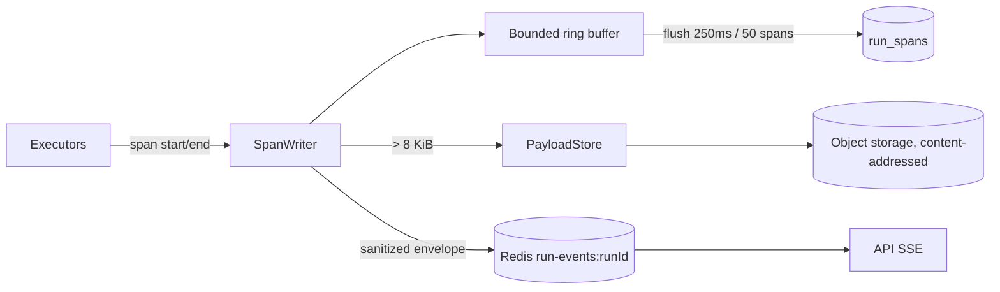
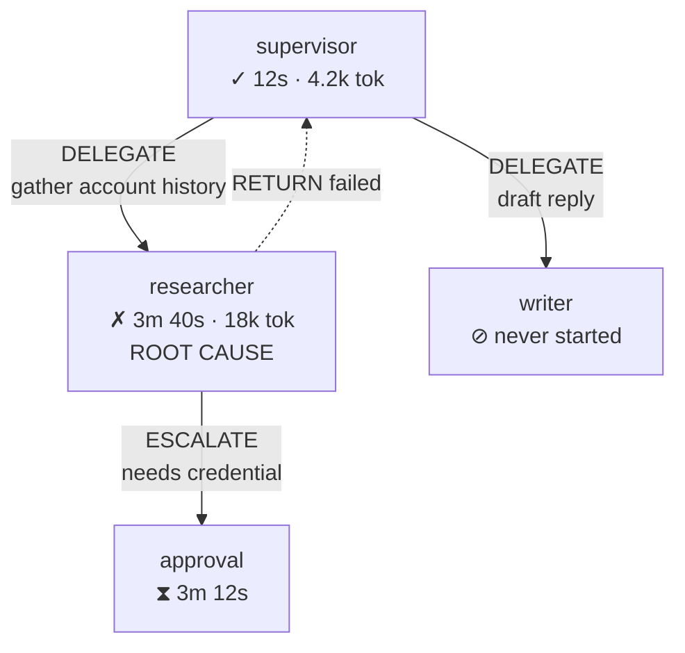

# Agent trace model and the Debug tab

The data model and UI for answering one question: **where did this agent fail,
and why.**

Companion to [AGENT-HARNESS-ARCHITECTURE.md](./AGENT-HARNESS-ARCHITECTURE.md).
Baseline: [AGENT-BRAIN-EXECUTION.md](./AGENT-BRAIN-EXECUTION.md) §8 (events) and
[AGENTIC-WORKFLOW-EXECUTION-FLOW.md](./AGENTIC-WORKFLOW-EXECUTION-FLOW.md) §11.

Status: **proposal**, 2026-08-28.

---

## 1. What the tab must answer

The user is an operations lead, not the engineer who built the workflow. A run
failed at 03:00 and somebody wants to know whether to re-run it, fix a
credential, or call support. Six questions, in the order they get asked:

| # | Question | View that answers it |
|---|---|---|
| 1 | Did it fail, and where? | Run map, one glance |
| 2 | Which agent, and what was it trying to do? | Handoff constellation |
| 3 | What did it call, with what, and what came back? | Iteration inspector |
| 4 | Was this our fault or theirs? | Failure panel + taxonomy |
| 5 | Why did it take four minutes / cost $3? | Timeline + budget burn-down |
| 6 | Will re-running fix it? | Retryability verdict + replay |

Question 4 is the commercial one. "Your CRM credential expired" and "the model
never converged" are different conversations, and a runtime that cannot tell them
apart generates support tickets for both.

### Why the existing event log is not enough

`run_events` is flat, ordered by `sequence`, and correct. But a flat log cannot
express **containment**: that an LLM call happened inside iteration 4, inside the
`researcher` activation, inside the `triage` step. With one agent you can infer
it from ordering. With five agents running concurrently under a supervisor,
interleaved events are unreadable, and inference is guesswork.

The event log stays. A **span tree** is added beside it.

- Spans answer *what contained what*.
- Events answer *what happened when*.
- They share `span_id`, so any event can be located in the tree.

---

## 2. Trace data model

> **The primary key must include `created_at`.** An earlier draft of this schema
> said `span_id uuid PRIMARY KEY` alongside `PARTITION BY RANGE (created_at)`.
> Postgres rejects that outright — *"unique constraint on partitioned table must
> include all partitioning columns"* — so the table could never have been created
> as written. V028 hit the same rule partitioning `run_events` and used
> `PRIMARY KEY (id, created_at)`; its comment at line 238 says so. `span_id` stays
> the leading column, so lookups by span id alone still use the index.
>
> Two consequences, both applied in V041:
>
> - **`run_events.span_id` is a plain `uuid`, not a foreign key.** A foreign key
>   into a partitioned table must include the partition key for the same reason,
>   and V028 already had to drop one over it. Events and spans are joined in the
>   reader.
> - **There is a `DEFAULT` partition**, so a month the maintenance job failed to
>   create costs query speed rather than every span in the flush batch. It must be
>   monitored: `run_spans_default_partition_rows()` should read zero, and a
>   non-zero value is how you learn the job died three weeks ago rather than
>   discovering it in an incident.

```sql
CREATE TABLE run_spans (
  span_id         uuid NOT NULL,
  trace_id        uuid NOT NULL,            -- = run_id of the root run
  run_id          uuid NOT NULL,
  parent_span_id  uuid,
  workspace_id    uuid NOT NULL,

  kind            text NOT NULL,
  name            text NOT NULL,            -- human label: "researcher", "crm.search"
  status          text NOT NULL,            -- ok|error|paused|skipped|cancelled|running

  step_id         text,
  activation_id   uuid,
  iteration_index int,
  attempt         int NOT NULL DEFAULT 1,

  started_at      timestamptz NOT NULL,
  ended_at        timestamptz,
  duration_ms     int,
  self_ms         int,                      -- duration minus time in children

  attributes_json jsonb NOT NULL DEFAULT '{}',   -- sanitized, small, indexed
  input_ref       text,                          -- payload store
  output_ref      text,
  error_json      jsonb,                         -- sanitized
  failure_class   text,
  is_root_cause   boolean NOT NULL DEFAULT false,

  tokens_in       int,
  tokens_out      int,
  cost_cents      numeric(10,4),

  created_at      timestamptz NOT NULL DEFAULT now(),

  PRIMARY KEY (span_id, created_at)          -- partition key must be in the key
) PARTITION BY RANGE (created_at);

CREATE TABLE run_spans_default PARTITION OF run_spans DEFAULT;

CREATE INDEX ON run_spans (trace_id, started_at);
CREATE INDEX ON run_spans (run_id, parent_span_id);
CREATE INDEX ON run_spans (workspace_id, failure_class, created_at DESC)
  WHERE status = 'error';
```

### Span kinds

| Kind | Parent | Emitted by |
|---|---|---|
| `run` | none (or parent `activation` for child runs) | `RunProcessor` |
| `tick` | `run` | `WorkflowRuntime`, one per worker tick |
| `step` | `tick` | `WorkflowRuntime.executeSingleNode` |
| `input_mapping` | `step` | input resolution |
| `activation` | `step`, or the `handoff` that created it | `AgentHarness` / `AgentCallExecutor` |
| `iteration` | `activation` | `AgentBrainRunner` |
| `llm_call` | `iteration` or `step` | `LlmNodeExecutor` |
| `tool_call` | `iteration` or `step` | `ToolNodeExecutor` |
| `handoff` | `activation` | `AgentBrainRunner` (wraps the whole delegation) |
| `approval` | `step`, `activation` or `tool_call` | approval gate |
| `retry` | `step` or `activation` | `executeGuardedWithRetry` |
| `checkpoint` | `tick` | checkpoint writer |
| `wait` | `run` | queue wait, approval parking, timer |

**Which of these are emitted today.** `run`, `tick`, `step`, `wait`, `llm_call`
and `tool_call` since P2; `activation` and `iteration` since P6; `handoff`
since P9. The rest —
`input_mapping`, `handoff`, `approval`, `retry`, `checkpoint` — are the vocabulary
this table reserves, and nothing writes them yet. A reader must not infer from a
trace's absence of `retry` spans that a step was not retried.

**Attributes that explain a thin answer.** Two families are worth knowing about,
because both describe an agent that behaved reasonably given inputs nobody
recorded:

* `context_truncated` / `context_dropped_sections` / `context_over_budget` on an
  `iteration` span — what the context assembler had to drop to fit the prompt. An
  agent that "ignored" an instruction it was never shown is the hardest agent
  failure to diagnose, because the prompt is well formed, the tool worked, and
  the model behaved sensibly given what it got.
* `budget_clamped` / `budget_clamped_dimensions` on an `activation` span — the
  agent was handed less than it asked for because its parent could not afford it.
  In every other artefact this looks exactly like an agent that is bad at its job.

**A delegation's shape.** The `handoff` span covers the WHOLE delegation — the
guards, the gate and the child's execution — so "this delegation took 40 seconds,
38 of them waiting on a gate" is answerable. The child's `activation` span nests
INSIDE it, which gives the constellation view a direct edge-to-node mapping rather
than one inferred by pairing timestamps.

**How an agent's spans find their parent.** Executors resolve their parent from
the node id they already hold, via `RunTracer`'s `nodeId -> spanId` registry — see
`RunTracer.bindNode`. For an agent step that one node id is claimed in turn by the
`step` span, then the `activation`, then each `iteration`, so a model call made in
iteration three parents to iteration three. Before P6 nothing claimed it back from
the step, and every model and tool call an agent made hung flat off the step: a
waterfall could say the step took four seconds but not which iteration spent them.
A `tool_call`'s synthetic node id (`<stepId>:tool:<toolId>`) is bound to the live
iteration for the duration of the call and unbound immediately after, because that
id is reused by every later iteration calling the same tool.

`tick` as a span kind is worth the extra level: it is what makes
"why did my run take 20 minutes of wall clock and 40 seconds of work" answerable
in one look. A run with nine ticks and eight `wait` spans is not slow, it is
yielding, and the UI should say so rather than showing a mysterious gap.

### `wait` spans

Every gap between ticks gets an explicit span with a reason: `queue`,
`approval`, `throttle`, `timer`, `child`, `tenant_admission`. Unexplained gaps in
a waterfall generate more support tickets than errors do, because they look like
the product hanging.

### Attributes

Small, flat, and sanitized. Payloads go to the payload store; attributes carry
what you filter and group by.

```json
{
  "model": "…", "provider": "…", "temperature": 0.2,
  "tool_id": "…", "tool_type": "http", "http_status": 403,
  "agent_id": "…", "agent_role": "worker", "depth": 2,
  "action": "CALL_TOOL", "stop_reason": "ERROR",
  "budget_remaining_pct": 34,
  "context_truncated": true, "context_dropped_sections": ["observations"],
  "recalled": false, "replayed": false
}
```

`context_truncated` earns its place: a silently shortened prompt is one of the
hardest agent failures to diagnose, and surfacing it as a filterable attribute
turns a two-hour investigation into a glance.

---

## 3. Write path

One boundary, same as events today.



Rules, carried over from `RunEventStore` because they are the reason it is
trustworthy:

1. **Sanitization is the caller's job.** `SpanWriter` stores what it is given.
   Raw provider responses, stack traces and secrets never reach it.
2. **Postgres before Pub/Sub.** A missed live update loses nothing; the span is
   already durable.
3. **Never block execution.** The buffer is bounded. Under pressure it drops
   spans and increments a counter that surfaces in the UI as
   "trace incomplete (N spans dropped)". A degraded trace is acceptable; a
   blocked run is not.
4. **No global sequence.** Spans have `parent_span_id` and timestamps, which is
   enough to build the tree. Only the event log needs the sequence lock, and §12.2
   of the architecture doc reduces how often it is taken.

### Payload store

> **`run_payloads` already exists — do not create it.** It shipped in **V040** with
> the agent loop reconstruction work, which needed somewhere to put an observation
> payload before this phase was built. A payload store two features share is the
> whole point of content addressing, so it was pulled forward rather than
> duplicated.
>
> What V040 created, matching the schema below plus a `truncated boolean`:
>
> | Aspect | V040 state | What this phase adds |
> |---|---|---|
> | Content addressing | sha256 of the **redacted** content | — |
> | Redaction + `redactions` | working, from day one | — |
> | `storage` / `object_key` | columns present, only `'inline'` ever written | the object tier |
> | Size ceiling | 64 KiB, truncate above and set `truncated` | 8 KiB inline / object above |
> | `expires_at` | written from workspace `log_retention_days` | — |
> | Reaper | none | deferred to P12 |
>
> **Done in V041:** the inline boundary is now 8 KiB and the object tier exists
> behind `PayloadBlobStore` (`put(key, bytes): String` / `get(key): bytes?` — no
> connection, no transaction handle, so an S3 implementation can satisfy it).
>
> **The object tier is still Postgres.** Bytes above 8 KiB go to
> `run_payload_blobs`, a table separate from `run_payloads` precisely so the two are
> independently swappable — P12 replaces one class and the metadata table does not
> change. Until then, a row reading `storage = 'object'` is **not** off the primary
> database. Do not read that column and assume a bucket.
>
> Still to do here: point span `input_ref` / `output_ref` at the same store.

```sql
CREATE TABLE run_payloads (
  ref          text PRIMARY KEY,        -- sha256 of content
  workspace_id uuid NOT NULL,
  size_bytes   int NOT NULL,
  content_type text NOT NULL,
  storage      text NOT NULL,           -- inline | object
  inline_value jsonb,                   -- when small
  object_key   text,
  redactions   jsonb,                   -- what was masked and why
  expires_at   timestamptz NOT NULL,
  created_at   timestamptz NOT NULL DEFAULT now()
);
```

Content addressing pays for itself immediately: a system prompt identical across
40 iterations is stored once. Redaction happens **before** storage and what was
redacted is recorded, so a user reading a trace sees `[redacted: connection
secret]` rather than a gap they will assume is a bug.

---

## 4. Failure taxonomy

A stop reason is a category, and a category tells nobody what happened to their
run. Every failure gets a class, a plain-language cause, and an owner.

| Class | Typical cause | Owner | Retry helps? |
|---|---|---|---|
| `CONFIG` | No tools granted, bad model id, empty roster | Workflow builder | No |
| `INPUT` | `INPUT_MAPPING_FAILED`, missing upstream field | Workflow builder | No |
| `AUTH` | Expired credential, revoked token, 401 | Workspace admin | No, until fixed |
| `TOOL_FAILURE` | Integration 4xx/5xx, malformed response | Integration owner | Sometimes |
| `MODEL_BEHAVIOR` | `MAX_ITERATIONS`, `SCHEMA_INVALID`, refusal | Agent designer | Rarely |
| `BUDGET` | `BUDGET_EXCEEDED`, `TEAM_BUDGET_EXCEEDED`, ceilings | Operator | Only with a raised limit |
| `POLICY` | Approval rejected, `TOOL_NOT_ALLOWED`, `AGENT_NOT_IN_ROSTER` | Approver / builder | No |
| `ORCHESTRATION` | `HANDOFF_LOOP`, `MAX_DEPTH_EXCEEDED`, `JOIN_DEADLOCK` | Workflow builder | No |
| `TIMEOUT` | Node, tick or provider timeout | Platform + design | Sometimes |
| `INFRA` | Lease loss, worker crash, provider 5xx, DB error | Platform | **Yes** |

The classes map onto the existing stop-reason table, which already draws the
right line: only "the loop broke" is retryable, and everything the loop reached
*by deciding* is not. The taxonomy makes that visible to a non-engineer.

`CeilingExceeded` renders as `BUDGET`, never as an error state, and always names
the breached limit — a run that did what it was asked, more expensively than
allowed, should not look like a crash.

### Root-cause attribution

A failed run has many `error` spans; almost all are propagation. The one that
matters is the deepest span whose error is not caused by a child.

```
1. Start at the failed root span.
2. Walk down through error children.
3. Stop at the deepest error span with no error child.
4. That span is the root cause. Set is_root_cause = true.
5. If it has error siblings (a parallel branch or a wait_all join),
   mark all of them and label the group "N concurrent failures".
```

Computed once, at run terminalisation, and stored — not recomputed per page view.
The UI reads a flag.

The failure panel then reads as one sentence a business user can act on:

> Run failed because the **researcher** agent could not reach **Salesforce**.
> Step `triage` → activation `researcher` (depth 2) → iteration 4 → tool
> `crm.search` returned **HTTP 403: token expired**.
> Class **AUTH** — a workspace admin needs to reconnect Salesforce.
> Retrying now will fail the same way.

---

## 5. The Debug tab

New tab beside the existing run views. Six views over the same trace.

### 5.1 Layout

```
┌──────────────────────────────────────────────────────────────────────────┐
│  Run  #4f21a  ·  Ticket triage v7  ·  FAILED  ·  4m 12s  ·  $0.31        │
│  [Overview] [Agents] [Timeline] [Iterations] [Cost] [Compare]   ⟳ Replay │
├──────────────────────────────────────────────────────────────────────────┤
│ ▼ Root cause                                                             │
│   AUTH · researcher → crm.search · HTTP 403 token expired                │
│   Reconnect Salesforce, then retry.        [Reconnect]  [Retry from here]│
├──────────────────────────────────────────────────────────────────────────┤
│                                                                          │
│                      ( active view renders here )                        │
│                                                                          │
└──────────────────────────────────────────────────────────────────────────┘
```

The root-cause banner is pinned across every view. It is the answer; the views
are the evidence.

### 5.2 Overview — the run map

The workflow DAG, exactly as drawn in the builder, with live status colouring.
Familiarity is the point: the debugger should look like the thing they built.

```
  ┌────────┐   ┌──────────────┐   ┌─────────┐   ┌──────────┐
  │ trigger│──▶│ triage (team)│──▶│ branch  │──▶│ notify   │
  │   ✓    │   │      ✗       │   │  ⊘      │   │    ⊘     │
  │  0.1s  │   │  3m 58s  ▼   │   │ skipped │   │ skipped  │
  └────────┘   └──────┬───────┘   └─────────┘   └──────────┘
                      │ expand
         ┌────────────┴──────────────┐
         │ supervisor ✓ → researcher ✗ → writer ⊘ │
         └───────────────────────────────────────┘
```

- Green ✓ succeeded, red ✗ failed, amber ⧗ waiting, grey ⊘ skipped, blue ▶ running.
- The failing path is bolded; unreached nodes are dimmed rather than hidden, so
  it is obvious *what did not happen*.
- Agent and team nodes carry a ▼ that expands the activation subtree inline.
- Click any node to jump to its span in the other views.

### 5.3 Agents — the handoff constellation

The view that does not exist today and that multi-agent needs most. Nodes are
activations; edges are handoffs, labelled with kind and reason.



What it makes visible in one glance:

- **Depth and fan-out** — a team that went three levels deep when it should have
  gone one.
- **Cycles** — A→B→A rendered as a loop with a hit counter, alongside the
  `HANDOFF_LOOP` guard that stopped it.
- **Blocked branches** — `writer` never started because its sibling failed under
  `wait_all`. This is the most common "why is nothing happening" question and the
  hardest to answer from a log.
- **Cost per agent** — node size scales with tokens, so the expensive member is
  obvious without opening the cost view.

Hovering an edge shows the task contract sent and the output returned — the
delegation's request and response, side by side. When a child returns a shape the
parent could not use, this is where that is legible.

### 5.4 Timeline — waterfall

Every span on a shared time axis, indented by containment.

```
 0s        30s       60s       90s      120s     180s     240s
 ├─────────┼─────────┼─────────┼─────────┼─────────┼─────────┤
 run                 ████████████████████████████████████████
 ├ wait:queue        ██
 ├ tick 1              ██████████
 │ └ step triage       ██████████
 │   └ activation:supervisor ████
 │     ├ iteration 1   ██
 │     │ └ llm_call    █▌
 │     └ iteration 2     ██
 │       └ handoff        ▌
 │   └ activation:researcher ████████
 │     └ iteration 4        ███
 │       └ tool_call crm.search  ██  ✗ 403
 ├ wait:approval             ░░░░░░░░░░░░░░░░░░░░░░░░
 └ tick 2                                            ████
```

- The **critical path** is highlighted: the chain of spans that determined total
  duration. Optimising anything off it is wasted effort.
- `wait` spans render hatched and labelled, so parked time reads as parked rather
  than as a hang.
- Concurrent activations render as genuinely parallel bars, which is how a
  supervisor's fan-out becomes self-explanatory.
- Brush to zoom; click any bar to open it in the inspector.

### 5.5 Iterations — the inspector

The deep view. One activation, its iterations down the left, detail on the right.

```
┌─ researcher ─────────────┬──────────────────────────────────────────────┐
│ ● 1  THINK        1.2s   │  Iteration 4          CALL_TOOL   ✗  2.4s    │
│ ● 2  CALL_TOOL    0.8s ✓ │  ┌────────────────────────────────────────┐  │
│ ● 3  THINK        1.1s   │  │ PROMPT             12,400 chars  [show] │  │
│ ● 4  CALL_TOOL    2.4s ✗ │  │  ⚠ truncated: 3 observations dropped   │  │
│ ○ 5  —      not reached  │  ├────────────────────────────────────────┤  │
│                          │  │ MODEL RESPONSE                  [show] │  │
│ Budget                   │  │ PARSED ACTION                          │  │
│ iterations  4/5  ████░   │  │  { "action": "CALL_TOOL",              │  │
│ tokens     18k/24k ███░  │  │    "toolId": "crm.search",             │  │
│ cost      21¢/40¢  ██░░  │  │    "args": { "accountId": "A-8891" } } │  │
│ time     3m40s/5m  ███░  │  ├────────────────────────────────────────┤  │
│                          │  │ TOOL RESULT                        ✗   │  │
│ [◀ prev]  [next ▶]       │  │  HTTP 403  · 240ms                     │  │
│ [diff 3 ↔ 4]             │  │  { "error": "token expired" }          │  │
│                          │  ├────────────────────────────────────────┤  │
│                          │  │ OBSERVATION RECORDED                   │  │
│                          │  │ MEMORY WRITTEN         (none)          │  │
│                          │  └────────────────────────────────────────┘  │
└──────────────────────────┴──────────────────────────────────────────────┘
```

Design decisions that matter here:

- **Prompt and response collapsed by default.** Expanded, they drown the page;
  hidden entirely, the tab is useless to the person who can actually fix it.
- **The truncation warning sits on the prompt**, where the missing information
  is, not in a separate panel nobody opens.
- **Parsed action shown next to raw response.** When the model emitted something
  unparseable and it was repaired into a `THINK`, that repair is visible rather
  than looking like the model chose to think.
- **Budget gauges are per-activation and live**, so "it ran out of iterations" is
  read, not deduced.
- **`diff 3 ↔ 4`** shows what changed between two iterations' prompts — usually
  the fastest route to "the model never got the data it needed".

### 5.6 Cost — burn-down

Stacked area over run time, one band per activation, with ceiling lines.

```
 cost ¢
  40 ┤─────────────────────────────── ceiling ───────────────
  30 ┤                        ▓▓▓▓▓▓▓▓  researcher
  20 ┤              ▓▓▓▓▓▓▓▓▓▓▓▓▓▓▓▓▓▓
  10 ┤    ░░░░░░░░░░░░░░░░░░░░░░░░░░░░  supervisor
   0 ┼────┴────┴────┴────┴────┴────┴────
     0s        60s       120s      180s
```

Answers "why did this run cost $3" with a name. Toggle between cost, tokens and
iterations on the same axis. A workspace-level roll-up of the same data belongs
in billing, not here, but it is the same query.

### 5.7 Compare

Diff a failed run against a successful one on the same workflow version:
divergence point, which spans exist in one and not the other, and attribute
deltas (different model, different input shape, longer context, more iterations).
"It worked yesterday" is the most common report, and this is the view that
answers it.

---

## 6. Replay and time travel

`REPLAY_RUN` against recorded provider calls already exists. Surfacing it is
mostly UI work over a built capability, and it is the difference between a
debugger and a viewer.

| Action | Behaviour | Side effects |
|---|---|---|
| **Replay run** | Re-execute against recorded provider responses | None — all calls recorded |
| **Replay from iteration** | Restore loop state up to iteration N, then run live | Live from N onward |
| **Replay with edit** | Change the prompt, agent instructions or tool result, then run from that point | Live from the edit |
| **Retry from step** | Existing `RETRY_NODE` | Real |

Replays are marked in the trace (`replayed: true`) and never counted in success
metrics or billed as production runs. Edited replays write to a scratch trace
that can be promoted to a workflow version change if the fix works — which closes
the loop from "found the bug" to "shipped the fix" inside one tab.

"Replay from iteration" depends on durable loop state
([architecture §10](./AGENT-HARNESS-ARCHITECTURE.md)); it is not buildable before
that lands.

---

## 7. API surface

```
GET  /api/runs/{runId}/trace                    → span tree, depth-limited
GET  /api/runs/{runId}/trace/spans/{spanId}     → one span + resolved payloads
GET  /api/runs/{runId}/activations              → activation tree + handoffs
GET  /api/runs/{runId}/activations/{id}/iterations
GET  /api/runs/{runId}/trace/critical-path
GET  /api/runs/{runId}/trace/root-cause
GET  /api/runs/{runId}/compare/{otherRunId}
POST /api/runs/{runId}/replay                   { fromSpanId?, edits? }
GET  /api/runs/{runId}/trace/stream             → SSE, live spans
GET  /api/workspaces/{id}/failures              → taxonomy roll-up, filterable
```

Two rules:

1. **Depth-limited by default.** A wide fan-out trace can be thousands of spans.
   Return the tree to depth 3 with child counts; expand on demand.
2. **Payloads are never inlined in the tree response.** They are fetched per span,
   with a signed URL for object-stored content. A trace response that inlines
   prompts is measured in megabytes.

The live stream reuses the existing pattern: replay durable spans from Postgres
first, then subscribe to Redis, and tell the client to poll if Redis is
unavailable.

---

## 8. Retention and scale

Governed by the same measures as
[architecture §12.1](./AGENT-HARNESS-ARCHITECTURE.md): monthly partitions,
payload offload, content addressing, tiered storage, and sampling that keeps
**every failed run** at full fidelity.

Three UI-specific consequences:

- **Trace completeness is shown, not assumed.** If spans were dropped under
  buffer pressure or the run predates full instrumentation, say so on the page.
- **Sampled successful runs show a reduced trace** with a clear label and an
  option to enable full capture for that workflow going forward.
- **Warm-tier runs load asynchronously.** A 60-day-old trace comes from object
  storage; show a skeleton and stream it in rather than blocking the tab.

---

## 9. OpenTelemetry export

The span kinds map onto OTel spans with GenAI semantic conventions
(`gen_ai.system`, `gen_ai.request.model`, `gen_ai.usage.input_tokens`,
`gen_ai.operation.name`), plus a `vectorbea.*` namespace for activation, handoff,
role and budget attributes.

Worth building early even though nothing depends on it: any business evaluating a
production agent runtime asks whether traces reach the observability stack they
already pay for, and "we export OTel" ends that conversation. It also means the
internal model is validated against an external one before the schema hardens.

---

## 10. Phasing

Matches the architecture doc's phases.

| Phase | Ships |
|---|---|
| **0** | `run_spans`, `run_payloads`, `SpanWriter`, span emission from existing executors, `span_id` on events. No UI |
| **2** | Tab v1: Overview, Timeline, Iterations, failure panel, root-cause attribution, retryability verdict |
| **5** | Tab v2: Agents constellation, Cost burn-down, Compare, replay-from-iteration |
| **6** | Partitioning, tiering, sampling controls, OTel export, workspace failure roll-up |

Phase 2 lands against today's single-agent runs. That is deliberate: the trace
model gets proven on existing traffic, the tab delivers value before multi-agent
exists, and the first team-orchestration bug is diagnosed with a working tool
instead of a log tail.

---

## 11. Success criteria

The tab works if these hold:

1. A non-engineer identifies the failing agent and the reason in **under 30
   seconds**, without opening a payload.
2. Every failed run has exactly one span flagged `is_root_cause` (or one labelled
   concurrent group).
3. Every failure carries a class, an owner and a retryability verdict — no run
   ends at "failed".
4. No unexplained gap in the timeline: every gap is a `wait` span with a reason.
5. Trace overhead stays under **3% of run wall clock** and never blocks a run.
6. Support tickets asking "why did this run fail" fall measurably. That is the
   metric the tab exists for.
