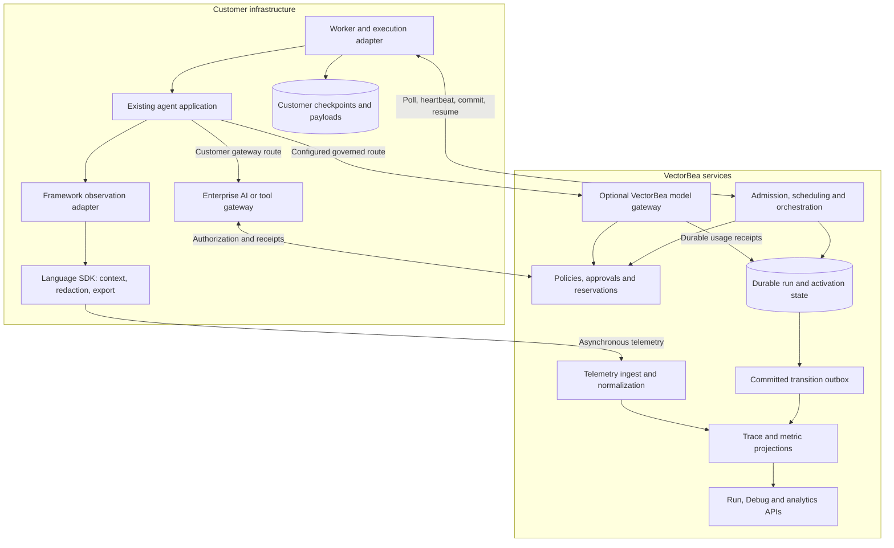

# Framework adapters, agent telemetry and durable multi-agent orchestration

Status: proposed architecture, 2026-09-07. Documentation only; package names, interfaces, protocol operations, metrics and release targets below are proposals unless explicitly identified as existing. Companion to [Execution model decision](EXECUTION-MODEL-DECISION.md).

Revised after independent review: architecture and a narrow LangGraph/Python vertical slice precede framework breadth; spending enforcement moves into that slice; Spring AI/JVM follows to prove cross-framework orchestration. The sequenced implementation instructions and gates are in [CROSS-AGENT-IMPLEMENTATION-PROMPTS.md](CROSS-AGENT-IMPLEMENTATION-PROMPTS.md). That playbook governs implementation order; this document governs the architecture.

## 1. Product contract

**VectorBea should be the common telemetry and orchestration layer for agents written in different frameworks and languages.** Developers retain their agent logic, model clients, tools and deployment environment. VectorBea explains what agents did and, when connected in durable-control mode, decides which managed work may proceed next.

The product should answer agent-specific questions: which specialist was called, why the run was handed off, what context was supplied, where tokens and money went, whether a tool actually succeeded, why a team stalled, and whether recovery can safely continue. Generic HTTP tracing alone does not answer these.

Support has three independently declared dimensions:

| Dimension | Promise | Integration requirement |
|---|---|---|
| Observe | Consistent run, agent, model, tool and collaboration telemetry for available framework hooks. | Install a language SDK/framework integration or export compatible OpenTelemetry. No worker deployment required. |
| Control | VectorBea durably authorizes and resumes supported execution boundaries. | Register an agent version, run a worker and use a certified execution adapter. |
| Govern spending/effects | Reject covered resource use before it happens. | An enforced model/tool gateway or customer resource policy; SDK callbacks alone are insufficient. |

These are not interchangeable. An adapter can observe every model call while supporting recovery only at the whole-agent boundary. A gateway can cap model spending for an observed agent without controlling that agent's scheduling. Preserve these distinctions in onboarding, the SDK capability response, run details and pricing.

“All major frameworks” means an extensible compatibility programme with explicit tested versions and capabilities, not a universal adapter that understands every Python object or JVM call stack. Unknown frameworks get generic function/model/tool telemetry and a custom adapter API. Hidden state, unsupported versions and missing usage remain visibly unknown, never invented or converted to zero.

## 2. System layout

The gateway routes in the diagram are alternatives configured per model/resource route. Direct-key calls can also exist, with advisory cost coverage. Observation does not require the control-plane request path. Both execution locations, including a future hosted worker, emit the same agent semantics.

Keep three reliability paths:

1. **Control and financial records:** committed state transitions, approvals, activation identities, reservations, settlements and idempotency. Durable before acknowledging progress; fail closed when the required authority is unavailable.
2. **Run diagnostic telemetry:** detailed spans, safe events, logs and payload references. Batched asynchronously with bounded memory, optional disk buffering and explicit loss accounting. Diagnostic overload must not block observed applications.
3. **VectorBea platform operations:** service saturation, database health, worker queues and exporter health. These monitor our service, separately from customer agent performance and product analytics.

Billing and policy enforcement never read sampled spans as their source of truth. A missing trace must degrade Debug, not erase a charge or release a budget reservation.

## 3. Adapter architecture: two contracts and one shared SDK

### Language SDKs

Build a language-neutral, versioned wire contract, implemented first in Python, then JVM, then TypeScript. Validate the contract using Python fixtures before replicating it. Keep framework dependencies in optional adapter packages; installing the base SDK must not install LangGraph, CrewAI and AutoGen together or force incompatible transitive versions.

The shared SDK owns identity and context propagation, safe attributes, payload policy, monotonic timing, local batching/spooling, retries and event IDs, provider request correlation, capability negotiation and exporter configuration. It must coexist with a customer's configured OpenTelemetry provider/exporter rather than replacing global configuration.

Proposed distribution: a Python core with framework extras, a Spring Boot starter plus JVM core, and a TypeScript core with separate integrations. These are release artifacts to create later, not packages claimed to exist today.

### Observation adapter

The adapter translates framework events into common semantic records:

| Responsibility | What it translates |
|---|---|
| Run lifecycle | Invocation start/end, stream cancellation, exception and incomplete process termination. |
| Agent lifecycle | Agent identity/version/role, activation start/end and explicitly exposed iteration or turn boundaries. |
| Model activity | Request and response metadata, streaming timing, usage, finish reason, retry/fallback and provider request IDs. |
| Tool/retrieval activity | Tool name/version, arguments/result references, outcome, retrieval timing and document references when allowed. |
| Collaboration | Delegation, handoff, agent messages, selection, joins and termination signals where hooks expose them. |
| Framework state | Checkpoint/interrupt notifications, namespace and safe state-change summaries; not arbitrary object serialization. |

Use public callbacks, middleware, event buses and OTel/Micrometer first. Narrow, version-pinned wrapping is a last resort with regression fixtures, not an unbounded global monkey-patching strategy. Installing instrumentation twice must not create two activations or two model charges.

Observed events are assertions from the application. A callback error must be contained; a policy adapter error in strict mode must refuse the protected action. Do not reuse the observation callback's fail-open error handling for authorization.

### Execution adapter

The execution adapter makes a declared unit of customer work callable by the existing executor boundary. It must specify:

| Operation | Required meaning |
|---|---|
| Describe/register | Agent reference, immutable code/config version, framework/version, input/output schemas, state schema and supported capabilities. |
| Prepare | Resolve code locally, load an approved checkpoint, verify compatibility and hydrate authorized inputs. Never execute customer code inside the control plane. |
| Advance | Execute only the granted segment and produce a completed result, continuation proposal, child call, approval wait, timer wait or classified failure. |
| Snapshot | Persist sufficient framework state and pending-work identity to restart at the advertised boundary. Return an immutable reference, schema/version and digest. |
| Restore | Load the committed checkpoint; reject absent, incompatible or corrupted state rather than silently starting fresh. |
| Cancel/drain | Stop claiming work, honor bounded cancellation where supported, and report uncertain effects. Cancellation is cooperative on customer compute. |
| Reconcile | Determine an external operation's result when a worker failed after dispatch; otherwise return unknown and require operator policy. |

Each registration advertises observation depth, execution granularity, checkpoint support, interrupt support, cancellation semantics, external-effect idempotency, gateway coverage and supported protocol versions. In strict C, reject an unsupported contract before run admission. In B, continue with reduced telemetry capability and a visible warning.

### Framework adapters and initial support scope

The following is an implementation plan grounded in public extension points, not a claim that these integrations already ship. Python and JavaScript editions are separately tested; frameworks sharing a brand do not necessarily share APIs.

| Framework | Observation integration | First controlled unit | Deeper integration and limit |
|---|---|---|---|
| LangGraph | Run/node/subgraph events, model/tool integration, checkpoint and interrupt metadata. | Certified graph segment or super-step; whole invocation fallback. | Preserve parallel super-step, reducer and subgraph namespace semantics. A checkpointer alone does not prevent the next node from executing. Certify a stop/commit/resume boundary; reject unsupported dynamic constructs in fine-grained mode. |
| LangChain | Runnable callbacks and agent middleware for agent/model/tool activity. | Runnable invocation; LangGraph-backed agents can use the matching graph adapter. | A chain callback is observation, not restartable state. Do not instrument underlying model calls twice through LangChain and LangGraph. |
| Spring AI | Micrometer observations, ChatClient/Advisor/model/tool hooks, Reactor-aware context. | Explicit application-defined agent operation handled by a JVM worker; outer orchestration only in the first release. | A ChatClient is not automatically a durable workflow. Do not require customer-written continuation codecs for onboarding or advertise JVM stack recovery. Arbitrary inner operations restart only under their declared retry/idempotency policy. |
| CrewAI | Event listeners for crews, tasks, agents, tools and model operations. | Crew invocation first; certified Flow or crew checkpoint boundaries next. | Map native state/checkpoint facilities where supported, and verify scheduling, pending tasks and external effects separately. Event delivery and saved state alone do not establish authorized execution. |
| AutoGen | Native OTel plus agent/message/team hooks and model-client usage. | Agent/team invocation, then certified turn/message boundaries. | AgentChat state and Core runtime messaging require distinct adapters. Saving agent/team state is not an atomic snapshot of all in-flight messages or side effects. |
| Other frameworks/runtimes | First-class OTel import, with optional generic agent/tool wrapper and enrichment hooks. | Whole invocation or a customer-supplied execution contract. | Add LlamaIndex, Semantic Kernel, PydanticAI and other integrations by demand and certification; do not advertise identical capabilities before testing them. |

Relevant framework facts: LangGraph distinguishes thread checkpoints from cross-thread stores ([persistence](https://docs.langchain.com/oss/python/langgraph/persistence)); LangChain middleware wraps agent model/tool steps and its current agent factory is LangGraph-backed ([middleware](https://docs.langchain.com/oss/python/langchain/middleware/overview)). Spring AI exposes Micrometer observations across its AI components and separates high-cardinality trace fields from metric labels ([observability](https://docs.spring.io/spring-ai/reference/observability/index.html)). CrewAI exposes an event bus, Flow persistence and crew checkpoint documentation ([events](https://docs.crewai.com/en/concepts/event-listener), [Flows](https://docs.crewai.com/en/concepts/flows), [checkpointing](https://docs.crewai.com/en/concepts/checkpointing)). AutoGen documents native OTel and explicit agent/team state management ([telemetry](https://microsoft.github.io/autogen/stable/user-guide/core-user-guide/framework/telemetry.html), [state](https://microsoft.github.io/autogen/stable/user-guide/agentchat-user-guide/tutorial/state.html)). References checked 2026-09-07; pin exact library versions during adapter certification.

### Compatibility operations

OTLP plus versioned GenAI/VectorBea mappings is a primary observation interface for every supported language, not a last-resort transport. Frameworks with sufficient native OTel need only export configuration and a capability report. OTel does not substitute for authenticated control commands or committed financial records.

Publish three support classes: certified (tested versions and explicit capabilities), community (reviewed, best-effort observation), and generic OTel (validated transport and best-effort semantic coverage). All three need ingest security and schema maintenance; none is maintenance-free. Certification belongs to a version/capability tuple, not a framework logo.

An integration maintainer owns CI on every adapter change, a scheduled weekly upstream compatibility check, and a release candidate certification run. Exact initial library versions are selected and locked in the architecture feasibility phase. Do not promise a three-version matrix automatically. Unsupported upgrades never downgrade an active controlled run to community execution: deny new incompatible admissions, pin working versions and park incompatible resumptions. An observation-only fallback is a separately selected mode. Publish affected capabilities, known issues, remediation and deprecation dates.

## 4. One execution owner per scope

Do not translate every framework into a new universal graph interpreter. That loses native scheduling, reducers, message semantics and version compatibility. Standardize durable boundaries and observable events instead.

There are two valid C arrangements:

- **Outer orchestration:** VectorBea controls whole agent/crew/team invocations and cross-framework delegation. The native framework schedules inside an invocation. We observe its internal activity but only claim durability and approval gates at the outer boundary.
- **Certified fine-grained orchestration:** the framework proposes ready work and its continuation, then stops at a supported boundary. VectorBea commits and authorizes the next segment. The adapter interprets framework-local state; VectorBea owns the authoritative checkpoint reference, policy decisions and authorization sequence.

The framework cannot independently resume a scope advertised as VectorBea-controlled. Existing native schedulers must either yield to the controlled adapter or remain an explicitly observational inner scope. For LangGraph, a parallel super-step may be the natural boundary, rather than pretending every individual node is independently committable. For a message runtime, a committed message/turn boundary may be appropriate. If hooks cannot prevent advance, offer outer orchestration, not simulated fine-grained control.

Opaque code can propose branch labels and continuations, but VectorBea cannot independently verify hidden business logic. It can enforce allowed targets, schema, limits, approvals and sequence. The worker's claims remain untrusted inputs to those checks.

This preserves plug-and-play observation while making controlled integration honest. A compatibility report should say, for example: “Observed: agents, models, tools and handoffs. Controlled: crew invocation. Recovery: crew checkpoint. Inner tool approvals: not enforced.”

## 5. Common agent model and causal identity

Use a common vocabulary with namespaced framework extensions. Preserve native IDs and versions for debugging; normalize meaning without flattening every framework into an LLM call.

| Entity | Meaning |
|---|---|
| Agent definition/version | Reusable identity and immutable deployment configuration; separate from one execution. |
| Session/conversation | Optional relationship across runs. It is not the billing or retry identity. |
| Run | One logical top-level invocation, stable across pauses and recovery. |
| Step/segment | One controlled unit, possibly containing many observed framework nodes. |
| Activation | One agent's participation, with parent/root activation, role and target version. Repeated invocations create distinct activations. |
| Attempt | One physical execution of a logical step/activation. Retry adds an attempt, not another logical admission. |
| Turn/iteration | A framework-exposed iteration. Mark unavailable when the framework does not expose it; do not infer it from token chunks. |
| Model/tool operation | A logical requested operation, with separate actual provider/tool attempts and external request IDs. |
| Delegation/handoff | A relationship between activations; distinguish call-and-return, ownership transfer and broadcast. |
| Message | Producer, recipients/topic, correlation/reply identity and delivery attempts. Broadcast creates multiple delivery records. |
| Checkpoint | Versioned continuation reference and its committed control sequence. |
| Policy/approval/usage receipt | Decision identity, scope, source and version; linked to the affected operation. |
| Evaluation | Explicitly measured quality or business outcome, with evaluator version and evidence coverage. |

The trace containment hierarchy is run → segment attempt → activation → iteration → model/tool/retrieval operation. Use parent-child relationships for containment and span links/message edges for causality across handoffs, queues, fan-in and long-lived sessions. A multi-agent conversation is a graph; forcing all communication into a single parent tree loses joins and broadcasts.

Carry workspace/environment, run/root-run, activation/root-activation, logical-step/attempt, framework/version, worker/deployment, event ID, schema version, occurrence/receipt time and source. Workers also carry a fenced lease identity on the control channel; never export bearer tokens or secrets as telemetry attributes.

Use W3C trace context across HTTP and message transports, with language-specific async context propagation: Python tasks/context variables, JVM coroutines/Reactor/executors and TypeScript async tasks. Baggage is allowlisted, size-capped and not a place for prompts, keys or tenant authorization. The server derives tenant scope from credentials, not client-supplied span attributes.

External OTel trace/span IDs are not interchangeable with internal database UUIDs. Preserve their exact 128-bit trace and 64-bit span identities in an explicit mapping. Current internal UUID span IDs remain backward compatible; do not truncate or fabricate parentage. Long-lived runs may have several linked physical traces for separate execution segments; the run/activation graph unifies them without keeping one exporter span open for days.

For parallel activity, use invocation/activation/attempt identity rather than only a node name. Two simultaneous calls to the same agent or tool must not overwrite each other's parent context.

## 6. Durable worker protocol and metric production

The worker needs only outbound HTTPS; long polling supports ordinary private deployments. Control endpoints and telemetry endpoints have different credentials, capacity limits and failure behavior. Proposed protocol operations are registration, poll, heartbeat, commit, reconciliation, cancellation acknowledgement and drain. Budget held connections per worker process rather than per execution slot, cap concurrent polls by worker and tenant, configure proxy idle timeouts, and use jittered reconnect/backoff. A parked HTTP poll must not hold a database connection or transaction. Load-test the chosen connection ceiling before expanding a cohort.

One managed segment proceeds as follows:

1. Admission authenticates the caller, resolves workspace billing-account entitlements, applies an idempotency key and durably creates the run. Record admission outcome and schedule-to-ready time.
2. A worker advertises supported agent/code/adapter versions and capacity. Polling returns an authorized work item containing logical IDs, attempt/lease generation, expiry, policy version, approved input/checkpoint references and bounded work allowance. Record queue and dispatch latency.
3. The adapter hydrates local state and begins the segment. It emits diagnostic activation/model/tool spans asynchronously. Record preparation latency separately from execution.
4. Model/tool authorization uses the configured gateway path. Record reservation, denial, provider dispatch, usage and settlement independently of span export. Direct calls carry reported/estimated usage instead.
5. The worker persists an immutable checkpoint/output artifact before reporting completion. It reports the checkpoint digest/reference, outcome, continuation proposal, stable child/message identities and usage receipts with a report idempotency key.
6. The server validates lease/attempt, policy and allowed transition. In one transaction it commits control state, checkpoint pointer, authoritative records and an outbox entry. It acknowledges the committed sequence and may return the next authorized segment, avoiding another poll RTT.
7. Partitioned outbox consumers project run timelines, operation facts, rollups and live updates. Preserve order within a run/aggregate using committed sequence and deduplicated application, not a global serial consumer. Poison records are isolated and surfaced without blocking unrelated tenants; financial truth remains in the ledger. Detailed spans may arrive before or after this projection; the read model merges by identity and source without allowing late telemetry to overwrite authoritative status.

A crash after artifact upload but before commit leaves an orphan artifact for delayed cleanup. A crash after server commit but before acknowledgement causes a repeat report, returning the same decision. Never authorize dependent work before commit. Garbage collection must check committed references and live leases, so it cannot delete a checkpoint during an in-flight commit.

Leases fence state reports and protected requests; they do not kill remote threads. A worker lost mid-effect creates an uncertain attempt. Reconcile or use destination-enforced idempotency before retry. Every genuinely executed provider retry can cost money even if the logical step was already counted once.

Use the outage defaults from the execution decision: an hour without workers parks the run within its deadline, with no execution-minute charge for the wait. Keep pending-run storage/capacity separate from active-worker capacity. Show wait reason explicitly: worker absence, approval, child join, timer, budget or rate limit.

## 7. Multi-agent orchestration across frameworks

Keep one activation scheduler and policy model, with native and external executors. Do not build separate CrewAI, LangGraph and Spring schedulers in the backend.

The agent registry maps a logical agent/version to its framework, worker queue, schemas, capabilities, data policy, allowed peers and tools. A parent selects only registered/granted peers. Child input/output uses typed portable values or authorized artifact references, not Python objects, Java classes or serialized executable closures.

Support these primitives:

| Primitive | Execution semantics | Telemetry |
|---|---|---|
| Call/delegate | Parent creates a child and waits for its result, releasing its execution slot. | Parent-child activation edge, allocation, queue/start/end and returned status. |
| Handoff | Transfer responsibility to a target agent with a durable accepted transition. | Transfer edge, previous/next owner, context reference and reason if explicitly supplied. |
| Fan-out/join | Durable child set; all/any/quorum policy pinned before execution. | Branch states, critical-path delay, useful work, loser cancellation and incurred cost. |
| Message | Durable producer/recipient identity with at-least-once delivery and inbox deduplication. | Send/receive/process spans linked by message ID, delivery latency and attempt count. |
| Review/critic | Another activation returns an explicit verdict; the orchestrator applies a bounded continuation policy. | Review score/verdict, evaluator identity, iterations and rework. |
| Shared context | Versioned entries/artifacts with scoped reads/writes and explicit merge/CAS policy. | Read/write/version references, truncation, size and conflicts; content is optional. |

An approval-gated call must reserve its activation identity durably without dispatching its protected work. Retries must not create another sibling. Join completion and parent wakeup must be deduplicated. A join cannot hold all worker slots while its children wait for slots: parked parents release capacity, and queue fairness limits one tenant's fan-out.

Hierarchical budgets reserve child allocations before concurrent dispatch. Allocate from account/workspace/run/parent pools without multiplying the parent's unspent balance. Settle unused allocations, retain uncertain spend reservations and include real retry costs. Bound depth, active children, messages, turns, total activations and cumulative cost; depth alone cannot stop endless handoffs at one level.

Cross-framework example: a LangGraph supervisor delegates research to a CrewAI worker and account validation to a Spring AI service; an AutoGen reviewer evaluates their outputs. VectorBea owns the outer activation DAG, joins, shared budget and final approval. Each framework keeps its local execution semantics. With observation-only inner adapters, the UI shows detailed local activity but labels control at invocation boundaries. Certified adapters can expose finer boundaries later without changing the outer orchestration contract.

Cross-workspace delegation is denied by default. Any future sharing requires an explicit trust grant, input data policy and billing attribution; neither a trace ID nor an agent name grants access. Termination/cancellation cascades according to policy, while already-committed external effects and incurred costs remain visible.

## 8. Agent metric catalogue and the meaning of each number

Metrics come from a versioned catalogue defining type, unit, scope, denominator, source, completeness, dimensions and retention. Separate logical operations from physical attempts. Store seconds, bytes, token counts and precise decimal currency values internally; format for users at read time.

The following are proposed metric families. Names are conceptual rather than a shipped wire schema.

| Family | Measurements | Source and limitation |
|---|---|---|
| Runs | Admitted/completed/failed/cancelled/timed-out counts; end-to-end latency; active duration; wait by reason; throughput. | C transitions are authoritative. B lifecycle events can be incomplete. Report admission and completion cohorts separately. |
| Agents | Activations, outcomes, active time, turns/iterations, stop reasons, model/tool calls, repeat loops and per-agent cost. | Adapter lifecycle plus C activation state; unavailable turn hooks mean unknown iteration count. |
| Models | Calls and attempts, input/output/cache/reasoning tokens, total latency, time to first token, generation duration, streaming throughput, rate limits, retries, fallback and finish reason. | Provider/gateway usage preferred. Cached/reasoning fields may be subsets of other counts; apply provider-specific accounting to avoid double addition. |
| Money | Reserved/settled/released/uncertain amounts; direct estimated cost; cost per run/agent/model/tool; retry and abandoned-branch spend. | Financial receipts and versioned price catalogues; model tokens alone do not price arbitrary tools, taxes or customer infrastructure. |
| Tools/MCP | Logical calls, attempts, duration, transport errors, domain errors, validation failures, approval waits and uncertain effects. | Tool/MCP hooks plus gateway records. HTTP 200 is not proof that the business operation succeeded. |
| Retrieval/memory | Embedding usage, retrieval latency, hits/misses, returned document count, context tokens, truncation, memory reads/writes and conflicts. | Adapter hooks; relevance and recall need evaluation labels, not latency data. |
| Collaboration | Delegations, handoffs, message deliveries, fan-out width, maximum active children, join wait, depth, transfers, repeated cycles and failed descendants. | C graph where managed; framework events elsewhere. Native role and topology information may be partial. |
| Reliability | Attempts per operation, recovery success, checkpoint latency/age/bytes, lease expiry, dead letters, duplicate reports, uncertain effects and cancellation lag. | Control transitions plus worker observations. A retried run and a newly admitted run are different. |
| Governance | Approval requested/approved/denied/expired, decision latency, entitlement refusals, budget denials, held reservations and governed usage coverage. | Policy/ledger records; report evaluated, allowed and denied separately. |
| Workers | Capacity, active leases, heartbeat age, queue age, version mismatch, hydration time, CPU/memory and exporter backlog. | Lease/capacity data plus optional runtime/collector metrics. Shared-process CPU cannot automatically be attributed to a particular concurrent agent. |
| Quality/business outcomes | Task acceptance, rubric scores, schema validity, user feedback, escalation, hallucination/grounding evaluations and cost per accepted outcome. | Explicit validators, human labels or versioned evaluators; quality is not inferred from a successful process exit. |
| Telemetry health | Export failures/drops, duplicate records, orphan spans, unknown usage, late data, clock uncertainty, sampling and ingest lag. | SDK/collector/ingest accounting. Coverage itself is part of the product. |

### Essential calculation rules

- Run elapsed time is terminal time minus admission time. Active wall time is the union of execution intervals; agent effort is the sum of individual agent execution time and can exceed elapsed time during parallelism. Waiting for children/approval is not active compute.
- Exclusive span time subtracts the union of overlapping child intervals within the parent, not the sum of child durations. Clamp/flag clock inconsistencies rather than generating negative or misleading self time. Use local monotonic durations and causal ordering across hosts; wall clocks alone do not establish causality.
- Provider time to first token is first content arrival minus provider-call start. User-visible time to first token includes queue/admission and preparation. Display both and define whether reasoning/non-content chunks count. Tokens per second uses a declared output-token count and generation interval; omit it when either is unknown.
- Run/model cost is the sum of unique billable leaf attempts. Framework wrapper spans and parent activations are rollups, not additional charges. A LangChain callback, a provider instrumentor and a gateway receipt for the same request are three views of one attempt.
- Gateway receipts supersede matching client usage for the same attempt; provider-returned client usage supersedes tokenizer estimates for advisory analytics. Keep both evidence records and the reconciliation reason. Do not deduplicate by prompt text or a loose time window; two identical requests may both be real charges.
- Material gateway/client discrepancies trigger reconciliation alerts by provider, model and integration version. Distinguish expected tokenization/rounding differences from systematic mapping defects. Never resolve an uncertain charge by silently writing zero; a pricing or billing incident needs an audited correction and owner.
- Success rate must name its denominator, for example successful terminal runs divided by terminal runs in the selected completion window. Show cancelled/unknown separately and expose exclusion rules. A completed agent is not necessarily a successful business task.
- Cost per successful outcome can mean all cohort spend divided by accepted outcomes, or spend on accepted runs divided by their count. Offer explicit labels rather than silently switching definitions. Zero accepted outcomes produces unavailable, not zero cost.
- Aggregate percentiles from histograms or underlying observations, never average p95s from individual workers. Show sample size and whether a distribution is sampled.
- Chargeable execution minutes must follow the plan's documented policy and source trust. Worker-reported activity is not independent proof of customer compute consumption. Polls, approval waits and fleet downtime do not become billable agent minutes.

Each displayed measurement carries source (control plane, gateway, provider-reported via worker, framework, estimate or evaluator), coverage (complete in its declared managed scope, partial, sampled or unavailable), and freshness. Even unsampled B telemetry cannot prove that off-path calls did not occur. A gateway signature authenticates its receipt, not all activity in the customer's infrastructure.

Keep high-cardinality run IDs, prompt text, message IDs and arbitrary tool names out of shared Prometheus metric labels. Use bounded operational dimensions such as framework, operation kind, normalized provider/model, outcome and region; tenant/agent/version drill-down belongs in access-controlled fact tables or deliberately bounded tenant analytics. Do not compute long-term financial totals by integrating a scraped counter that can reset or miss scrapes.

## 9. Data flow, storage and query architecture

Start with the existing stack and clear logical boundaries, rather than requiring a new streaming platform and analytics database on day one.

| Store/path | Responsibility |
|---|---|
| Postgres control state | Runs, steps, activations, leases, checkpoint pointers, approvals, reservations, settlements and idempotency. Strong consistency for decisions. |
| Transactional outbox | Publish committed lifecycle/financial changes without a database-write/message-publish gap. Consumers are idempotent and replayable. |
| Tenant telemetry ingest | Authenticate OTLP/native envelopes, constrain sizes/rates, sanitize, normalize schemas and deduplicate by source identity. Never accept client tenant labels as authorization. |
| Run spans/events and operation facts | Debug details plus normalized agent/model/tool/relationship records. Separate from internal product-analytics events. |
| Rollups | Versioned agent/run/cost/latency summaries by time bucket and approved dimensions. Rebuild from durable facts; late data applies idempotent revisions. |
| Object storage/customer store | Payloads, large artifacts and checkpoint state under the workspace policy. DB rows hold immutable references and metadata. |
| Prometheus/Tempo/OTel export | Service operation metrics and tracing interoperability; these do not become the financial system of record. |
| Query API and live stream | Tenant-checked run graph, traces, metrics, approvals and coverage. Resumable live cursors read persisted events after reconnect. |

Use partitioned Postgres for initial telemetry/facts and bounded rollups, with resource limits or a separate telemetry database/pool to protect control-plane transactions. Keep an interface that can later project high-volume facts into a columnar store such as ClickHouse when measured retention/query/write requirements justify it. This is a possible deployment evolution, not a new mandatory dependency.

Internal graph/event schemas and OTel transport schemas evolve independently through versioned mappings. Reuse recognized GenAI conventions for agent/model/tool spans; keep VectorBea-specific policy, handoff and durability attributes under a namespace. Pin the semantic-convention version and preserve framework-specific fields. The OTel documentation currently points to a separate maintained GenAI conventions repository, reinforcing the need for a versioned mapping instead of assumptions that field names never change ([OTel GenAI documentation](https://opentelemetry.io/docs/specs/semconv/gen-ai/)).

For B, optional unsampled operation summaries support better analytics than sampled detail, but remain client-reported and can be lost. For C, lifecycle summaries derive from committed transitions; gateway summaries derive from receipts. Once a record is durably acknowledged at ingest, retries must not duplicate it. Before acknowledgement, bounded exporter buffers may lose data on crash; document that boundary.

Preserve producer occurrence time, receipt time and producer-local sequence. C gets an authoritative transition order, while distributed B events get only causal/partial order. Accept late spans and missing parents without fabricating success. Bounded reordering/watermarks mark analytics provisional until reconciled; run completion can be final before its trace is complete.

Protect normalizers against untrusted payloads, decompression bombs, oversized attributes, log injection and pathological fan-out. Tenant retention/deletion applies to replicas, rollups, exports and object references according to declared policy. Derived metrics must not resurrect deleted sensitive payloads.

## 10. Data boundary and Debug experience

Retain the execution decision's workspace choices: metadata-only by default for external workers, locally redacted payloads, full payload opt-in, or customer-held payloads. Retention and access rights are separate for diagnostic payloads, live recovery state and financial/audit records.

The SDK applies an allowlist before upload, including safe error handling; raw exceptions can contain prompts or credentials. The gateway honors the same persistence policy but still processes payloads transiently. “Not stored” and “never sent to VectorBea” remain distinct settings/contracts. Customer-gateway and customer-storage integration enables the latter for payloads, while minimal control metadata still reaches us.

Debug should provide:

| View | What it explains |
|---|---|
| Run overview | Outcome, total/active/wait time, cost, quality verdict and coverage summary. |
| Agent graph | Which agents participated, across frameworks; delegation, handoff, message and join edges. |
| Timeline | Worker queue, actual execution, model latency, tool activity, approvals, retries and recovery. |
| Activation inspector | Role/version, turns, input/output references, context changes, termination and child results. |
| Cost tree | Direct versus descendant spend, model/tool attempts, reserved versus settled, retry spend and unknown amounts. |
| Failure/recovery panel | Observed failure, classified cause, uncertain effects, safe retry boundary and compatible worker availability. |
| Policy history | Who approved which immutable action, which budget/entitlement decision applied, and whether the path was enforced. |
| Comparison/evaluations | Versioned behaviour and outcome comparisons with sample size, dataset and evaluator provenance. |

Metadata-only mode still supports topology, timing, counts, failures and policy/cost evidence, but cannot explain a bad answer's semantic content. The UI states “payload not captured” or “customer storage unavailable,” never presents blank content as if an agent saw no input. Expose submitted decisions and tool evidence; do not promise access to private model chain-of-thought.

Distinguish recorded playback, deterministic framework continuation and fresh rerun. Playback creates no model/tool effects. Continuing from a checkpoint may execute new effects. A new run can have different model outputs and costs. Each operation needs its own permission and billing semantics.

## 11. Sampling, overhead and latency

Observation should be asynchronous and local by default. Measure a baseline before setting release thresholds for hook overhead, application slowdown and telemetry freshness. Separate small metadata-only hooks, redaction/payload work, streaming and concurrency in Python/JVM benchmarks. The previous 1 ms p95 hook and 2% median slowdown figures are research hypotheses, not release promises. Record hardware, workload, sampling, payload policy and p50/p95/p99 before deciding acceptable overhead with pilot customers.

Start with bounded batches of approximately 100 records or a 250 ms flush interval, whichever occurs first, and an explicit byte cap. Benchmark before choosing defaults. Use bounded encrypted disk spool only when allowed by customer policy. Drop optional debug/token-detail events first, count losses, and avoid emitting a network event per streamed token. Keep content chunks optional and aggregate stream timing/counters.

Unsampled control/financial facts are independent of detail sampling. Tail sampling may retain errors, slow runs and selected examples, but its own buffer can overflow; never use it to claim guaranteed diagnostic retention. Exporter outage in B does not stop the agent. Gateway/authorization outage in strict C prevents new protected requests. Long-lived runs export completed segments and periodic summaries rather than waiting until the entire run ends.

For control overhead, reuse N × (RTT + commit/policy + dispatch delay). Twenty sequential boundaries at 75 ms RTT plus 5 ms commit overhead add about 1.6 seconds before queueing. Four safe local segments reduce that to about 320 ms. Batch only cheap, bounded, side-effect-free work; preserve approval/model/tool boundaries. Use completion-and-next-work responses, long polling and region-aware placement. Do not use speculative prefetch to execute work whose authorization depends on uncommitted results.

Capacity planning needs distributions, not a single eight-spans-per-segment example. At 100k runs/month and an assumed 1 KiB/span: 160 spans/run is about 15 GiB raw; 1,000 is about 95 GiB; 10,000 is about 954 GiB. These are light/medium/heavy scenarios, not measured percentiles. Count events, payload bytes, indexes, replication, backups and exports separately. The earlier harness estimate of 50–200 times deterministic-workflow event volume uses a different unit; measure both events and spans on the same fixtures to reconcile it. Benchmark peak ingest and tenant bursts, not monthly average alone. Do not set free-tier retention or margins from these unvalidated scenarios.

## 12. Existing components to reuse and gaps to close

The repository has valuable foundations, but the old architecture documents mix proposals and implementation notes. Source and focused certification tests should decide what is shipped.

| Existing source/evidence | Architecture role | Required extension |
|---|---|---|
| [RunTracer](../apps/worker-kotlin/src/main/kotlin/com/vectorbea/worker/events/RunTracer.kt) | In-process run/activation span relationships. | Explicit distributed context and per-invocation identity for external concurrent work. |
| [SpanWriter](../apps/worker-kotlin/src/main/kotlin/com/vectorbea/worker/events/SpanWriter.kt) | Bounded asynchronous diagnostic writes, with drop accounting. | External ingest and safe normalization; do not route mandatory financial/control facts through this lossy path. |
| [OtelSpanMapper](../apps/worker-kotlin/src/main/kotlin/com/vectorbea/worker/events/otel/OtelSpanMapper.kt) | Export internal durable trace representations. | Bidirectional, versioned external mappings and span links. Existing export is not automatically an OTLP ingestion product. |
| [AgentHarness](../apps/worker-kotlin/src/main/kotlin/com/vectorbea/worker/agents/orchestration/AgentHarness.kt), [OrchestrationLoop](../apps/worker-kotlin/src/main/kotlin/com/vectorbea/worker/agents/orchestration/OrchestrationLoop.kt), [AgentCallExecutor](../apps/worker-kotlin/src/main/kotlin/com/vectorbea/worker/runtime/executor/AgentCallExecutor.kt) | Activation lifecycle and shared orchestration concepts. | Register external executor targets behind the same boundary; preserve one decision owner per scope. |
| [RunLeaseManager](../apps/worker-kotlin/src/main/kotlin/com/vectorbea/worker/durable/RunLeaseManager.kt), [ActivationStore](../apps/worker-kotlin/src/main/kotlin/com/vectorbea/worker/agents/orchestration/ActivationStore.kt), [BudgetLedger](../apps/worker-kotlin/src/main/kotlin/com/vectorbea/worker/agents/budget/BudgetLedger.kt) | Leases, idempotent activation identities and hierarchical allocation. | Remote fencing, transactional account reservations, uncertain settlement and atomic control outbox. |
| [WorkerMetrics](../apps/worker-kotlin/src/main/kotlin/com/vectorbea/worker/metrics/WorkerMetrics.kt) | Worker and service operation measurements. | Agent-semantic metric catalogue, normalized facts and customer query views; existing runtime counters do not imply complete agent analytics. |
| [Telemetry audit](TELEMETRY-AUDIT.md) | Separates internal product analytics, platform metrics and run traces. | Keep that separation. Its “Option B” is a monitoring-stack decision, not SDK-observed execution Model B. |
| [Agent trace and debugger](AGENT-TRACE-AND-DEBUGGER.md) | Existing Debug vocabulary and payload references. | Cross-framework causality, source/coverage labels, quality evaluations and external ID mapping. |

The main new backend capabilities are tenant-facing agent telemetry ingest, canonical operation/relationship projections, the external worker protocol, a capability registry and governed request receipts. The SDK work is Python/JVM/TypeScript core plus framework integrations. Neither requires replacing the existing orchestration runtime with a new runtime per framework.

## 13. Plug-and-play onboarding and release sequence

Observation onboarding: create workspace → select metadata policy → install the language/framework integration → configure a scoped ingestion credential → run the existing application → view a capability/coverage report and first trace. An OTLP-only path supports existing instrumented applications. Free ingestion credentials must be distinct from paid general API/worker control credentials.

Controlled onboarding adds: register agent/code version and schemas → deploy a worker in the customer's infrastructure → validate checkpoint/continuation capabilities → trigger a managed run → optionally configure the enforcement gateway. Cloud-hosted agent endpoints that expose only invoke/status/cancel can join at their remote-job boundary; VectorBea cannot inject internal tracing or node control without cooperation from that runtime.

Recommended sequence:

| Stage | Deliverable | Exit criterion |
|---|---|---|
| 0 — Architecture and feasibility | Source audit, contracts, trust boundaries, infrastructure decision and pinned LangGraph experiments. | One execution owner, recoverable delegation boundaries and exact enforcement scope demonstrated or narrowed before implementation. |
| 1 — LangGraph/Python vertical slice | Canonical facts, OTel ingest, Python observation, strict ledger and narrow model gateway. | A real graph produces attributable telemetry and a covered concurrent spend attempt is refused before dispatch. |
| 2 — Durable agent collaboration | External worker protocol, Python worker, activations, delegation/joins, approvals and Debug. | Two separately deployed Python workers collaborate and recover without duplicating committed effects. |
| 3 — Cross-framework hero | Spring AI/JVM observations and outer worker execution using the same contracts. | LangGraph delegates to Spring AI and resumes after worker loss; one causal graph, budget and approval history. |
| 4 — Pilot hardening | Failure, capacity, privacy, billing, compatibility and deployment certification. | Evidence-backed operational limits and a reproducible hero acceptance suite. |
| 5 — Depth and expansion | Certified fine-grained LangGraph, LangChain compatibility, CrewAI, AutoGen, TypeScript, enterprise gateways and evaluations. | Each capability ships independently after its tests; no global all-framework release gate. |

Broad B observation through OTel establishes integration reach; the first deep adapter is LangGraph/Python. Bring governed model calls into that first slice, then prove managed cross-agent coordination before building a broad adapter catalogue. The native platform remains a first-class executor of the same engine, not a separate orchestration product. Freeze unrelated new orchestration engines, hosted arbitrary-code execution and speculative framework parity during this programme; retain native reliability, security and existing-customer commitments.

Certification must cover nested agents, recursion, parallel same-name invocations, streaming cancellation, context propagation, hidden retries, duplicate instrumentation, missing usage, clock skew, redaction, retry side effects, checkpoint version migration, control-plane outage, telemetry outage and unsupported versions. Financial tests include concurrent reservations and lost provider responses; orchestration tests include parent slot release, duplicate child creation, join deduplication and budget exhaustion during fan-out.

Publish support per framework version and capability, with a maintenance owner and deprecation window. Unknown versions can use best-effort observation but cannot silently receive certified durable-control guarantees. This is how VectorBea can grow toward broad framework coverage while keeping agent telemetry and multi-agent orchestration as its specialization.

## 14. Gateway contract for the first governed slice

Ship a deliberately bounded provider/endpoint matrix selected from existing connector support. Do not advertise a universal base-URL replacement. Preserve supported provider request fields, headers, SSE framing, tool-use data, cache controls, errors and streaming behavior; do not translate every provider through one lossy schema. Strict mode rejects unsupported or unpriceable billing features before dispatch. No automatic retries after an ambiguous upstream acceptance, no automatic provider fallback and no cache layer in the first slice. Add each later only with covered cost and idempotency semantics.

For the hosted gateway, use customer-billed provider credentials stored through the existing encrypted-secret abstraction after a custody/security review, referenced by workspace-scoped virtual credentials. Provider keys are never returned to the SDK or stored in telemetry. Encryption root keys must be managed separately from ciphertext; use deployment-managed secrets initially and a managed key service where the security contract requires it. Do not introduce arbitrary header-forwarded provider keys as a second launch custody mode. A customer-hosted gateway is a separate supported integration with local key custody; it must meet the same authorization/receipt contract before receiving the hard-spend label.

Financial lifecycle: reserved → dispatched → settled, or reserved → released if non-dispatch is proven; dispatched → uncertain on ambiguous response. Reserve a conservative supported upper bound before forwarding; settle from authoritative usage, not counting streamed text chunks. Uncertain reservations remain held until reconciliation or an audited, conservative resolution. Expiry alone must not release a request that may have spent money. Settle every actual retry separately. Enforce one account currency/price schedule at launch; unsupported charges remain refused in strict mode. Limit numerical arithmetic to exact integer/decimal units.

Standalone observed applications can use governed calls with a workspace virtual key and unique operation identity without a C lease. C calls additionally bind run/activation/attempt and current capability. Never let a standalone credential spend out of a protected managed-run allocation. Both draw from the same atomic account pool when appropriate; telemetry correlation IDs alone confer no spending rights.

Gateway availability becomes a dependency of protected requests. Fail closed, expose the reason and separately measure gateway, ledger and provider health. Default to one designated ledger write region; no eventually consistent multi-region spending promises. Pin a request's policy/price version and test reserve/dispatch crash windows. Regional expansion needs an explicit consistency design. Measure direct-versus-proxy latency over complete loops and under concurrency, rather than assuming one extra RTT per iteration. Publish a gateway SLA only after the operational hardening gate; do not inherit a telemetry SLA by accident.

Gateway provider observations feed the durable ledger first, then diagnostic projections. A material usage mismatch opens a reconciliation incident. Retain bounded audit evidence under the workspace policy, without logging secrets or storing prompts by default. Gateway bypass outside customer-enforced routing remains outside the hard-cap guarantee.

## 15. Infrastructure and commercial validation

The existing Kotlin API/worker, Postgres, Redis transport, Next.js UI and monitoring stack are an appropriate starting architecture. This is not evidence that today's production sizing, backups or availability are sufficient. Inventory and load-test them in the first and pre-pilot phases. External customers never connect to internal Postgres or Redis; they use authenticated HTTPS.

The new requirements are software modules and operating boundaries: tenant-facing OTLP ingest, transactional outbox/receipts, worker protocol, Python/JVM distribution and a governed gateway. Use separate bounded pools/queues for control, ingest and streaming; isolate gateway streaming into its own deployment of shared components if measured saturation threatens control. Do not duplicate ledger or policy authority. The current monitoring collector is an internal service path, not a ready-made public multi-tenant ingest endpoint.

Durable artifact access needs explicit validation. Existing PayloadStore and archive abstractions are not proof of a deployed S3-compatible object store or portable customer checkpoints; the checked-in archive implementation includes a filesystem-backed store. Small hosted artifacts can use the existing durable database path if semantics and limits fit. Customer-held checkpoints require a customer durable store reachable by replacement workers; local ephemeral files are insufficient. Introduce an object-store integration only when required by artifact size/deployment or enterprise data policy, with a real restart/access test.

No new Kafka, Temporal replacement, Kubernetes control plane, vector database or mandatory ClickHouse deployment is required for the first release. Add a separate telemetry database/columnar projection or independently deployed gateway only after measured resource isolation/retention needs justify it. Backup restore, TLS, rate limits, secret rotation, gateway circuit protection and runtime packaging are required operating work even without a new vendor.

Measure the adoption funnel: first observed run, first governed call, worker connected, first delegated run and first successful cross-framework recovery. Treat Observe-to-Control conversion as an unknown hypothesis with cohort denominators; do not invent a forecast. Record setup time, abandonment cause and willingness to pay with pilot customers. Keep Observe inexpensive and bounded; charge for managed orchestration, governance and declared usage without asserting that gateway budgets alone are unique. Existing catalogue prices are not a validated price for this scope.
