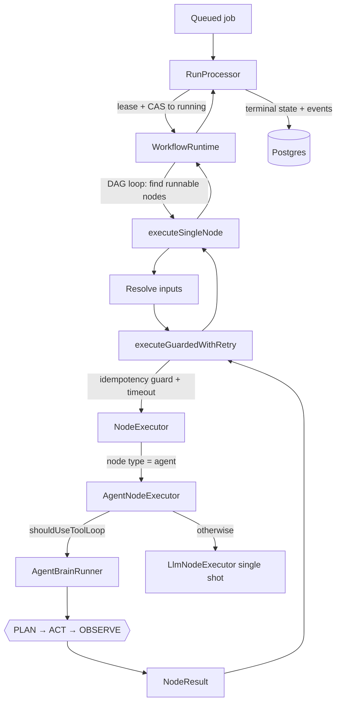

# Agent execution: run processor → runtime → agent brain

How an agent step actually runs. Traces the path from a queued run down to a
single iteration of the agent loop, and back out again.

Scope: the **agent** path. The outer transport — how a run is created, classified
and dispatched through Redis/Postgres — is covered in
[AGENTIC-WORKFLOW-EXECUTION-FLOW.md](./AGENTIC-WORKFLOW-EXECUTION-FLOW.md); this
document assumes it and starts where a worker has a job in hand.

Current as of 2026-08-28.

---

## 1. The whole path in one picture



Five layers, each with one job:

| Layer | File | Owns |
|---|---|---|
| `RunProcessor` | `runtime/RunProcessor.kt` | Job kind, run lease, run status transitions |
| `WorkflowRuntime` | `runtime/WorkflowRuntime.kt` | DAG scheduling, node lifecycle, retries, checkpoints, yielding |
| `NodeExecutorRegistry` | `runtime/executor/NodeExecutorRegistry.kt` | node type → executor |
| `AgentNodeExecutor` | `runtime/executor/AgentNodeExecutor.kt` | Agent lookup, single-shot vs loop |
| `AgentBrainRunner` | `agents/brain/runtime/AgentBrainRunner.kt` | The iterative loop, budgets, tools, approvals |

---

## 2. RunProcessor — which kind of work is this?

A job arrives as a `WorkflowRunJob`. The processor dispatches on `jobType`:

| Job type | Meaning | Entry point |
|---|---|---|
| `START_RUN` | First execution of a run | `processStartRun` |
| `RESUME_RUN` | Continue from a checkpoint — approval decided, timer fired, or a yield | `processResumeRun` |
| `RETRY_NODE` | Re-run one failed node inside an existing run | `processRetryNode` |
| `REPLAY_RUN` | Re-execute against recorded provider calls | `processReplayRun` |
| `UNKNOWN` | Unparseable — logged and dropped | — |

Before any of them execute:

1. **Workspace match.** The job's workspace must equal the run's. A mismatch aborts.
2. **Beta gate re-check.** Workspace controls are re-read *now*, not trusted from
   enqueue time, so a workspace disabled after the job was queued cannot execute.
   Fails **closed** if the check itself errors.
3. **Run lease.** `RunLeaseManager` takes exclusive ownership, renewed on a
   background `lease-renewer` thread. Losing the lease cancels the in-flight work
   rather than letting two workers run the same graph.
4. **Status CAS.** `queued|claimed → running` as a compare-and-set. If it fails, the
   run was already taken or is terminal, and the processor bails — this is what
   stops a redelivered message from double-running side effects.
   `RESUME_RUN` accepts a wider set: `waiting_for_approval`, `recovering`,
   `waiting_for_timer`, `yielded`, `queued`.

Then it loads `graph_json` from the workflow **version** (immutable — a run always
executes the graph it was created against), parses it, and calls
`WorkflowRuntime.execute`.

### What comes back

`WorkflowRuntime.ExecutionResult` is the entire vocabulary between the two layers:

| Result | Run status | Then what |
|---|---|---|
| `Succeeded(output)` | `succeeded` | Terminal |
| `Failed(reason)` | `failed` | Terminal (or dead-lettered on repeated delivery) |
| `WaitingForApproval(approvalId, nodeId)` | `waiting_for_approval` | Parks. Resumes on the approval decision |
| `Yielded(reason, checkpointNodeId)` | `yielded` | Checkpoints, re-enqueues `RESUME_RUN` |
| `Throttled` | `yielded` | Timer set to the provider's backoff, then resumes |
| `CeilingExceeded(breach)` | `failed` | Terminal, but *nothing went wrong* — a limit was hit |
| `Cancelled(reason)` | `cancelled` | Terminal |

`CeilingExceeded` is deliberately not `Failed`: the run did what it was asked, for
longer or more expensively than allowed, and the user needs to be told which limit.

---

## 3. WorkflowRuntime — the DAG loop

One bounded loop. Each iteration, in order:

1. **Hard run duration** — `WORKER_MAX_RUN_DURATION_MS`, default `0` = unlimited.
   Long waits at approval gates and timers are the product, not a bug.
2. **Cancellation** — checked every 5th iteration to bound DB reads.
3. **Cooperative yield** — if the per-tick `ExecutionBudgetTracker` is exhausted,
   checkpoint and return `Yielded`. Checked *before* more work, so one slow node
   still yields promptly.
4. **Run ceilings** — steps, cost, tokens, active duration, payload size. Checked
   every iteration, because "continuously" has to mean continuously.
5. **Completion** — `scheduler.isRunComplete`.
6. **Deadlock** — blocked nodes with nothing runnable.
7. **Execute** the runnable set: `PARALLEL` nodes fan out branches; the rest run
   sequentially.

### The per-tick execution budget

`ExecutionBudget.fromEnv()` — this is the mechanism behind "why did my run
re-enqueue":

| Dimension | Env var | Default |
|---|---|---|
| Wall clock per tick | `MAX_WALL_CLOCK_MS_PER_TICK` | **30 000** |
| Nodes per tick | `MAX_NODES_PER_TICK` | 0 (disabled) |
| Agent iterations per tick | `MAX_AGENT_ITERATIONS_PER_TICK` | **not implemented** |
| Tool calls per tick | `MAX_TOOL_CALLS_PER_TICK` | **not implemented** |
| LLM calls per tick | `MAX_LLM_CALLS_PER_TICK` | **not implemented** |

> **The last three do nothing, at any value.** `ExecutionBudgetTracker` defines
> `recordAgentIteration()`, `recordToolCall()` and `recordLlmCall()`, and **nothing
> calls them** — zero call sites in the codebase. The counters they feed are always
> zero, so the ceilings they gate are never reached. Setting these variables has no
> effect.
>
> They are also unreachable by construction, not merely unwired: `canContinue()` is
> consulted only in the DAG scheduling loop, between nodes. An agent step that has
> started runs to completion, times out, or parks — the tick budget cannot interrupt
> it mid-loop, so a per-tick iteration ceiling has no moment at which to fire.
>
> Wiring the recorders alone would make this worse, not better: live counters against
> a check that cannot fire mid-step would make the config look functional while
> staying inert. Mid-loop yielding is a real behaviour change and is deferred to P9,
> where a team holding a worker for its whole duration is what makes it worth having.

Only wall clock is on by default. A run gets **30 seconds per tick**; past that it
checkpoints, yields the worker thread, and comes back as `RESUME_RUN`. Agent steps
are the usual cause — several LLM calls at 1–2 s each add up fast. Node-count
yielding is off deliberately: yielding a 6-node workflow would just amplify queue
traffic.

**A re-enqueue is not a restart.** Completed steps are protected by the
idempotency guard (§4) and return cached output.

### Node lifecycle

For each node, `executeSingleNode`:

```
markRunning → STEP_SCHEDULED → STEP_STARTED
  → resolve inputs (INPUT_MAPPING_STARTED / STEP_INPUT_RESOLVED)
  → executeGuardedWithRetry
  → STEP_COMPLETED | STEP_FAILED | APPROVAL_REQUESTED
  → select outgoing edges → mark successors pending
```

Input resolution walks `{{steps.<id>.output.<field>}}` references against the
in-memory step-output view. A failure here emits `INPUT_MAPPING_FAILED` and fails
the node with a message naming the likely cause (wrong node id or an incomplete
upstream step).

---

## 4. Guards around every node execution

`executeGuardedWithRetry` wraps each attempt in three things.

### Idempotency guard

Applies to `GUARDED_NODE_TYPES` = `LLM, HTTP, DB_QUERY, DB_WRITE, TOOL, AGENT` —
everything that can cause an external effect.

`StepExecutionGuard.tryAcquire` before each attempt. If the step already completed
in a previous attempt or tick, the output stored by `StepOutputStore` under the same
node id is returned and `STEP_SKIPPED` is emitted instead of re-executing. This is
what makes resume and redelivery safe.

The guard reports only the **verdict**; there is no cached result on
`AcquireResult`. The caller fetches the output itself, and "completed, but nothing
stored" re-executes.

> This guard is keyed on the **graph node**, so it does not see the tool calls made
> *inside* an agent loop — and it deliberately leaves an approval-paused agent step
> `running`, so that step re-executes from iteration 1 by design. Those inner calls
> have their own guard with its own key; see [§7 Two keys over one call](#two-keys-over-one-call).

### Timeout

Each attempt runs under `node.timeoutPolicy.timeoutMs`, falling back to per-class
defaults:

| Class | Env var | Default |
|---|---|---|
| Any node | `DEFAULT_NODE_TIMEOUT_MS` | 60 000 |
| HTTP | `HTTP_NODE_TIMEOUT_MS` | 30 000 |
| LLM | `LLM_NODE_TIMEOUT_MS` | 90 000 |
| Agent | `AGENT_NODE_TIMEOUT_MS` | 120 000 |

The agent's single-shot path passes an **inner** HTTP budget shorter than the node
budget (`nodeTimeout − min(nodeTimeout/10, 5 s)`), so the HTTP client gives up
first and the failure carries the provider's real error instead of a bare
cancellation.

### Retry — and when it is skipped

`NodeResult.Failed` carries `retryable` (default `true`). The retry policy answers
*how many times*; `retryable` answers *could another attempt differ at all*.

A settled outcome returns immediately, however many attempts remain, and the
`STEP_FAILED` event says so. Each agent retry is a whole brain loop, so doomed
retries also burn the 30 s tick budget and make the run yield — which is what made
this look like a run going in circles.

---

## 5. Node executors

`NodeExecutorRegistry` maps type → executor. Unknown types get
`UnsupportedNodeExecutor`.

| Node type | Executor | Notes |
|---|---|---|
| `trigger`, `transform`, `branch`, `parallel`, `join`, `end` | control-flow | No external I/O |
| `approval` | `ApprovalNodeExecutor` | Explicit human gate |
| `llm` | `LlmNodeExecutor` | Provider dialects, throttle, circuit breaker, replay recording |
| `http` | `HttpNodeExecutor` | Side-effect guard |
| `db_query` / `db_write` | `DbRead/DbWriteNodeExecutor` | Write path has its own approval gate |
| `tool` | `ToolNodeExecutor` | Looks the tool up at runtime, dispatches on its type |
| `agent` | `AgentNodeExecutor` | Looks the agent up at runtime |

`tool` and `agent` are **reference types**: the graph stores only an id, and the
definition is read from the database at execution time.

---

## 6. AgentNodeExecutor — which shape of agent?

1. Read `agentId` from node config, validate as UUID.
2. Load the agent **workspace-scoped** (`id = ? AND workspace_id = ? AND status =
   'active'`). Cross-workspace access is impossible. The query has a two-stage
   fallback so the worker survives schema skew between API and worker deploys.
3. Decide the execution shape:

```kotlin
shouldUseToolLoop(agentType, hasGrantedTools, brainEnabled) =
    brainEnabled ?: (agentType in {"iterative_agent","tool_agent"} || hasGrantedTools)
```

The question is **"is this agent set up to use tools"**, not "what is it labelled".
Granting a tool is the operator saying it should be used. `brainEnabled` on the
node overrides in both directions.

### Single-shot path

Builds system + user messages and delegates to `LlmNodeExecutor` — one request, no
tool loop. If the response content parses as a JSON object, its fields are merged
into the node output so `{{steps.x.output.risk_level}}` works without a Transform
node.

### Loop path

Builds an `AgentBrainConfig` and hands off to `AgentBrainRunner`. Defaults, when
the agent row does not override them:

| Setting | Default |
|---|---|
| `temperature` | 0.2 |
| `maxTokens` (per call) | 2048 |
| `maxIterations` | 5 |
| `maxToolCalls` | 5 |
| `maxTotalTokens` | 16 384 |
| `maxCostCents` | 50 |
| `timeoutMs` | 120 000 |

`taskInstruction` falls back through node config (`taskInstruction`, then the
builder's older `taskOverride`) → `taskInstruction` → `task` → `prompt` → `input`
in resolved inputs, so an agent fed by input mapping still gets its task.

### 6a. What a workflow step passes an agent, and gets back

Built on the canvas, a step's data lives in its own `config`:

| Key | Written by | Read by |
|---|---|---|
| `inputMapping` | Inputs tab. `{ name: value }`; a value is typed text or `{{ steps.<nodeId>.output.<field> }}` | `WorkflowGraph.convertNode` → `MappingResolver` |
| `taskInstruction` | Configure tab (was `taskOverride`, which nothing read — both are accepted) | `nodeTaskInstruction` |
| `outputFields` | Output tab. `[{ name, type, description }]` | `stepOutputFields` |

- **Both paths see the task AND the data.** The single model call used to send
  `taskInstruction ?: inputs-as-JSON`, so a step with an instruction and mapped
  inputs sent the instruction alone. It now sends the instruction, then
  `INPUT DATA:` and the inputs (`singleCallUserContent`), which is what the
  tool-using loop's `AgentPromptBuilder` always did.
- **Output fields are asked for, then read.** The single call appends "Reply with
  only a JSON object with these fields" to the USER message (not the system
  prompt — the skills position there is not reopened), strips a Markdown fence,
  and merges the parsed fields into the output. The loop receives them as
  `outputSchemaJson`, which `AgentBrainConfig` carried and nothing set.
- **`content` always exists.** "Full reply" is offered for every agent step, so
  the loop's final output gains `content` when it has none (`withFullReply`).
- The builder's field lists come from these keys and the tool registry
  (`components/app/builder/step-io.ts`), not from fixtures. An agent's registered
  `outputSchema` is not offered, because no step execution path sends it.

Tests: `AgentStepInputsTest` (worker), `__tests__/step-io.test.ts` (web).

---

## 7. AgentBrainRunner — the loop

The runtime enforces every boundary. The model only *chooses*; it never executes
anything itself.

```mermaid
flowchart TD
    S[Start: recall run-scoped memory] --> B{Budget OK?}
    B -->|no| BE[BUDGET_EXCEEDED]
    B -->|yes| P[Build system + user prompt]
    P --> L[LLM call via LlmNodeExecutor]
    L --> PA[Parse action JSON]
    PA --> V{Valid + tool granted?}
    V -->|no| ERR[ERROR / TOOL_NOT_ALLOWED]
    V -->|yes| A{Action}
    A -->|THINK| O[Observation + memory]
    A -->|CALL_TOOL| T[ToolNodeExecutor]
    T --> O
    O --> I{iteration >= max?}
    I -->|no| B
    I -->|yes| MI[MAX_ITERATIONS]
    A -->|FINAL| SV{Schema valid?}
    SV -->|yes| OK[FINAL_OUTPUT]
    SV -->|no| SI[SCHEMA_INVALID]
    A -->|ASK_APPROVAL| G[Approval gate]
    G -->|granted| O
    G -->|pending| AP[APPROVAL_REQUESTED — park run]
    G -->|rejected| AF[AGENT_FAILED]
    A -->|FAIL| AF
```



### The prompt

**System prompt** — agent name, role, instructions, the allowed-tools JSON, the
action schema, the output schema if declared, and the safety rules.

**User prompt**, rebuilt every iteration from:

- `TASK` — the task instruction
- `INPUT DATA` — resolved inputs as JSON
- `PREVIOUS OBSERVATIONS` — last 10, **each with its tool result** (`RESULT: …`)
- `WORKING MEMORY` — last 5 entries, including entries recalled from an earlier
  execution of this step
- A budget warning on the final iteration, instructing FINAL or FAIL

The observation payload matters: without it the model is told a tool call
succeeded and told the *names* of the fields it returned, then asked to answer from
data it has never seen. Payloads are sanitized and capped at
`MAX_TOOL_PAYLOAD_CHARS` (2 000) per observation.

### The five actions

| Action | Runtime does |
|---|---|
| `THINK` | Record a sanitized observation and a memory entry. Loop continues |
| `CALL_TOOL` | Validate the grant, execute via `ToolNodeExecutor`, record the result |
| `FINAL` | Validate against the output schema, stop |
| `ASK_APPROVAL` | Resolve the approval gate (§9) |
| `FAIL` | Stop, recording the model's stated reason |

Unparseable responses are repaired into a `THINK` so one bad JSON response does
not kill the step.

### Budgets — enforced by code, not by the prompt

`AgentBudgetGuard.checkOrThrow` runs before every iteration, over iterations, tool
calls, tokens, cost and elapsed time. The prompt states the budgets, but the prompt
is not the enforcement.

### Tool calls

The synthetic node handed to `ToolNodeExecutor` is:

```
id     = "<stepId>:tool:<toolId>"      // stable — this is the APPROVAL key
type   = "tool"
config = { toolId }
```

The idempotency guard uses a **different** key over the same call —
`<stepId>:tool:<toolId>:<sha256(canonical args)>` — and never this one. The node
id is what `ToolNodeExecutor` files its approval under, so it must not move; the
guard key is what decides whether this exact call has already run, so it must.
See [Two keys over one call](#two-keys-over-one-call) below.

Both keys take a scope that is the step id at depth 0 and the activation id
below it (`AgentBrainRunner.keyScope`), so two workers in one team calling the
same gated tool open two gates rather than sharing one decision.

Using `ToolNodeExecutor` (rather than an HTTP executor) is what makes an agent
calling a tool and a workflow calling that tool do the same thing: type dispatch,
`requires_approval`, and SQL template resolution all come along.

#### Two keys over one call

A tool call in the loop is filed under **two different keys**, because two
different questions are being asked about it:

| Question | Key | Filed in | Set by |
|---|---|---|---|
| **May this run?** | `<stepId>:tool:<toolId>` | `run_approvals` | `ToolNodeExecutor.approvalGate` |
| **Has this already run?** | `<stepId>:tool:<toolId>:<sha256(canonical args)>` | `step_executions` + `step_outputs` | `AgentBrainRunner.executeTool` |

They were one key once, and that was a bug in each direction.

**Why the approval key must NOT carry the arguments.** The step re-executes from
iteration 1 on resume, so a key that varies per attempt files the decision under one
name and looks it up under another. The original id was `<stepId>:tool-<iteration>`:
the approved row went in under `:tool-4`, the resumed run asked for `:tool-2`, found
nothing, and opened another gate. Approving that one produced a third. Arguments are
the same hazard in slower motion — a resumed pass re-derives them from the model and
need not reproduce them byte for byte. One gate per (step, tool) is the deliberate
trade: a person approving `send_email` is approving the agent's use of that tool in
that step, and is asked once.

**Why the idempotency key MUST carry the arguments.** `search(a)` and `search(b)`
are two operations. Keyed only on the tool, the second is "already completed" and is
handed the first one's stored output — the agent asks a different question and gets
the previous answer, with nothing in the timeline saying so.

**Why the arguments are canonicalised rather than serialised.** The guard key has to
survive re-execution ([invariant 2](../AGENT-HARNESS-ARCHITECTURE.md#13-invariants)),
and a resumed step rebuilds its arguments by parsing the model's JSON afresh. Jackson
returns `Int` or `Double` depending on the literal, and map order follows the
document. `AgentBrainRunner.canonicalJson` therefore sorts keys, renders `1`, `1.0`
and `1.00` identically, and drops nulls (which `executeTool` already strips before
dispatch). List order is preserved — `[a,b]` and `[b,a]` are different arguments.
Without this the key would move between attempts and the guard would silently stop
deduplicating: present, and doing nothing.

**Attempt component.** The guard uses `RuntimeContext.attemptGroup`, not the
iteration or the node attempt, for the reason `SideEffectGuard` does: it moves only
when a human asks for the work to happen again. A resume dedupes; a deliberate re-run
genuinely re-runs.

**What each outcome writes.** Completed marks the guard row `succeeded` and stores
the output; failed marks it `failed`, so a resumed step calls the tool again — which
is right for a call that did not succeed. `ApprovalPaused` writes nothing: the call
has not run, so its row stays `running` and the post-approval resume executes it.

On a hit the loop emits `STEP_SKIPPED` and feeds the stored result back as the
observation. The event is filed against `config.stepId`, not the guard key, for the
same reason the synthetic LLM node is: an event under a hashed internal id attaches
to a step no screen can resolve.

> Both stores are best-effort. A failure to record costs a duplicate call on a later
> resume, never a wrong result now — and "guard says completed, no stored output"
> re-executes rather than handing the model an empty result to reason over.

**Repeated-failure stop.** If the same tool fails twice with the same message
(normalised for any attempt counter), the loop stops rather than spending its
remaining iterations reproving a deterministic failure.

### Stop reasons

| Stop reason | Meaning | Node result | Retryable |
|---|---|---|---|
| `FINAL_OUTPUT` | Success | `Completed` | — |
| `APPROVAL_REQUESTED` | Waiting on a person | `ApprovalPaused` | no |
| `AGENT_FAILED` | The agent declined, or a reviewer rejected | `Failed` | no |
| `MAX_ITERATIONS` | Budget spent without converging | `Failed` | no |
| `BUDGET_EXCEEDED` | Tokens / cost / tool calls / time | `Failed` | no |
| `TOOL_NOT_ALLOWED` | Called an ungranted tool | `Failed` | no |
| `SCHEMA_INVALID` | Final output missed its schema | `Failed` | no |
| `ERROR` | Exception, refused connection, LLM failure | `Failed` | **yes** |
| `ERROR` (repeated tool failure) | Deterministic tool failure | `Failed` | no |

Only "the loop broke" is retryable. Everything the loop reached *by deciding* is
not — retrying replays the same prompt against the same state at full cost.

Every non-`FINAL_OUTPUT` stop carries a `failureReason`, falling back through:
explicit reason → last failed observation → a sentence describing the stop reason.
A stop reason on its own is a category, and a category tells nobody what happened
to their run.

### What is persisted

| Table | Contents |
|---|---|
| `agent_iterations` | One row per iteration: the parsed action and its arguments, status, sanitized summary, cumulative budget **and per-iteration deltas**, plus `run_payloads` refs for the observation payload and the full tool result. Status is constrained to `running/completed/failed/skipped` (`skipped` is never written) |
| `agent_memory_entries` | Run-scoped sanitized memory, keyed by `(run_id, agent_id, key)` |
| `run_payloads` | Content-addressed payloads, redacted before storage (V040) |
| `run_events` | The timeline (§8) |

**A resumed step rebuilds its loop rather than replaying it** — when
`AGENT_LOOP_RECONSTRUCTION_ENABLED` is on. The transcript above is enough to
restore observations, the last action and the consumption budgets, so the step
continues at `lastIteration + 1` and repeats no LLM call it already paid for. See
[architecture §10](../AGENT-HARNESS-ARCHITECTURE.md).

**Memory recall is the fallback, not a parallel path.** When reconstruction
declines, recall restores a flattened key/value summary instead. The two never both
run: they restore overlapping state at different fidelities, and doing both puts
every observation in front of the model twice — which reads to the model as the
tool having been called twice.

**Two tables, two opposite traps.** `agent_memory_entries` has no unique key, so
re-persisting a recalled entry **doubles** the rows. `agent_iterations` has
`UNIQUE (run_id, step_id, iteration_number)` and upserts with
`DO UPDATE SET … = NULL`, so re-persisting **blanks** them. Recalled entries and
reconstructed iterations are both flagged and never written back, for different
reasons.

---

## 8. Events and the timeline

`RunEventStore.appendEvent` writes to `run_events` and publishes a sanitized
envelope to Redis `run-events:{runId}` for the API's SSE endpoint.

**Sequencing.** `sequence` is assigned under a `FOR UPDATE` lock on the run's
`agent_runs` row, held for the same transaction as the insert. An in-memory
per-run lock orders writers inside one worker; the row lock is what makes the
assignment safe against the API, which appends to the same run from another
process. Without it, two `MAX(sequence)+1` reads under READ COMMITTED collide.

**Sanitization is the caller's job.** `metadataJsonSanitized` and
`errorJsonSanitized` are stored as-is. Raw errors, stack traces and payloads must
never reach them.

**Event names carry meaning to the UI.** `LogsTab` grades any type containing
`RETRY` as a warning, so a resume is `RUN_RESUMED`, not `RETRY_STARTED`. A tool
held at a gate is `waiting_for_approval`, not `failed`.

---

## 9. Approvals end to end

Two gates can open on an agent step, keyed differently so they do not collide:

| Gate | Key (`run_approvals.node_id`) | Opened by |
|---|---|---|
| Agent's own `ASK_APPROVAL` | `<stepId>` | `AgentBrainRunner.resolveApprovalGate` |
| A tool with `requires_approval` | `<stepId>:tool:<toolId>` | `ToolNodeExecutor.approvalGate` |

Both find-then-create against `(runId, nodeId)`, and both interpret the row
through the **one shared rule**, `decideOnApproval` in `ApprovalStore.kt`:

| Status | Decision |
|---|---|
| `APPROVED` | `GRANT` |
| `REJECTED`, `EXPIRED`, `CANCELLED` | `REJECT` |
| `PENDING`, `SENT_BACK`, anything unrecognised, null | `WAIT` |

Unrecognised must mean WAIT and never "open a new gate" — on a step that
re-executes, that would file a fresh approval on every resume.

The full circuit:

```
agent or tool needs approval
  → row created PENDING in run_approvals
  → NodeResult.ApprovalPaused
  → runtime: ribbon GATED, APPROVAL_REQUESTED event, checkpoint
  → run status waiting_for_approval
  → [human decides via API]
  → APPROVAL_APPROVED event + RESUME_RUN enqueued with resumeFromNodeId
  → worker re-executes the agent step from iteration 1
  → gate finds APPROVED under the same key → proceeds
```

`requires_approval` is enforced at the **tool boundary**, before dispatch, for
every tool type, and fails closed if the lookup errors. It used to be honoured only
by `DbWriteNodeExecutor`, which meant HTTP/Slack/email/CRM tools flagged for
approval ran ungated.

The column defaults to `false`, so only deliberately flagged tools gate.

---

## 10. Failure handling outside the node

- **Node failure policy** — `continue`, failure edges, or fail the run.
- **Checkpoints** — written after nodes with `checkpointPolicy.enabled`, and on
  every yield and approval pause.
- **Crash recovery** — `CrashRecoveryLoop` finds runs whose lease expired and
  re-enqueues them.
- **Dead letters** — after repeated delivery, `DeadLetterStore` writes the job, its
  full error chain and worker context to `dead_letters` and marks the run `failed`
  so nothing redelivers it.

---

## 11. Known limits

Real constraints, not bugs to be surprised by:

1. **One approval per (step, tool) and one per step for the agent.** The key must
   survive re-execution, and iteration numbers do not. A second `ASK_APPROVAL` in
   one step sees the first decision.
2. **A resumed agent replays its loop from iteration 1 — unless reconstruction is
   on.** With `AGENT_LOOP_RECONSTRUCTION_ENABLED` the step rebuilds its loop from
   `agent_iterations` and continues at `lastIteration + 1`, repeating no LLM call it
   already paid for. The flag defaults **off**, so replay is still what ships. When
   it does replay, the **tool calls** are not re-executed: each is guarded per
   (step, tool, arguments) and returns its stored result, so the emails and writes
   of the first pass do not happen twice. See
   [§7 Two keys over one call](#two-keys-over-one-call).
3. **`database` tools route by SQL first keyword.** Anything not starting with
   `SELECT` takes the write path (and its gate). A `SELECT` that writes via a
   volatile function takes the read path, which has no gate.
4. **Agent memory is run-scoped only.** `workflow_scoped` exists in the schema and
   is not implemented.
5. **Replay does not reach the agent path.** `AgentNodeExecutor` accepts no
   `ModelCallRecorder` or `ReplayContext`, and `AgentBrainRunner` builds its
   executors without them. So agent steps write no `model_calls` rows, and a
   `REPLAY_RUN` over a workflow containing an agent node **executes it live** —
   real provider calls, real tool side effects.
6. **The tick budget cannot interrupt an agent step.** `canContinue()` is checked
   between DAG nodes only, so a started agent step runs to completion, times out, or
   parks; a long-running agent holds its worker for the whole duration.
   `MAX_AGENT_ITERATIONS_PER_TICK`, `MAX_TOOL_CALLS_PER_TICK` and
   `MAX_LLM_CALLS_PER_TICK` are documented knobs that do nothing at any value (§3).
   Mid-loop yielding is a real behaviour change and is deferred to P9.
7. **`RuntimeContext.attemptGroup` is always 0.** Nothing increments it, so every
   mechanism keyed on it treats a deliberate re-run as a continuation. The visible
   consequence: a `RETRY_NODE` on an agent step replays from iteration 1 and is
   served the *previous* attempt's cached tool results, because those synthetic tool
   nodes did complete. Somebody clicking retry is not getting a retry. Tracked as a
   standalone fix ahead of P6.

The loop itself is now covered end to end: `ScriptedLlmProvider` and
`AgentBrainFixture` drive `AgentBrainRunner.run` with no network, and
`AgentBrainLoopTest` asserts every stop reason in §7.

---

## Code map

| Concern | Path (under `apps/worker-kotlin/src/main/kotlin/com/vectorbea/worker/`) |
|---|---|
| Job dispatch, leases, run status | `runtime/RunProcessor.kt` |
| DAG loop, retries, timeouts, yielding | `runtime/WorkflowRuntime.kt` |
| Per-tick budget | `runtime/budget/ExecutionBudget.kt`, `ExecutionBudgetTracker.kt` |
| Node type → executor | `runtime/executor/NodeExecutorRegistry.kt` |
| Agent lookup and routing | `runtime/executor/AgentNodeExecutor.kt` |
| The loop | `agents/brain/runtime/AgentBrainRunner.kt` |
| Budgets, safety, memory | `agents/brain/runtime/AgentBudgetGuard.kt`, `AgentSafetyGuard.kt`, `AgentMemoryStore.kt` |
| Prompts | `agents/brain/prompts/AgentPromptBuilder.kt` |
| Loop state, actions, budget model | `agents/brain/model/` |
| Tool dispatch and tool approval gate | `runtime/executor/ToolNodeExecutor.kt` |
| Approvals | `runtime/checkpoint/ApprovalStore.kt` |
| Events and sequencing | `events/RunEventStore.kt` |
