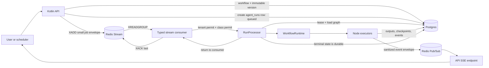
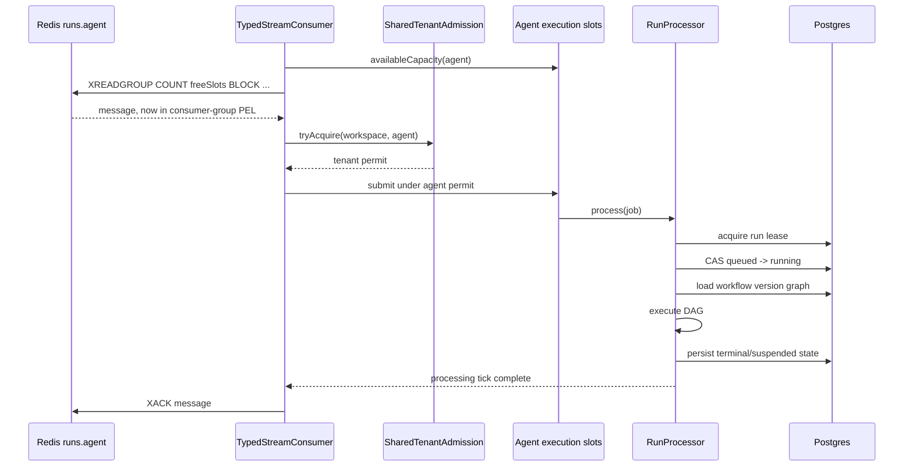
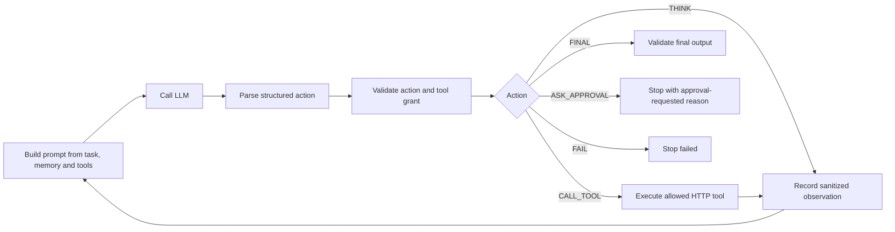
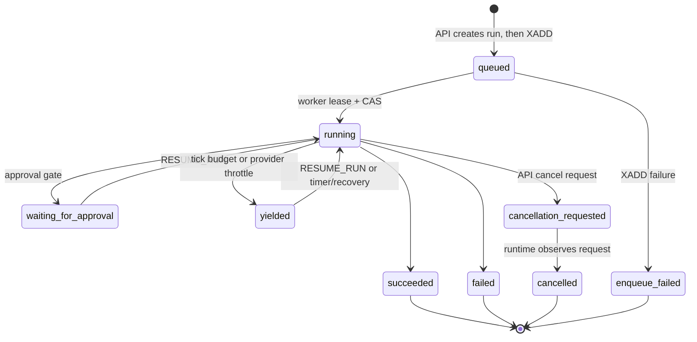

# Agentic workflow execution flow

This document traces the implementation that exists in this repository as of
2026-08-18. It explains what happens after somebody creates a workflow, how a
run is dispatched through Redis, how the worker executes the graph and agent
nodes, and which data is durable.

## Short version

Postgres is the system of record. Redis is a delivery and live-notification
layer in the default configuration.



The important distinction is:

- `workflow_versions.graph_json` is the executable definition.
- `agent_runs` is the durable state of one execution.
- Redis Streams tells a worker that a run is ready; it is not the authoritative
  copy of the workflow or run input.
- `run_events`, `step_outputs`, `run_checkpoints`, and `run_leases` make progress
  observable and recoverable.
- Redis Pub/Sub is only the fast live-update path. Missing a Pub/Sub message does
  not lose history because the event was written to Postgres first.

## 1. Services involved

| Component | Responsibility | Important implementation |
|---|---|---|
| Next.js web app | Workflow UI and run UI | `apps/web` |
| Kotlin API | CRUD, versioning, trigger validation, run creation, enqueue, SSE | [`apps/api-kotlin`](../../apps/api-kotlin) |
| Redis Streams | Default run dispatch transport | `runs.short`, `runs.long`, `runs.agent`, `runs.system` |
| Kotlin worker | Claims jobs and executes workflow DAGs | [`apps/worker-kotlin`](../../apps/worker-kotlin) |
| Postgres | Authoritative definitions, run state, outputs, events, leases and checkpoints | migrations in [`apps/api-kotlin/src/main/resources/db/migration`](../../apps/api-kotlin/src/main/resources/db/migration) |
| Redis Pub/Sub | Best-effort live run-event fan-out | `run-events:{runId}` |

Redis is also used for caching, rate limiting, locks, idempotency caching and
worker heartbeat information. Those roles are separate from the run Stream.

## 2. Creating a workflow

### 2.1 Manual/API creation

Creation and execution are separate operations.

1. `POST /api/workflows` calls `WorkflowRoutes.create` and inserts a `workflows`
   row. A newly created workflow normally starts as `draft` and has no executable
   graph yet.
2. Saving the canvas calls `POST /api/workflows/:id/versions`.
3. `WorkflowRoutes.createVersion` validates the outer graph shape, inserts an
   immutable `workflow_versions` row, and points
   `workflows.current_version_id` at it.
4. If the trigger config is cron-based, the same route creates or updates a
   `schedules` row.

Relevant code:

- [`WorkflowRoutes.create`](../../apps/api-kotlin/src/main/kotlin/com/vectorbea/api/routes/WorkflowRoutes.kt#L153)
- [`WorkflowRoutes.createVersion`](../../apps/api-kotlin/src/main/kotlin/com/vectorbea/api/routes/WorkflowRoutes.kt#L223)
- [`WorkflowRepository`](../../apps/api-kotlin/src/main/kotlin/com/vectorbea/api/repository/WorkflowRepository.kt)
- Frontend repository calls in [`apps/web/lib/repository/index.ts`](../../apps/web/lib/repository/index.ts#L118)

The saved graph may use React Flow's nested `data` shape or the worker's flat
internal shape. `WorkflowGraph.parse` accepts both and converts them to the same
runtime model.

### 2.2 AI Architect creation

The AI Architect takes this route:

```text
goal
  -> clarification/guardrail
  -> generated plan
  -> connection requirements
  -> tool records
  -> agent records
  -> graph compiled with real IDs
  -> workflow row + workflow version row
```

The main build is in
[`WorkflowArchitectService.createWorkflow`](../../apps/api-kotlin/src/main/kotlin/com/vectorbea/api/architect/WorkflowArchitectService.kt#L586).
It uses a per-workspace Postgres advisory lock so simultaneous builds cannot
bypass the workspace build limit.

After either creation path, execution is the same: the worker only needs a
workflow, its current version, and the version's graph.

## 3. Triggering a run

A manual run enters through:

```http
POST /api/workflows/{workflowId}/run
Content-Type: application/json

{
  "input": { "ticketId": "T-1042" },
  "idempotencyKey": "ticket-T-1042-v1",
  "triggerType": "manual",
  "mode": "simulation"
}
```

The implementation is
[`RunRoutes.triggerRun`](../../apps/api-kotlin/src/main/kotlin/com/vectorbea/api/routes/RunRoutes.kt#L213).

It performs the following work before touching Redis:

1. Authorize the workspace/environment and load the workflow.
2. Reject archived workflows or workflows without `current_version_id`.
3. Apply beta/usage controls and simulation-versus-real-execution gates.
4. Check the caller's idempotency key.
5. Serialize the input into `agent_runs.input_json`.
6. Classify the immutable version as `short`, `long`, `agent`, or `system`.
7. Compute `fair_vtime` and priority for weighted tenant ordering.
8. Apply run-creation rate limits and admission control.
9. Insert `agent_runs` with status `queued`.
10. Append `RUN_CREATED` and `RUN_QUEUED` to `run_events`.
11. Enqueue a small `START_RUN` envelope.
12. Return HTTP `202` with the new `runId`.

This ordering is deliberate: the durable run row exists before its Redis
message. If `XADD` fails, the API changes the run to `enqueue_failed` instead of
leaving an invisible `queued` run.

Scheduled runs follow almost the same path. `WorkflowScheduler` atomically
claims a due schedule in Postgres, creates the run/events, and enqueues the same
`START_RUN` job. See
[`WorkflowScheduler.fire`](../../apps/api-kotlin/src/main/kotlin/com/vectorbea/api/schedule/WorkflowScheduler.kt#L111).

## 4. Execution-class routing

Classification happens once per immutable workflow version.

| Class | Selected when | Redis stream | Worker group |
|---|---|---|---|
| `short` | Small deterministic graph | `runs.short` | `runs.short.workers` |
| `long` | External I/O, large graph, or wide parallel fan-out | `runs.long` | `runs.long.workers` |
| `agent` | At least one `llm` or `agent` node | `runs.agent` | `runs.agent.workers` |
| `system` | Worker-generated timer/recovery control work | `runs.system` | `runs.system.workers` |

`GraphClassifier` gives agent work precedence, then checks long-running node
types, node count and parallel fan-out. The result is memoized in-process and in
`workflow_versions.execution_class`, then copied to
`agent_runs.execution_class`.

Relevant code:

- [`ExecutionClass`](../../apps/api-kotlin/src/main/kotlin/com/vectorbea/api/queue/ExecutionClass.kt)
- [`ExecutionClassResolver`](../../apps/api-kotlin/src/main/kotlin/com/vectorbea/api/queue/ExecutionClassResolver.kt)
- [`GraphClassifier`](../../apps/api-kotlin/src/main/kotlin/com/vectorbea/api/queue/GraphClassifier.kt)
- [`FairOrdering`](../../apps/api-kotlin/src/main/kotlin/com/vectorbea/api/queue/FairOrdering.kt)

## 5. What is written to Redis

In the default `QUEUE_MODE=redis`, `TypedStreamsWorkflowQueue.enqueue` selects
the stream from `job.executionClass` and calls `XADD`.

An approximate `START_RUN` entry is:

```text
XADD runs.agent *
  jobId              46d7...
  runId              f3a9...
  workspaceId        2c11...
  environmentId      9f31...
  workflowId         d17a...
  workflowVersionId  a810...
  jobType            START_RUN
  reason             manual
  createdAt          2026-08-18T10:30:00Z
  retryCount         0
  inputJson           {"ticketId":"T-1042"}
```

Secrets and connection strings must never be included. Executors resolve
connection secrets server-side.

Payload policy:

- `agent_runs.input_json` is the durable copy and fallback source.
- Only a fresh `START_RUN` may carry input in Redis.
- Inputs larger than `MAX_REDIS_MESSAGE_PAYLOAD_BYTES` (default 16 KiB) are
  omitted and loaded from Postgres by the worker.
- `RESUME_RUN`, `RETRY_NODE`, and `REPLAY_RUN` messages carry IDs and control
  fields, not the original input.

When a `START_RUN` message includes the input copy, `RunProcessor` uses that copy
verbatim. When it is absent, the processor loads the durable Postgres value.

Relevant code:

- [`TypedStreamsWorkflowQueue`](../../apps/api-kotlin/src/main/kotlin/com/vectorbea/api/queue/TypedStreamsWorkflowQueue.kt)
- [`RedisStreamsWorkflowQueue.buildStreamFields`](../../apps/api-kotlin/src/main/kotlin/com/vectorbea/api/queue/RedisStreamsWorkflowQueue.kt#L84)

## 6. Redis consumption and worker admission

The worker starts one `TypedStreamConsumer` per execution class. Each consumer
has a dedicated Redis connection because blocking `XREADGROUP` calls must not
serialize the four classes behind one connection.



The consumer asks Redis for no more messages than the corresponding lane has
free permits. A `runs.agent` message therefore cannot consume a `short` permit
or be pulled by a consumer that has no agent capacity.

If tenant admission temporarily refuses work, the consumer retains it in a
small bounded local deferred queue and retries before reading more. If a worker
crashes with unacknowledged entries, `XAUTOCLAIM` reclaims PEL entries after the
idle threshold. Malformed or unexpectedly crashing messages are copied to
`runs.{class}:dlq` and acknowledged so they cannot poison the stream forever.

Relevant code:

- [`TypedStreamConsumer`](../../apps/worker-kotlin/src/main/kotlin/com/vectorbea/worker/queue/TypedStreamConsumer.kt)
- [`ExecutionSlots`](../../apps/worker-kotlin/src/main/kotlin/com/vectorbea/worker/queue/ExecutionSlots.kt)
- Worker wiring in [`Main.kt`](../../apps/worker-kotlin/src/main/kotlin/com/vectorbea/worker/Main.kt#L313)

## 7. RunProcessor: durable ownership before execution

`RunProcessor.process` is the boundary between queue delivery and workflow
execution.

Before a node can run, it:

1. Loads the `agent_runs` row.
2. Acquires a `run_leases` row for exclusive ownership.
3. Enforces the shared per-tenant concurrency limit at the lease boundary.
4. Records delivery attempts and dead-letters poison runs after the maximum.
5. Starts a lease heartbeat. Losing the lease cancels the coroutine.
6. Dispatches by job type: `START_RUN`, `RESUME_RUN`, `RETRY_NODE`, or
   `REPLAY_RUN`.
7. Uses a compare-and-set status update such as `queued|claimed -> running`.
   A duplicate Redis message loses this transition and performs no work.
8. Loads and parses `workflow_versions.graph_json`.
9. Calls `WorkflowRuntime.execute` or `WorkflowRuntime.resume`.
10. Converts the runtime result into durable run status/events.
11. Releases the lease in `finally`.

The Redis consumer calls `XACK` only after this processing tick returns. This is
at-least-once delivery with database guards preventing duplicate execution.

See [`RunProcessor`](../../apps/worker-kotlin/src/main/kotlin/com/vectorbea/worker/runtime/RunProcessor.kt).

## 8. WorkflowRuntime: executing the DAG

The runtime does not execute the JSON array from top to bottom. It interprets it
as a directed acyclic graph.

```text
validate graph
  -> parse workflow input
  -> create RuntimeContext
  -> find runnable nodes
  -> resolve each node's input mappings
  -> acquire step/idempotency guard where required
  -> execute with retry + timeout
  -> validate output contract/confidence
  -> persist output
  -> select outgoing edges
  -> write checkpoint
  -> repeat until END/completion, pause, yield, cancellation, or failure
```

`GraphScheduler.findRunnableNodes` considers a node runnable when it is pending,
reachable through a selected inbound edge, and not blocked by an incomplete
join. Branch nodes evaluate conditions, parallel nodes fan out, and joins apply
`wait_all` or `wait_any`.

Each runnable node goes through these stages:

1. Emit `STEP_SCHEDULED` and `STEP_STARTED`.
2. Resolve inputs from workflow input and previous step outputs.
3. Pick a `NodeExecutor` by type.
4. Apply the step-execution idempotency guard for external/side-effecting nodes.
5. Execute under the node timeout and retry policy.
6. Validate the output contract before committing it.
7. Optionally route low-confidence output to a human approval gate.
8. Save the output to `step_outputs` and in-memory runtime context.
9. Select success/default/branch/failure edges.
10. Emit the completion/failure event and save a checkpoint when enabled.

Supported runtime types are trigger, transform, branch, parallel, join,
approval, end, LLM, HTTP, database read/write, tool reference, and agent
reference. Builder node aliases such as `http_tool` and `db_read` are converted
to runtime types while parsing.

Relevant code:

- [`WorkflowRuntime`](../../apps/worker-kotlin/src/main/kotlin/com/vectorbea/worker/runtime/WorkflowRuntime.kt)
- [`WorkflowGraph.parse`](../../apps/worker-kotlin/src/main/kotlin/com/vectorbea/worker/runtime/graph/WorkflowGraph.kt)
- [`GraphScheduler`](../../apps/worker-kotlin/src/main/kotlin/com/vectorbea/worker/runtime/graph/GraphScheduler.kt)
- [`NodeExecutorRegistry`](../../apps/worker-kotlin/src/main/kotlin/com/vectorbea/worker/runtime/executor/NodeExecutorRegistry.kt)

## 9. What makes an agent node agentic

An `agent` graph node contains an `agentId`. `AgentNodeExecutor` loads that agent
from the workspace-scoped `agents` table, including instructions, model,
connection, budgets, and allowed tools.

There are two execution shapes:

### Single-shot agent

For ordinary agent types, the executor builds system/user messages and delegates
to `LlmNodeExecutor`. If the returned content is a JSON object, its fields are
merged into the node output so downstream expressions can reference them.

### Iterative agent brain

When `agents.type = 'iterative_agent'`, `AgentBrainRunner` executes a bounded
loop:



The model does not enforce its own safety boundaries. Runtime code enforces:

- maximum iterations, tool calls, tokens, cost and timeout;
- allowed-tool IDs;
- workspace-scoped agent/tool lookup;
- sanitized reasoning summaries rather than raw chain-of-thought persistence;
- final-output validation.

Iterations are recorded in `agent_iterations`, and sanitized memory/observations
are persisted for debugging.

An iterative agent's `ASK_APPROVAL` action currently stops the brain loop but
does not create the same resumable workflow gate as an explicit `approval` graph
node. `AgentNodeExecutor` treats every stop reason other than `FINAL_OUTPUT` as a
node failure. Use an explicit approval node for a durable human-in-the-loop pause.

Relevant code:

- [`AgentNodeExecutor`](../../apps/worker-kotlin/src/main/kotlin/com/vectorbea/worker/runtime/executor/AgentNodeExecutor.kt)
- [`AgentBrainRunner`](../../apps/worker-kotlin/src/main/kotlin/com/vectorbea/worker/agents/brain/runtime/AgentBrainRunner.kt)

## 10. Pause, approval, yield and resume

Long-lived work does not keep a worker permit forever.

### Human approval

1. The approval executor creates an approval record.
2. The runtime writes a checkpoint when the node's checkpoint policy is enabled
   (enabled by default) and returns `WaitingForApproval`.
3. `RunProcessor` changes the run to `waiting_for_approval` and returns, allowing
   the current Redis message to be acknowledged and the permit to be released.
4. A person calls `POST /api/approvals/:id/approve` or `/reject`.
5. The API durably stores the decision and enqueues `RESUME_RUN` on the run's
   original execution-class stream.
6. The worker loads the latest checkpoint, resets the approval node to pending,
   and continues. The approval executor now observes the stored decision.

See [`ApprovalRoutes`](../../apps/api-kotlin/src/main/kotlin/com/vectorbea/api/routes/ApprovalRoutes.kt#L115).

### Cooperative yield

The runtime has a bounded per-tick node/time budget. When it is exhausted, it
writes a checkpoint and returns `Yielded`. `RunProcessor` changes the run to
`yielded` and `XADD`s a slim `RESUME_RUN` message. A later tick restores completed
node states, selected edges and persisted step outputs.

### Provider throttling and timers

A provider `429` produces `Throttled`. The current node remains pending, the run
becomes `yielded`, and a durable `workflow_timers` row records when it may
resume. Previously committed progress is available through step outputs and
checkpoints. The timer scheduler later submits system work. The worker permit is
free during the wait.

## 11. Completion, events and the live UI

On success, the worker:

1. Stores final output and sets `agent_runs.status = 'succeeded'`.
2. Aggregates token/cost data from run events.
3. Appends `RUN_SUCCEEDED` to Postgres.
4. Publishes a small sanitized copy on `run-events:{runId}`.
5. Releases the run lease.
6. Returns to `TypedStreamConsumer`, which `XACK`s the Stream message.

Failures, cancellation and ceiling breaches follow the same durable-final-state
pattern with their own status and event.

`RunEventStore.appendEvent` always attempts the Postgres insert before Pub/Sub.
The API's SSE endpoint first replays historical events from Postgres, then
subscribes to the Redis channel for new events. If Redis is unavailable, the API
tells the client to fall back to polling.

Relevant code:

- [`RunEventStore`](../../apps/worker-kotlin/src/main/kotlin/com/vectorbea/worker/events/RunEventStore.kt)
- [`RunRoutes.streamEvents`](../../apps/api-kotlin/src/main/kotlin/com/vectorbea/api/routes/RunRoutes.kt#L542)
- [`RedisRunEventBus`](../../apps/api-kotlin/src/main/kotlin/com/vectorbea/api/events/RedisRunEventBus.kt)

## 12. Run state model



Other terminal ceiling statuses include cost, token, step, active-duration and
payload limit violations.

## 13. Failure and duplicate-delivery behavior

| Failure point | Behavior |
|---|---|
| DB run creation fails | Nothing is enqueued |
| Redis `XADD` fails | Run becomes `enqueue_failed` |
| Same trigger is retried with idempotency key | Existing run is returned |
| Same Stream message is delivered twice | Run lease and status CAS prevent two active executions |
| Worker dies after reading | Entry remains in the PEL; `XAUTOCLAIM` can recover it |
| Worker dies during a node | Lease expires; checkpoint/step guards allow recovery |
| External side effect is redelivered | Step and side-effect guards reuse/recognize recorded work |
| Pub/Sub publish fails | Event remains in Postgres; clients can fetch/poll it |
| Approval lasts days | Run is checkpointed; no execution permit is held |
| Yield re-enqueue fails | The `yielded` row remains; crash recovery can later resume it |
| Approval resume enqueue fails | The decision remains durable, but the current route only logs the enqueue failure; see observation below |

This is best described as **at-least-once delivery with lease, CAS,
idempotency, and side-effect guards**, not globally exactly-once execution.

## 14. Redis mode versus Postgres-claim mode

The repository contains a second queue transport. It is controlled independently
for the API and worker, so deployment values must be coordinated.

| Mode | API `QUEUE_MODE` | Worker `WORKER_CLAIM_MODE` | Dispatch behavior |
|---|---|---|---|
| Redis/default | `redis` | `redis` | API `XADD`s typed Streams; workers use `XREADGROUP`/`XACK` |
| Migration | `dual` | `dual` | Postgres rows are claimable and jobs are mirrored/consumed while Streams drain |
| Postgres claim | `postgres` | `postgres` | The queued `agent_runs` row is the queue; workers use `FOR UPDATE SKIP LOCKED` and Postgres `LISTEN/NOTIFY` |

In Postgres-claim mode Redis is not the queue and is not the wake-up mechanism.
Postgres `NOTIFY` wakes the claim loops, with a safety poll as backup. Redis still
serves cache, rate-limit, lock, heartbeat and live-event Pub/Sub roles.

See [`PostgresClaimQueue`](../../apps/api-kotlin/src/main/kotlin/com/vectorbea/api/queue/PostgresClaimQueue.kt),
[`PostgresClaim`](../../apps/worker-kotlin/src/main/kotlin/com/vectorbea/worker/queue/PostgresClaim.kt),
and [`POSTGRES-CLAIM.md`](POSTGRES-CLAIM.md).

## 15. Concrete example

Suppose a workflow is:

```text
manual trigger
  -> iterative agent "Triage ticket"
  -> branch on output.severity
      -> high: HTTP tool "Page on-call"
      -> normal: transform summary
  -> end
```

Its execution is:

1. Saving creates a version whose `graph_json` includes the nodes and edges.
2. Because it contains an agent node, classification is `agent`.
3. Triggering inserts a queued `agent_runs` row and `XADD`s `START_RUN` to
   `runs.agent`.
4. A `runs.agent.workers` consumer reads it only when an agent permit is free.
5. `RunProcessor` acquires the run lease, changes the run to `running`, and loads
   the exact immutable version.
6. The trigger node completes and selects the edge to the agent.
7. The agent executor loads its definition. Because it is iterative, the brain
   repeatedly chooses `THINK`, an allowed `CALL_TOOL`, or `FINAL` within its
   budgets.
8. The final structured agent output is validated and checkpointed.
9. The branch scheduler reads the output and selects exactly one branch.
10. If the high-severity path is selected, the HTTP executor resolves its secret
    server-side and runs behind side-effect protection.
11. The end node completes. The run becomes `succeeded`, its final event is
    persisted/published, and the Redis entry is acknowledged.

## 16. Current implementation observations

These details matter when testing this flow from the product UI:

1. The currently routed builder page at
   [`apps/web/app/(app)/workflows/[id]/builder/page.tsx`](../../apps/web/app/%28app%29/workflows/%5Bid%5D/builder/page.tsx)
   reads mock workflow data. Its `BuilderView` save and run handlers currently
   update local/mock state or log to the console. The real client functions
   (`saveWorkflowGraph` and `triggerWorkflow`) exist in
   [`apps/web/lib/repository/index.ts`](../../apps/web/lib/repository/index.ts),
   but this routed builder is not wired to them. The backend flow documented
   above can still be exercised directly through the Kotlin API.
2. `WorkflowArchitectService.createWorkflow` inserts a workflow version but does
   not call `WorkflowRepository.setCurrentVersion`. The ordinary version route
   does. As written, an Architect-created workflow can therefore have a version
   while `current_version_id` remains null, and the run endpoint will reject it
   until a version is saved/published through the ordinary route or the code is
   corrected.
3. When an approval decision is stored but enqueueing its `RESUME_RUN` fails,
   `ApprovalRoutes` logs the error and still returns success. The approval is no
   longer pending, so repeating the same decision is rejected, while crash
   recovery does not scan `waiting_for_approval` runs. This path currently needs
   a dedicated resume retry/reconciler to avoid a decided run remaining stuck.
4. `QUEUE_MODE` and `WORKER_CLAIM_MODE` both default to `redis`. The local
   `docker-compose.yml` does not override them, so the typed Redis Streams path
   is the effective local/default path even though Postgres-claim support is
   present.

## 17. Fast code-reading order

For a focused walkthrough, read these files in order:

1. [`WorkflowRoutes.kt`](../../apps/api-kotlin/src/main/kotlin/com/vectorbea/api/routes/WorkflowRoutes.kt)
2. [`RunRoutes.kt`](../../apps/api-kotlin/src/main/kotlin/com/vectorbea/api/routes/RunRoutes.kt)
3. [`TypedStreamsWorkflowQueue.kt`](../../apps/api-kotlin/src/main/kotlin/com/vectorbea/api/queue/TypedStreamsWorkflowQueue.kt)
4. [`TypedStreamConsumer.kt`](../../apps/worker-kotlin/src/main/kotlin/com/vectorbea/worker/queue/TypedStreamConsumer.kt)
5. [`RunProcessor.kt`](../../apps/worker-kotlin/src/main/kotlin/com/vectorbea/worker/runtime/RunProcessor.kt)
6. [`WorkflowRuntime.kt`](../../apps/worker-kotlin/src/main/kotlin/com/vectorbea/worker/runtime/WorkflowRuntime.kt)
7. [`GraphScheduler.kt`](../../apps/worker-kotlin/src/main/kotlin/com/vectorbea/worker/runtime/graph/GraphScheduler.kt)
8. [`NodeExecutorRegistry.kt`](../../apps/worker-kotlin/src/main/kotlin/com/vectorbea/worker/runtime/executor/NodeExecutorRegistry.kt)
9. [`AgentNodeExecutor.kt`](../../apps/worker-kotlin/src/main/kotlin/com/vectorbea/worker/runtime/executor/AgentNodeExecutor.kt)
10. [`AgentBrainRunner.kt`](../../apps/worker-kotlin/src/main/kotlin/com/vectorbea/worker/agents/brain/runtime/AgentBrainRunner.kt)
11. [`RunEventStore.kt`](../../apps/worker-kotlin/src/main/kotlin/com/vectorbea/worker/events/RunEventStore.kt)
