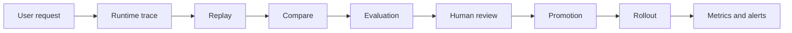
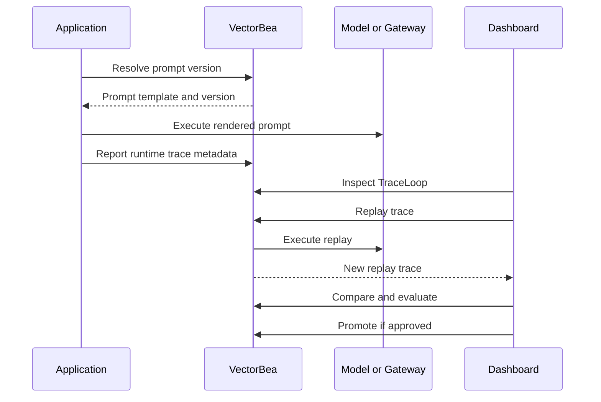
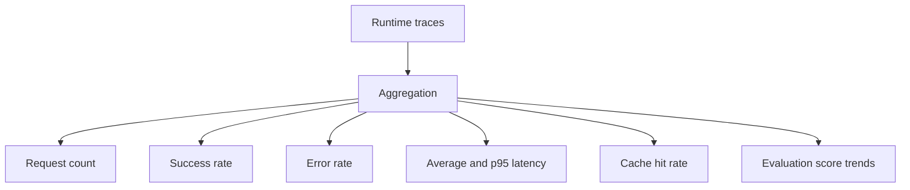
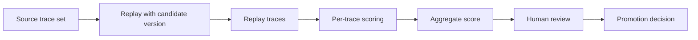
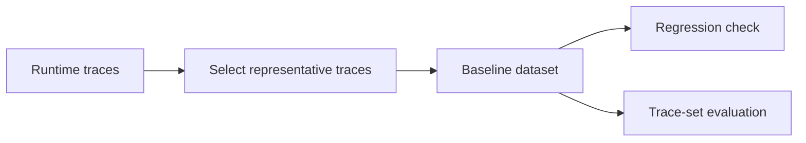
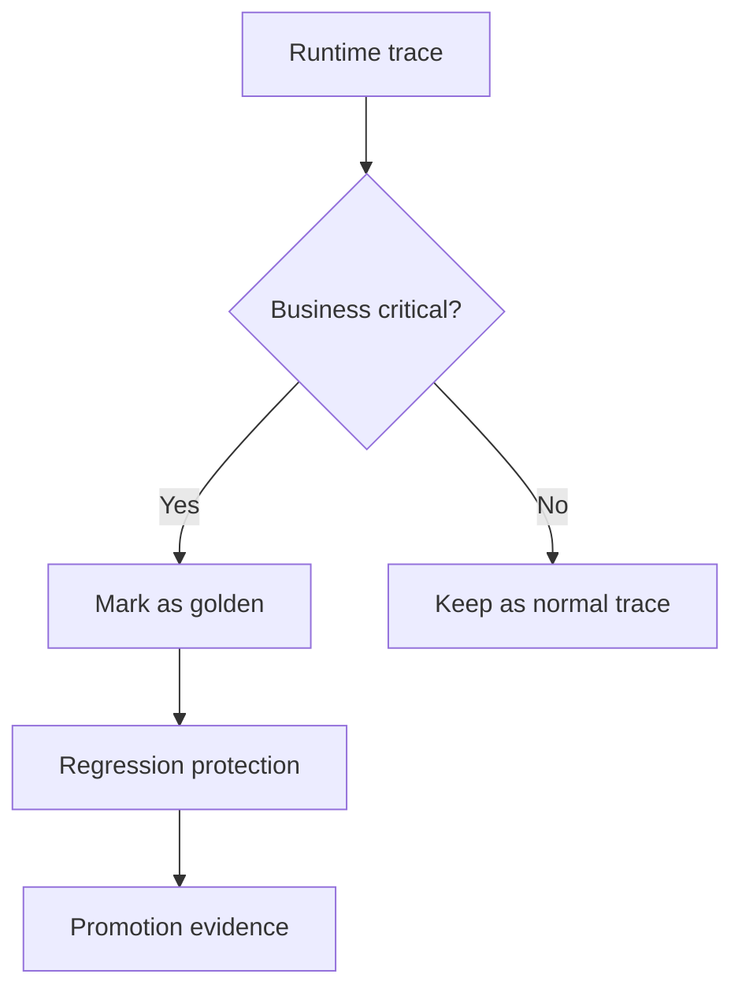
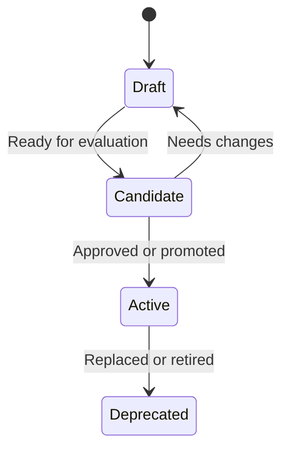
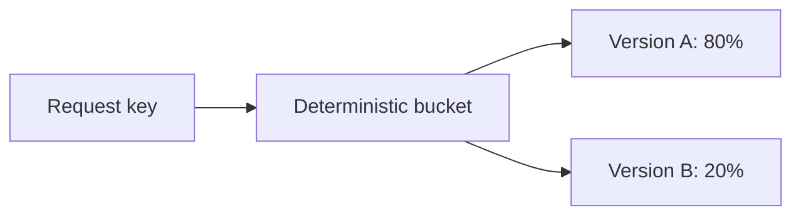
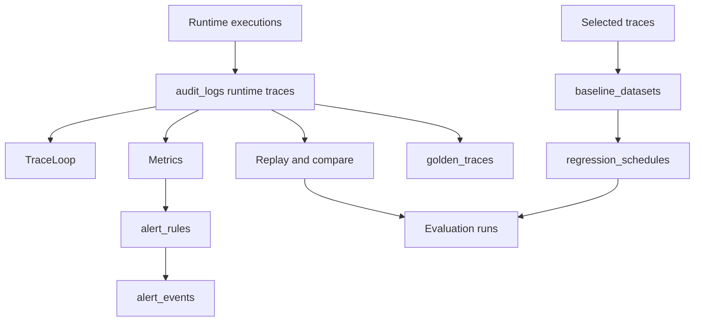

# VectorBea Product Guide

VectorBea is a control plane for AI behavior. It helps teams manage prompts, versions, runtime execution traces, replay, comparisons, evaluations, rollout decisions, and production monitoring.

VectorBea does not replace OpenAI, Anthropic, internal model gateways, or your application. It sits above those systems so teams can understand and govern how AI behavior changes over time.

## 1. Overview

### What it is

VectorBea gives developers and product teams a shared operating layer for AI workflows:

- Prompts are versioned and promoted intentionally.
- Runtime executions become traces.
- Traces can be replayed, compared, and evaluated.
- Evaluations can support promotion and rollout decisions.
- Metrics and alerts monitor production behavior.

### Why it exists

AI behavior changes quickly. A small prompt edit, model routing change, cache issue, or gateway failure can affect user-facing output. VectorBea makes those changes visible and reviewable before they become production incidents.

### Core workflow



### How to use it

1. Create a prompt and publish a version.
2. Connect your app through a VectorBea SDK or sidecar.
3. Run real traffic and inspect runtime traces.
4. Replay important traces when changing a prompt.
5. Compare old and new executions.
6. Run evaluations over a trace set.
7. Promote the candidate version when checks and review pass.
8. Monitor production through metrics, alerts, and regression checks.

### What to expect in the UI

You will see the workflow across these areas:

| Area | Purpose |
|---|---|
| Prompts | Create, edit, version, and promote prompt behavior |
| TraceLoop | Inspect one runtime execution end to end |
| Evaluations | Replay trace sets and score candidate prompt versions |
| Metrics | Monitor aggregate behavior from runtime traces |
| Alerts | Detect latency, error, or evaluation-score regressions |
| Regression checks | Re-run important trace sets on a schedule triggered externally |

### Common pitfalls and limitations

| Pitfall | What to know |
|---|---|
| Expecting VectorBea to call every model directly | VectorBea manages control, tracing, replay, and evaluation. Final execution may happen through your model provider or enterprise gateway. |
| Expecting token and cost data everywhere | Token and cost data are only available when the runtime or gateway reports them. Partial observability shows unavailable, not zero. |
| Expecting built-in scheduling | Regression schedules and alert evaluation require an external trigger such as CI, cron, or a hosted scheduler. |
| Treating all audit records as traces | Trace pages show runtime executions only. Admin audit events are tracked separately. |

## 2. Core Workflow End to End

### What it is

The core workflow turns production behavior into evidence for safe prompt iteration.



### Why it exists

This workflow gives teams a repeatable way to answer:

- What prompt version produced this output?
- Which executor or gateway handled the request?
- Where was latency spent?
- Did cache, fallback, or guardrails affect the response?
- Did a candidate version improve or regress behavior?

### How to use it

1. Start with a production trace.
2. Inspect TraceLoop to understand the execution.
3. Replay the trace against the same or candidate prompt version.
4. Compare original and replayed outputs.
5. Run an evaluation if the change needs evidence.
6. Request human review if the evaluation needs approval.
7. Promote and roll out the version when the decision is ready.

### What to expect in the UI

TraceLoop shows execution steps such as prompt resolution, cache lookup, LLM call, gateway dispatch, guardrail checks, parsing, and audit persistence when those details are available.

### Common pitfalls and limitations

- Older traces may have less metadata than newer traces.
- Enterprise gateway traces may have partial model, token, or cost visibility.
- Direct-provider replay may be simulated if the repository does not contain a live provider execution engine.

## 3. Metrics

### What it is

Metrics are aggregated insights derived from runtime traces. They are not synthetic counters and they do not include generic admin audits.



### Why it exists

Metrics help teams detect slow prompts, rollout regressions, failing gateways, cache behavior changes, and prompt versions that need review.

### How to use it

1. Open the metrics or dashboard area.
2. Select a time window such as 1 hour, 24 hours, or 7 days.
3. Filter by environment, prompt, or version when available.
4. Look for changes in latency, success rate, error rate, and cache hit rate.
5. Use TraceLoop links to inspect individual requests behind unusual metrics.

### What to expect in the UI

| Metric | Meaning |
|---|---|
| Request count | Number of runtime traces in the selected window |
| Success rate | Percentage of traces with successful status |
| Error rate | Percentage of traces with error status |
| Average latency | Mean end-to-end runtime duration |
| p95 latency | Approximate latency at the 95th percentile |
| Cache hit rate | Share of traces where cache status is `hit` |
| Evaluation score average | Average score for evaluation-backed traces where available |

### Common pitfalls and limitations

- Missing token or cost values mean unavailable, not zero.
- Metrics reflect only runtime traces that were actually captured.
- Small traffic windows can make rates look volatile.
- If a gateway reports partial observability, model-level breakdowns may be limited.

## 4. Evaluations

### What it is

Evaluations test prompt behavior using real runtime traces. They help decide whether a candidate prompt version is safe to promote.

There are two common evaluation types:

| Type | Use case |
|---|---|
| Single replay evaluation | Evaluate one replayed trace against its original trace |
| Trace-set evaluation | Replay multiple traces against a candidate version and score the set |



### Why it exists

Automated tests rarely cover the full shape of real AI traffic. Evaluations use production-like traces so prompt changes are judged against realistic inputs and outputs.

### How to use it

1. Choose source traces or a baseline dataset.
2. Select a candidate prompt version.
3. Run the evaluation.
4. Inspect per-trace results.
5. Review aggregate scoring and critical failures.
6. Add human review when required.
7. Promote or block the candidate version.

### What to expect in the UI

Evaluation detail pages show:

- Candidate prompt version
- Source trace count
- Replay trace count
- Overall score and recommendation
- Weighted checks
- Critical failures
- Observability limitations
- Reviewer status and rationale
- Links to source traces, replay traces, and comparisons

### Scoring model

VectorBea uses transparent weighted checks. The exact scoring policy is configured in code, not through a UI editor yet.

| Check category | Examples |
|---|---|
| Correctness | Output exists, structured output remains valid |
| Reliability | Execution succeeded, no status regression |
| Performance | Latency improvement or regression |
| Efficiency | Token usage when available |
| Observability | Whether missing gateway data limits confidence |
| Safety | Guardrail or validation results when available |

### Common pitfalls and limitations

- A high score does not replace human review for sensitive workflows.
- Unavailable checks are shown as unavailable, not passed or failed.
- Direct-provider replay may be simulated unless a live provider execution path is configured.
- Enterprise gateway replay is the fully live path when a gateway URL/config is provided.

## 5. Baseline Datasets

### What it is

A baseline dataset is a curated set of runtime traces used for repeatable testing.



### Why it exists

Baseline datasets turn real usage into a reusable test bed. Instead of judging a candidate prompt on one example, teams can test it against scenarios that represent normal production traffic.

### How to use it

1. Open Trace List or the Evaluations area.
2. Select runtime traces that represent important scenarios.
3. Create a baseline dataset.
4. Name it clearly, such as `Support billing baseline` or `Enterprise onboarding flows`.
5. Use the dataset when running evaluations or regression checks.

### What to expect in the UI

Baseline dataset views should show:

- Dataset name and description
- Prompt or workflow context
- Source trace count
- Created by and created time when available
- Actions to run evaluations or regression checks

### Common pitfalls and limitations

- A baseline dataset is only as good as the traces selected.
- Avoid mixing unrelated prompts or workflows unless the evaluation is intended to be broad.
- Empty datasets cannot produce meaningful evaluation results.

## 6. Golden Traces

### What it is

Golden traces are critical runtime traces that must not regress. They are often tied to high-value user journeys, compliance-sensitive flows, or known edge cases.



### Why it exists

Not every trace has equal business importance. Golden traces make sure the most important flows receive extra protection during replay, evaluation, and rollout decisions.

### How to use it

1. Inspect a trace that represents a critical case.
2. Mark it as golden.
3. Add a label or note describing why it matters.
4. Include golden traces in baseline datasets or regression checks.
5. Review golden-trace failures before promotion.

### What to expect in the UI

Golden traces may appear with:

- A golden or protected marker
- Notes explaining importance
- Prompt/version context
- Links back to the original runtime trace
- Regression check results

### Common pitfalls and limitations

- Golden traces should be curated, not bulk-marked.
- If a golden trace lacks input/output metadata, replay may be unavailable.
- Golden traces are still runtime traces; admin actions should not appear as golden traces.

## 7. Regression Checks

### What it is

Regression checks replay a baseline or golden trace set and evaluate whether behavior changed in an unacceptable way.

Regression checks can be:

| Type | Description |
|---|---|
| Manual run | Triggered by a user from the dashboard |
| Scheduled run | Triggered externally using a stored schedule configuration |

### Why it exists

Regression checks catch prompt, model, gateway, or rollout issues before they affect a wider audience.

### How to use it

1. Create a baseline dataset or mark golden traces.
2. Create a regression schedule or run a check manually.
3. Select the candidate version strategy.
4. Trigger the run.
5. Inspect failures, unavailable checks, and aggregate score.
6. Use results as evidence for promotion or rollback.

### What to expect in the UI

Regression check results should show:

- Schedule name
- Baseline dataset
- Candidate prompt version strategy
- Last run time
- Last result or recommendation
- Run status such as idle, running, failed, or disabled

### Common pitfalls and limitations

- There is no built-in cron runner. Scheduled checks must be triggered externally.
- Missing token/cost data should appear as unavailable.
- Gateway failures should be reviewed separately from prompt regressions.
- Failed regression checks should not create runtime traces unless an actual replay execution occurred.

## 8. Rollout and Promotion

### What it is

Rollout controls how prompt versions receive traffic. Promotion is the decision to move a candidate version toward production use.

### Rollout states



| State | Meaning | Typical action |
|---|---|---|
| Draft | Work in progress | Edit and test |
| Candidate | Ready for replay/evaluation | Run trace-set evaluation |
| Active | Serving production traffic | Monitor metrics and alerts |
| Deprecated | No longer preferred | Keep for history or rollback context |

### Why it exists

Rollout lets teams avoid all-or-nothing prompt changes. A candidate can be tested, reviewed, and gradually exposed before full rollout.

### How to use it

1. Create or edit a prompt version.
2. Move it to candidate when ready.
3. Run an evaluation against baseline or golden traces.
4. Complete human review if required.
5. Promote the version.
6. Configure rollout percentage.
7. Monitor metrics after traffic shifts.

### Traffic splitting

VectorBea uses deterministic bucketing when traffic splitting is configured. A stable key such as user id or request id determines which version handles a request.



### Common pitfalls and limitations

- Rollout percentages should not exceed 100 percent across active/candidate versions.
- A candidate with failed critical checks should not be promoted without review.
- Traffic splitting depends on a stable key for consistent behavior.

## 9. Blocked vs Full Rollout

### What it is

Blocked rollout means a candidate version should not receive full production traffic yet. Full rollout means the candidate has enough evidence and approval to become the primary active version.

### Why it exists

Prompt changes can be subtle. A candidate may look good in one example but fail on important traces, increase latency, or lose observability through a gateway. Rollout gates make those risks explicit.

### Decision table

| State | Meaning | Action |
|---|---|---|
| Blocked by critical failure | A required check failed, such as execution success or structured output validity | Fix the prompt or runtime issue, then rerun evaluation |
| Blocked by regression | Candidate is worse than baseline on important traces | Inspect comparisons and adjust the candidate |
| Needs review | Automated score is inconclusive or human approval is required | Assign reviewer and capture rationale |
| Ready with caution | Checks pass, but observability is partial or some non-critical checks are unavailable | Review missing data before widening traffic |
| Full rollout ready | Critical checks passed and required review is approved | Promote and increase rollout percentage |

### How to use it

1. Open the evaluation run detail page.
2. Review the verdict and blocking reasons.
3. Inspect failed traces or comparisons.
4. Add reviewer rationale.
5. Promote only when the decision surface shows it is safe.

### What to expect in the UI

You should see clear labels such as:

- Ready for rollout
- Ready with caution
- Needs review
- Blocked by regression
- Blocked by failed critical checks
- Inconclusive due to missing observability

### Common pitfalls and limitations

- Partial observability should not be ignored.
- A human reviewer may approve with caution, but the rationale should explain why.
- Promotion and review events are audit events, not runtime traces.

## 10. Scheduled Execution and Scripts

### What it is

VectorBea stores regression schedules and alert rules, but this repository does not include a built-in scheduler. External systems must call the run endpoints.

### Why it exists

Many teams already use CI, cron, Vercel Cron, GitHub Actions, or internal schedulers. VectorBea exposes callable endpoints so scheduled checks can fit into existing operations.

### How to use it

1. Create a regression schedule or alert rule in the dashboard.
2. Copy the endpoint for the run/evaluate action.
3. Call it from CI, cron, or an internal scheduler.
4. Review the resulting evaluation run, schedule status, or alert events.

### Common endpoints

| Purpose | Endpoint |
|---|---|
| Run a regression schedule | `POST /api/evaluations/regression-schedules/{id}/run` |
| Evaluate alert rules | `POST /api/alerts/evaluate` |

### Simple curl examples

Run a regression schedule:

```bash
curl -X POST "https://dev.vectorbea.com/api/evaluations/regression-schedules/{scheduleId}/run?workspaceId={workspaceId}"
```

Evaluate alerts:

```bash
curl -X POST "https://dev.vectorbea.com/api/alerts/evaluate?workspaceId={workspaceId}"
```

### CI usage

Use CI when you want regression checks tied to deployment or prompt release workflows:

1. Store the schedule id and workspace id as CI secrets or variables.
2. Call the schedule endpoint after deploying a candidate.
3. Fail or warn the pipeline based on the returned status if your team wants that policy.

### What to expect in the UI

The UI may show an informational note such as external trigger required. That is expected. It is not an error as long as the backing tables and endpoints are available.

### Common pitfalls and limitations

- No built-in cron runner exists in this repository.
- Authentication/session requirements depend on deployment configuration.
- External callers should handle retries and alerting for failed trigger attempts.

## 11. Internal Tracking Model

### What it is

This section explains how VectorBea tracks product data at a user-facing level. It is not a database administration guide, but it helps teams understand where features get their information.



### Why it exists

VectorBea avoids fake or disconnected tracking. Metrics, evaluations, regression checks, and rollout evidence should tie back to real runtime traces whenever possible.

### Tracking summary

| Product concept | Tracking source |
|---|---|
| Runtime traces | `audit_logs` rows marked as runtime executions |
| Admin/audit events | `audit_logs` rows marked as audit/admin events |
| Metrics | Aggregated from runtime traces |
| Evaluations | Evaluation runs and per-trace results |
| Baseline datasets | `baseline_datasets` |
| Golden traces | `golden_traces` |
| Regression checks | `regression_schedules` plus evaluation runs |
| Alerts | `alert_rules` and `alert_events` |
| Rollout decisions | Prompt version state, rollout percentage, and audit records |

### How to use this knowledge

1. If a metric looks wrong, inspect the underlying runtime traces.
2. If an evaluation is inconclusive, check whether source traces have enough metadata.
3. If token or cost data is missing, check executor observability.
4. If a scheduled check is not running, verify the external trigger.
5. If a rollout is blocked, inspect critical checks and reviewer rationale.

### What to expect in the UI

The UI should distinguish:

- Runtime traces from admin audit events
- Live replay from simulated replay
- Full observability from partial observability
- Available metrics from unavailable data
- Automated recommendation from human review

### Common pitfalls and limitations

- Do not treat missing values as zero.
- Do not expect admin audit events to appear in TraceLoop.
- Do not expect scheduled runs without an external trigger.
- Do not assume direct-provider replay is live unless a real provider execution path is configured.

## Quick Reference

| Task | Start here |
|---|---|
| Debug one AI request | Open TraceLoop for the runtime trace |
| Test a candidate prompt | Replay traces and run an evaluation |
| Protect critical flows | Mark traces as golden and include them in regression checks |
| Monitor production health | Use metrics and alerts |
| Release safely | Use evaluation, human review, promotion, and rollout percentage |
| Automate checks | Trigger regression and alert endpoints from CI or cron |

