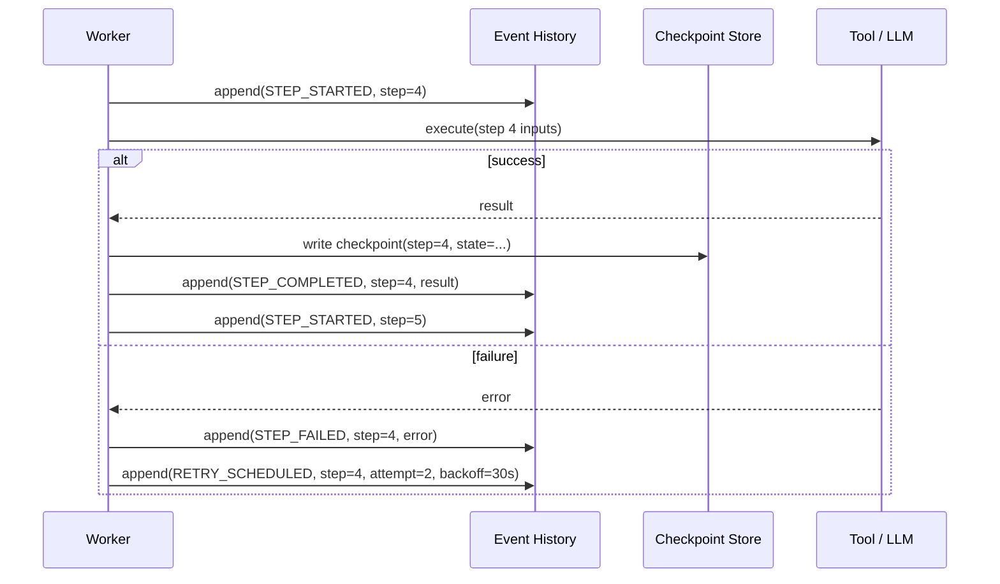

When we started building Vectorbea, the first version of the execution engine was, honestly,
a queue and a for-loop. A workflow was a list of steps, each step called an LLM or a tool, and
a worker walked the list and executed each one. It worked for demos. It fell over the moment
a real workflow ran for more than about ninety seconds.

The failure modes were not exotic. A worker process got redeployed mid-run. An LLM provider
returned a 529 and we retried the whole workflow instead of the one step that failed. A user
closed their laptop and came back four hours later expecting the run to have either finished or
failed cleanly, instead it was just gone, vanished into whatever in-memory state the worker had
been holding when it died.

## Async jobs aren't enough

The standard advice for "long-running work" in a web application is to push it onto a job queue.
That's good advice, and we do it. But a job queue gives you *at-least-once execution of a single
unit of work*. An agentic workflow is not a single unit of work, it's a sequence (often a graph)
of steps, each of which can fail independently, each of which might involve a slow external call,
and some of which might need to pause for minutes or days waiting on a human.

A retry decorator around the whole workflow function looks appealing because it's three lines of
code. The problem is what it retries: everything, including the parts that already succeeded and
had side effects. Re-running a workflow that already sent an email, called a paid API, or wrote
to a customer's system is not a retry, it's a bug with a friendly name.

<Callout type="note" title="The core problem">
A workflow needs to survive process restarts, deploys, and crashes *without* re-executing steps
that already completed and without losing track of where it was. That's a different requirement
than "retry the function if it throws."
</Callout>

## What durable execution actually means here

We use "durable execution" to mean three things working together:

1. **The state of a run is persisted, not held in memory.** At any point, you can ask "what step
   is run `r_8f2e` on, and what has it already produced?" and get an answer from the database, not
   from whichever worker process happens to still be alive.
2. **Steps are the unit of retry, not workflows.** If step 4 fails, we retry step 4, using the
   inputs and context it had, not by re-running steps 1 through 3.
3. **Progress is checkpointed.** After each step completes, we write a checkpoint that captures
   enough information to resume from exactly that point, on any worker, at any time.

In the first version, we under-invested in (3) specifically, assuming that "just re-run the step
that failed" would be enough. It wasn't, because resuming requires knowing not just *which* step
to run next but the *exact accumulated state* the workflow had at that point, variables, tool
outputs, conversation history, partial results. Checkpointing is what makes "resume" mean
something more than "start over from a slightly later point."

## Event history as the backbone

The other piece that took us longer to get right than we expected was the event history, an
append-only log of everything that happens during a run: step started, step completed, step
failed, retry scheduled, approval requested, approval granted, checkpoint written. 

<Callout type="decision" title="Design decision">
We made the event history the source of truth for "what happened," and derived the run's current
state from it, rather than maintaining a separate mutable "current state" table that the event
log merely describes after the fact. This cost us some upfront complexity but means the UI's run
timeline and the engine's resume logic are reading from the same ground truth.
</Callout>

Here's roughly how a single step's lifecycle looks across the worker, the event history, and the
checkpoint store:

If the worker dies right after `STEP_COMPLETED` is appended but before the next step starts,
a new worker can pick up the run, read the event history, see that step 4 finished and step 5
hasn't started, and continue from there, without re-executing step 4 and without losing the
result it produced.

## The tradeoff

None of this is free. Durable execution means every step boundary is a write to Postgres, which
adds latency compared to keeping everything in memory. The design goal was correctness and
resumability first, raw throughput second, which is the right tradeoff for workflows that might
run for hours and involve real-world side effects, and the wrong tradeoff for, say, a tight loop
processing millions of small in-memory records.

<Callout type="tradeoff" title="Tradeoff">
We accept extra writes and slightly higher per-step latency in exchange for being able to say,
truthfully, "if this run is interrupted, it will resume from where it left off, not from
scratch." For an agentic system that calls paid APIs and takes real-world actions, that property
is worth more than shaving milliseconds off step transitions.
</Callout>

## What's next in this series

This is intentionally simplified, a real implementation has to handle concurrent runs, partial
failures during checkpoint writes, and the question of *how much* state to checkpoint versus
recompute. The next few posts go deeper: how we modeled the event history as a first-class
primitive, how retries and idempotency interact, and how human approval gates fit into a model
that assumes a workflow can be paused indefinitely.

The short version, if you're evaluating whether to build this kind of system yourself: if your
workflows are short and stateless, you probably don't need any of this. If they run for minutes
to days, touch real systems, and need to survive your own infrastructure being unreliable ,
durable execution stops being an optimization and starts being the only way the product can be
trusted at all.
