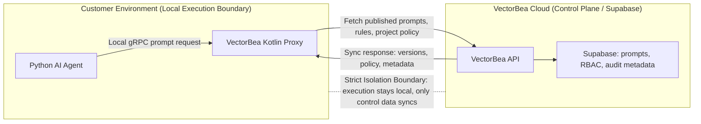

export const metadata = {
  title: "Architecture",
};

# Architecture

VectorBea is intentionally split into a **cloud control plane** and a **local data plane**. That split is what lets the platform deliver centralized governance without forcing model invocation, agent execution, or application data to leave the customer environment.

## Control Plane vs. Data Plane

The **control plane** is where VectorBea stores and manages shared operating state:

- Organizations and projects
- Prompt definitions and versions
- Publication status
- Role mappings and RBAC decisions
- Audit metadata
- Seat billing and plan controls

The **data plane** is the customer-local execution layer. In practice, this is the VectorBea Kotlin proxy deployed close to the workload. It is responsible for:

- Fetching the published prompt rules relevant to the local project
- Caching and serving prompt definitions locally
- Enforcing prompt policy before the request continues toward the model provider
- Preserving a hard operational boundary between local execution and cloud synchronization

## Request flow

At runtime, the agent does not need to fetch prompt text directly from the cloud for every request. Instead, it communicates with the local proxy over a low-latency local interface. The proxy already knows which prompt versions are published and allowed for that project because it continuously syncs from the VectorBea control plane.

That means:

- The agent gets local responsiveness.
- The platform keeps centralized governance.
- The organization avoids pushing sensitive execution logic into a remote shared runtime.

## Isolation boundary

The architectural boundary matters just as much as the network path:

- **Local execution** includes the AI agent, application data, runtime variables, and the proxy process handling prompt resolution.
- **Cloud sync** includes prompt metadata, versioning state, RBAC policy, audit configuration, and organization/project administration.

The local side executes. The cloud side governs.

## Mermaid flow

## Why the sidecar model works

The Kotlin proxy works well as a sidecar because it gives the team a stable, local enforcement point:

- Application teams integrate once against the proxy.
- Prompt operations teams can publish updates without redeploying every service.
- Security teams can reason about a clear network and responsibility boundary.
- Platform teams can run the same model across local Docker, VM, and Kubernetes environments.

## Failure domains and safety

A healthy production deployment treats the proxy as a controlled cache and policy enforcement point:

- If the control plane is temporarily unreachable, the proxy can continue serving the latest synchronized published rules.
- If a prompt is unpublished or superseded, the control plane remains the source of truth for what the proxy should accept.
- If access policy changes, project membership and RBAC updates flow through the same sync channel rather than relying on ad hoc application logic.

## Practical design principle

The architecture is built around a simple principle:

> Govern centrally. Execute locally.

That is the reason VectorBea can support both developer velocity and enterprise control without making the customer surrender data-plane ownership.
